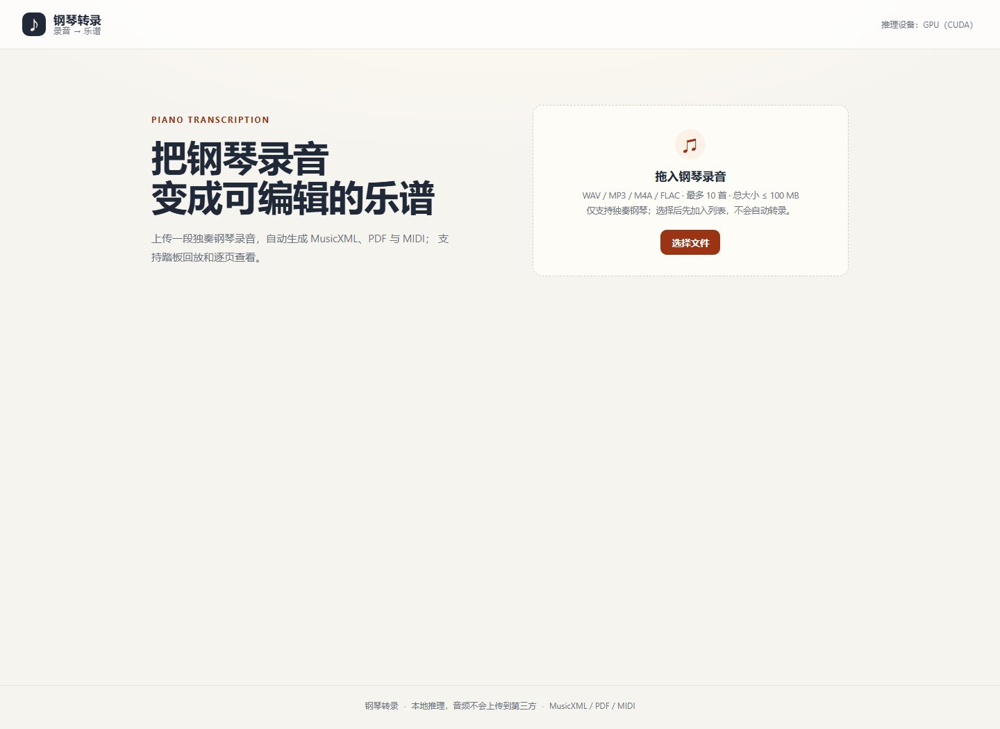
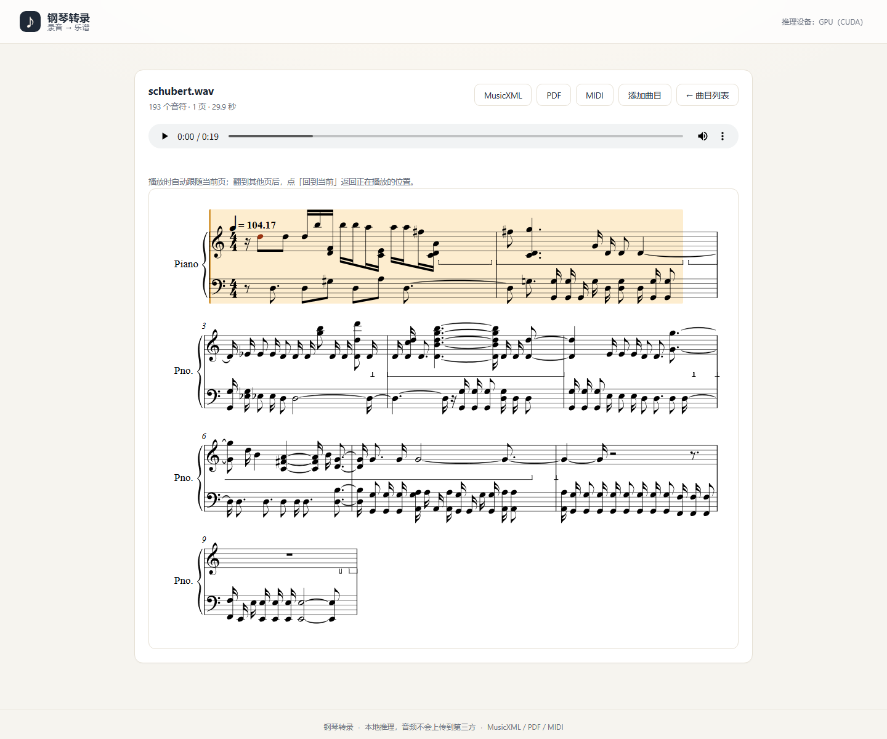

# Piano Transcription

**[English](README.md) | [简体中文](README.zh-CN.md)**

Turn solo piano recordings into editable sheet music — locally.



## What it does

- Upload WAV / MP3 / M4A / FLAC recordings (up to 10 tracks, 100 MB total).
- A hybrid model turns audio into note events, then into readable music notation.
- Review the result page by page, with the current measure highlighted during playback.
- Listen back with a realistic piano sound and pedal (CC64) support.
- Download **MusicXML**, **PDF**, and **MIDI**.



## How it works

```text
audio
  → log-CQT (32 ms frames, 264 bins)
  → CNN + Transformer
  → 8 heads: onset / frame / velocity / offset / pedal / pedal_on /
             onset_reg / offset_reg
  → decode to NoteEvent(pitch, start, end, velocity)
  → MusicXML / PDF / MIDI / piano playback
```

The model keeps a **classification backbone** for note presence and duration,
and uses a **sub-frame onset regression** head to refine note starts inside a frame.
Raw note events are used for event-level metrics and playback; the score is quantized
to a readable rhythmic grid (16th notes).

## Results

Results on the MAESTRO v3.0.0 test split (177 tracks, raw note events):

| Metric | Hybrid model |
|---|---:|
| note-with-offset F1 (key-off ground truth) | 0.331 |
| onset F1 @ 50 ms | 0.870 |
| onset F1 @ 20 ms | 0.812 |
| **onset F1 @ 10 ms** | **0.626** |

The 10 ms onset F1 is **0.626**, compared with **0.507** for the classification-only
baseline. A holdout track reaches **0.660** at 10 ms and **0.405** note F1.

For reference, a ByteDance piano-transcription model measured on three validation
excerpts reached **0.901** onset F1 @10 ms and **0.444** note F1. Its note-off targets
are closer to acoustic sustain/pedal release, so the note-F1 comparison is not
apples-to-apples with key-off ground truth.

## Quick start

### Local Python

```bash
python -m pip install -e .

# Put a trained checkpoint at models/best.pt, or set PIANO2_CKPT:
#   export PIANO2_CKPT=/path/to/checkpoint.pt

python -m uvicorn app.main:app --host 127.0.0.1 --port 8000
```

Open <http://127.0.0.1:8000>.

Realistic piano playback needs `fluidsynth` and a SoundFont such as `FluidR3_GM.sf2`;
without them the app falls back to a lightweight synthesizer.

### Docker

```bash
docker build -t piano-transcription .
docker run --rm -p 8000:8000 \
  -v "$PWD/models:/workspace/models" \
  piano-transcription \
  bash -c "cd /workspace && python -m uvicorn app.main:app --host 0.0.0.0 --port 8000"
```

Add `--gpus all` if CUDA is available.

> Model weights are not included in this repository. Place a checkpoint at
> `models/best.pt` or set `PIANO2_CKPT`.

## Project layout

| Path | Contents |
|---|---|
| `app/` | FastAPI backend, job queue, score rendering, static UI |
| `src/piano2/` | features, model, training, decoding, notation, evaluation |
| `tutorial/` | step-by-step guides from audio to score |
| `docs/` | architecture, data, decoding, notation, app design |
| `training/` | experiment reports and results |
| `scripts/` | command-line entry points and evaluation scripts |
| `tests/` | pytest suite |

## Documentation

- [Tutorial index](tutorial/README.md)
- [Project overview](docs/01_overview.md)
- [Data and labels](docs/02_data.md)
- [Model and training](docs/03_model_training.md)
- [Decoding](docs/04_decoding.md)
- [App design](docs/08_m4_app.md)
- [Experiment reports](training/README.md)

## Limitations

- Designed for **solo piano**; mixes and ensemble recordings are out of scope.
- The score is a readable rhythmic representation, not a millisecond-accurate
  performance transcription. Sub-frame timing is preserved in raw events and playback,
  but is quantized in MusicXML/PDF.
- Dense, pedaled textures and fast repeated notes remain difficult.
- Trained on MAESTRO; generalization to unseen pianos/rooms is still being evaluated.

## Data and license notes

Training data comes from MAESTRO v3.0.0, which is distributed under
CC BY-NC-SA 4.0. This project is intended for research and non-commercial use.
Third-party model names and results are referenced for comparison only.
