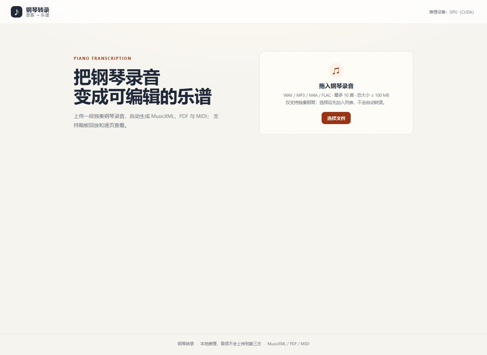
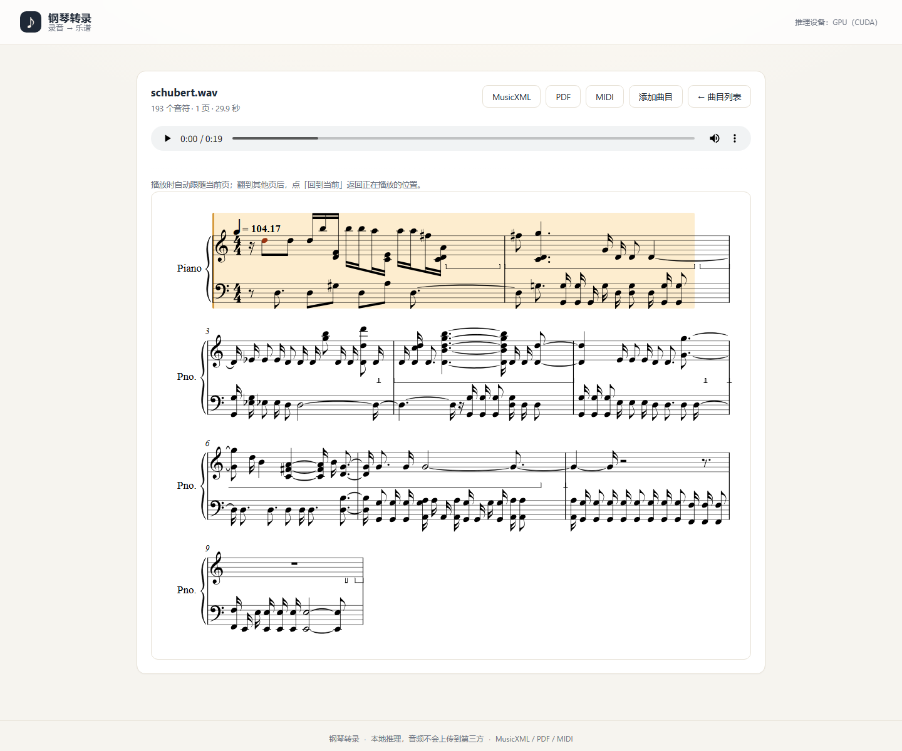

# 钢琴转录

**[English](README.md) | [简体中文](README.zh-CN.md)**

把独奏钢琴录音变成可编辑的乐谱，全程本地运行。



## 功能

- 上传 WAV / MP3 / M4A / FLAC，最多 10 首、总大小 ≤ 100 MB；
- 混合模型把音频解码成音符事件，再生成可读乐谱；
- 结果页逐页查看，播放时自动跟随并高亮当前小节；
- 真实钢琴音色回放，支持踏板（CC64）；
- 下载 **MusicXML**、**PDF**、**MIDI**。



## 工作流程

```text
音频
  → log-CQT（32 ms 一帧，264 bins）
  → CNN + Transformer
  → 8 个头：onset / frame / velocity / offset / pedal / pedal_on /
            onset_reg / offset_reg
  → 解码成 NoteEvent(pitch, start, end, velocity)
  → MusicXML / PDF / MIDI / 钢琴回放
```

模型用**分类头**判断音符是否存在、何时结束，用 **onset 回归头**在帧内修正起音位置。
原始音符事件用于事件级指标和回放；乐谱会量化到可读的节奏网格（16 分音符）。

## 结果

MAESTRO v3.0.0 test split（177 首，原始音符事件）：

| 指标 | 混合模型 |
|---|---:|
| note-with-offset F1（key-off 口径） | 0.331 |
| onset F1 @ 50 ms | 0.870 |
| onset F1 @ 20 ms | 0.812 |
| **onset F1 @ 10 ms** | **0.626** |

10 ms onset F1 为 **0.626**，分类基线为 **0.507**；holdout 单曲达到 10 ms **0.660**、
note F1 **0.405**。

作为参考，ByteDance 的钢琴转录模型在三段 validation 上达到 onset F1 @10 ms **0.901**、
note F1 **0.444**。它的 note-off 更接近声学延音/踏板释放，因此 note F1 与我们的
key-off 口径不能直接对比。

## 快速开始

### 本地 Python

```bash
python -m pip install -e .

# 把训练好的权重放到 models/best.pt，或设置 PIANO2_CKPT：
#   export PIANO2_CKPT=/path/to/checkpoint.pt

python -m uvicorn app.main:app --host 127.0.0.1 --port 8000
```

浏览器打开 <http://127.0.0.1:8000>。

真实钢琴回放需要 `fluidsynth` 和 SoundFont（如 `FluidR3_GM.sf2`）；
缺少时自动回退到轻量合成器。

### Docker

```bash
docker build -t piano-transcription .
docker run --rm -p 8000:8000 \
  -v "$PWD/models:/workspace/models" \
  piano-transcription \
  bash -c "cd /workspace && python -m uvicorn app.main:app --host 0.0.0.0 --port 8000"
```

有 CUDA 时加 `--gpus all`。

> 模型权重不随仓库分发。请把 checkpoint 放到 `models/best.pt`，或设置
> `PIANO2_CKPT`。

## 项目结构

| 路径 | 内容 |
|---|---|
| `app/` | FastAPI 后端、任务队列、谱面渲染、静态前端 |
| `src/piano2/` | 特征、模型、训练、解码、记谱、评测 |
| `tutorial/` | 从声音到乐谱的逐步教程 |
| `docs/` | 架构、数据、解码、记谱、应用设计 |
| `training/` | 实验报告与结果 |
| `scripts/` | 命令行入口与评测脚本 |
| `tests/` | pytest 测试 |

## 文档

- [教程目录](tutorial/README.md)
- [项目总览](docs/01_overview.md)
- [数据与标签](docs/02_data.md)
- [模型与训练](docs/03_model_training.md)
- [解码](docs/04_decoding.md)
- [应用设计](docs/08_m4_app.md)
- [实验报告](training/README.md)

## 局限

- 只面向**独奏钢琴**；混音、合奏不在范围内。
- 乐谱是可读的节奏表示，不是毫秒级演奏记录。亚帧时间保留在原始事件和回放中，
  但 MusicXML/PDF 会被量化。
- 密集踏板织体、快速重复音仍然困难。
- 目前主要在 MAESTRO 上训练，跨钢琴/跨房间泛化仍在评测中。

## 数据与许可说明

训练数据来自 MAESTRO v3.0.0，采用 CC BY-NC-SA 4.0 许可。
本项目仅用于研究与非商业用途；第三方模型名称和结果仅用于对比。
