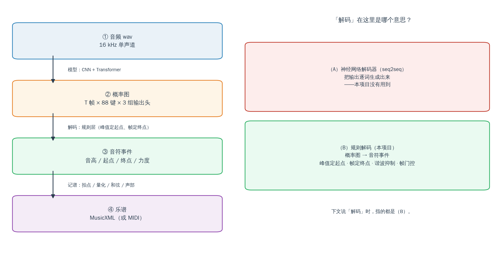

# 01 总览

## 1. 这个项目做什么

输入一段钢琴独奏音频，输出**可读的乐谱**（MusicXML，可渲染成 PNG/PDF）。流程分四段：



1. **音频 → CQT**：16 kHz 单声道，hop 512（每帧 32 ms），264 个频率 bin（88 键 × 3 bin/半音）；
2. **CQT → 概率图**：CNN + Transformer，五个输出头（onset / frame / velocity / pedal / pedal_on）；
3. **概率图 → 音符事件**：规则解码（峰值定起点、帧定终点、条件式谐波抑制、帧一致性门控）；
4. **音符事件 → MusicXML**：拍点估计、量化、和弦化、时值拆分、手动建小节，最后 verovio 渲染预览。

「解码」在这里指第 3 段（规则层），**不是**神经网络里的 seq2seq decoder。

## 2. 当前状态

| 阶段 | 内容 | 状态 |
|---|---|---|
| M0 | 诊断「黑音符太多」、建立评测与 oracle、证明解码器是主因 | 完成（见 `history/04_m0_results.md`） |
| M0.5 | 解码器重构与调参：onset F1 0.196 → 0.952（稀疏曲目） | 完成（见 `history/06_m05_discussion.md`） |
| M0.6 | 训练前门禁 G1–G8：数据/泄漏/特征/评测/资源/可复现性 | 完成（见 `history/08_training_readiness.md`） |
| M1 | 数据 v2（标签修正、踏板头、memmap、段索引）+ 训练脚本 + 本地 pilot | 完成（见 `history/09_m1_data_v2_and_pilot.md`） |
| M2 | **建新仓**（本仓库）：最终版骨架、代码迁移、测试、文档 | 进行中 |
| M3 | 4090 全量训练 + 3 种子 A/B + 评测报告 | 待做 |
| M4 | 浏览器应用（上传音频 → 看谱 → 下载） | 待做 |

## 3. 仓库结构

```text
piano2/
├─ src/piano2/          产品代码（最终版）
│  ├─ core.py           基础类型与常量（NoteEvent、泛音表）
│  ├─ constants.py      路径与运行配置（环境变量可覆盖）
│  ├─ inference.py      CQT 计算、模型推理（滑窗）
│  ├─ dataset.py        数据 v2 段数据集（memmap）
│  ├─ model.py          五头模型
│  ├─ train.py          训练循环
│  ├─ decode.py         概率图 → 音符事件（最终解码器）
│  ├─ notation.py       音符事件 → MusicXML
│  ├─ render.py         MusicXML → PNG
│  ├─ plot_style.py     中文图表风格
│  └─ eval/             评测指标与谱面统计
├─ scripts/             可执行入口：build_data / transcribe / evaluate / check_labels
├─ tests/               pytest（模型/解码/记谱/指标/标签）
├─ docs/                总览、数据、模型、解码、记谱评测、阶段程序、路线图
│  ├─ figs/             全部配图（13 张）
│  └─ history/          M0–M1 的历史文档（原样保留，路径已修正）
├─ experiments/         阶段程序与产物（M0/M0.5/M0.6/M1）
│  ├─ stage_code/       各阶段的处理程序（保留可追溯性，不是产品代码）
│  ├─ reports/          各阶段报告
│  ├─ artifacts/        关键图表、日志、summary
│  └─ registry/         实验登记表（EXP-000 基线）
├─ pyproject.toml, requirements.txt, Dockerfile, .gitignore
```

## 4. 快速开始

```bash
# 安装（容器里）
pip install -e .

# 自检：跑单元测试
python -m pytest -q

# 从音频直接出谱
python scripts/transcribe.py --wav /path/to/audio.wav --out-dir outputs/transcribe

# 在固定评测集上评测
python scripts/evaluate.py --model outputs/M1/pilot_onset2/checkpoints/best.pt
```

数据与模型权重不进仓库，路径用环境变量覆盖（见 `src/piano2/constants.py` 文件头）：

| 环境变量 | 默认值 | 含义 |
|---|---|---|
| `PIANO2_DATA_ROOT` | `/Docker/piano2_data/processed/maestro_processed_v2` | 数据 v2 根目录 |
| `PIANO2_MAESTRO_ROOT` | `/Docker/piano2_data/raw/maestro-v3.0.0` | MAESTRO 原始数据 |
| `PIANO2_OUTPUT_ROOT` | `/Docker/git/piano2/outputs` | 输出目录 |
| `PIANO2_CKPT` | 旧模型检查点 | 默认模型权重 |

## 5. 文档索引

| 文档 | 内容 |
|---|---|
| `00_glossary.md` | 术语表（55 个词，6 类） |
| `01_overview.md` | 本文 |
| `02_data.md` | 数据：MAESTRO、数据 v2 设计、标签口径、重建方式 |
| `03_model_training.md` | 模型 v2 结构、训练策略、pilot 结果与预算 |
| `04_decoding.md` | 最终解码器：原理、参数、效果、图 |
| `05_notation_eval.md` | 记谱流程、渲染、评测口径与 oracle |
| `06_stage_programs.md` | M0/M0.5/M0.6/M1 阶段程序说明（保留原因与用法） |
| `07_roadmap.md` | M3 训练计划、M4 应用计划、风险清单 |
| `08_m4_app.md` | M4 浏览器应用（Docker 本地交付）的设计、API、镜像分发与验收标准 |
| `history/` | M0–M3 的历史报告与调试日志（原样保留） |

教学向的内容放在仓库根的 `tutorial/`：从声音到乐谱的每一步、图解、常见问题、应用使用教程。

## 6. 一个必须知道的约定

解码器和记谱层已经被 M0/M0.5 验证过：**它们不是主要瓶颈**。所以后续改动的默认顺序是：

1. 先确认评测链路（oracle）没坏；
2. 再看解码器是否吃掉了模型的潜力；
3. 最后才改模型/训练。

这条顺序来自 M0 的教训：先怀疑模型欠训练，做了三解码器对照才发现是解码/记谱的问题。
