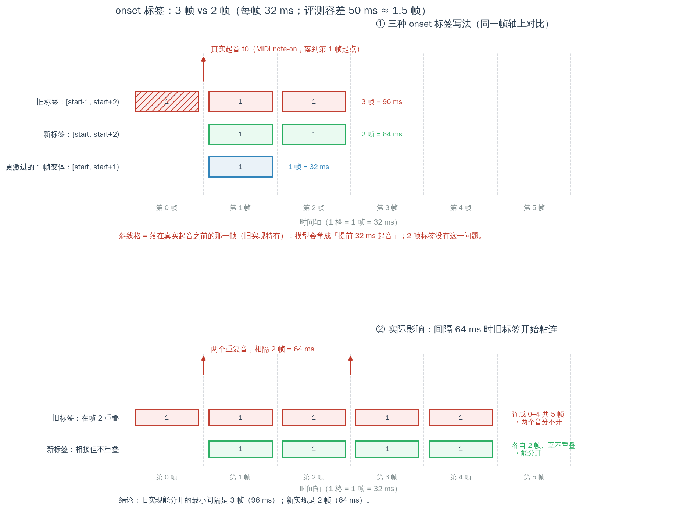
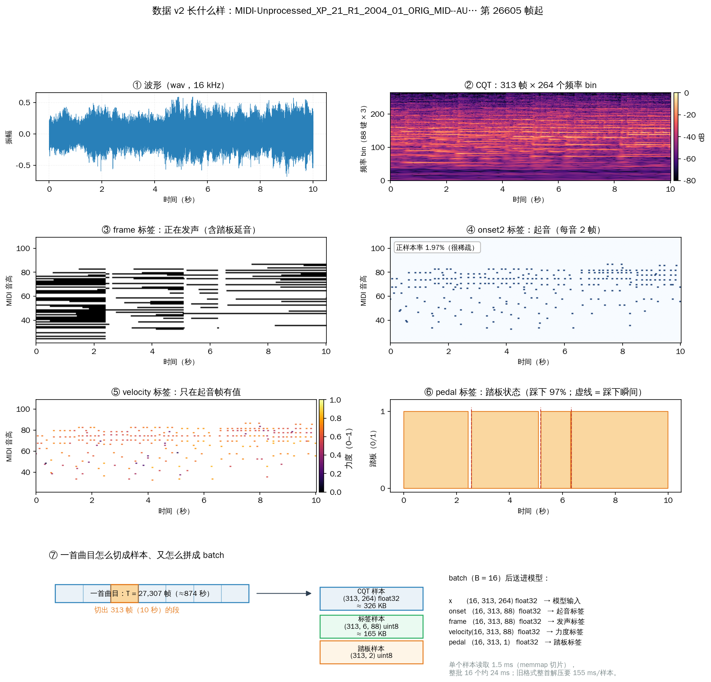

# 02 数据

## 1. 数据来源

**MAESTRO v3.0.0**（MIDI and Audio Edited for Synchronized and Transcribed Orchestral / piano performances）：

| 项目 | 数值 |
|---|---|
| 曲目数 | 1276 首（train 962 / validation 137 / test 177） |
| 总时长 | 约 199 小时（train 159.24 小时） |
| 格式 | 每首一个 wav（16 kHz 以上）+ 一个对齐的 MIDI |
| 许可证 | CC BY-NC-SA 4.0，**仅限非商业用途** |

这是钢琴转录领域最常用的公开数据集，音频与 MIDI 对齐质量高，适合做标签监督训练。

## 2. 数据 v2 的设计

数据 v2 在 M1 重建，目录 `/Docker/piano2_data/processed/maestro_processed_v2`（约 33 GB），每首曲目三个文件：

| 文件 | 形状 | dtype | 内容 |
|---|---|---|---|
| `*.cqt.npy` | (T, 264) | float32 | log-CQT，dB 值 [-80, 0] |
| `*.lab.npy` | (T, 6, 88) | uint8 | 6 个标签通道（见下表） |
| `*.pedal.npy` | (T, 2) | uint8 | 踏板状态 + 踩下瞬间 |

标签通道：

| 序号 | 通道 | 含义 |
|---|---|---|
| 0 | frame | 该音正在发声（**含踏板延音**） |
| 1 | onset1 | 起音（1 帧变体，对照用） |
| 2 | **onset2** | 起音（2 帧变体，**默认**） |
| 3 | onset3 | 起音（3 帧变体，旧实现，对照用） |
| 4 | velocity | 力度（0–127） |
| 5 | pedal | 踏板状态（0/1，广播到 88 键） |

### 2.1 为什么 onset 是 2 帧

每帧 32 ms。旧实现把起音标在 `start-1, start, start+1` 三帧上，其中一帧在真实起音**之前**，
模型会学成提前 32 ms；且 3 帧平台太宽，同键快速重复时会粘连。



新实现标 `[start, start+2)` 两帧：最坏时间误差 +32 ms，仍在评测容差 50 ms 内。
数据里同时保留 1 帧和 3 帧变体，A/B 实验用（见 `03_model_training.md` 第 4 节）。

### 2.2 分段与索引

- 每段 10 秒 = 313 帧；训练用段索引（`segments.json`）随机采样，**不重复解压整首歌**；
- CQT 用 `.npy` 存储，训练时 `np.load(..., mmap_mode="r")` 随机切片；
- 段统计：train 56,922 / validation 6,935 / test 7,128；
- 验证集用**固定段**（不随机），保证 val F1 跨步可比。

### 2.3 输入归一化

训练/推理都把 dB 值映射到 [0, 1]：

```text
x_norm = (clip(x_db, -80, 0) + 80) / 80
```

这条约定写在 `constants.py` 与 `inference.normalize_input` 里，两边必须一致（M0.6 的 G3 检查过）。

### 2.4 数据长什么样（图解）

同一段 10 秒音频的特征与全部标签（真实数据，取自训练集第 26,605 帧起的 313 帧）：



- ① **波形**：wav 的原始采样，16 kHz、float32、单声道；模型不直接吃它；
- ② **CQT**：每列一帧（32 ms），每行一个频率 bin（264 = 88 键 × 3 bin/半音），单位 dB；
- ③ **frame 标签**：哪些键在发声（含踏板延音），形状 (T, 88)，0/1；
- ④ **onset2 标签**：每个起音标 2 帧；注意它非常稀疏（该段正样本率 1.97%，全数据约 0.7%）；
- ⑤ **velocity 标签**：只在起音帧有值（0–1），颜色表示力度，其余是空白；
- ⑥ **pedal 标签**：踏板状态 0/1 随时间的方波（该段踩下 97%），红色虚线是「踩下瞬间」（pedal_on）；
- ⑦ **切片**：一首歌 T 帧（例子中 27,307 帧 ≈ 874 秒）按 313 帧（10 秒）切段；一个样本就是
  CQT (313, 264) + 标签 (313, 6, 88) + 踏板 (313, 2)，batch 后变成 (16, 313, …)。

「数据类型」有两层含义，这里都说一下：

| 层次 | 类型 | 说明 |
|---|---|---|
| 音乐格式 | wav / MIDI / MusicXML | wav 是输入；MIDI 是标签来源（note on/off、velocity、CC64 踏板）；MusicXML 是最终输出 |
| 训练数组 | float32 / uint8 | CQT 需要浮点精度用 float32；标签只有 0/1 和 0–127 的力度，用 uint8 省内存（1 字节/元素） |

### 2.5 标签口径：frame 与 offset（M3.5 的数据改动）

数据 v2 的 `frame` 通道是**发声状态**：按键按住 + 踏板延音（构建时用 pretty_midi 的默认踏板处理，
`pedal_threshold=64`）。它描述的是「这个键现在响不响」，**不是**「键什么时候松开」。

而音符的**时值**应该由 MIDI 的 note-off（键释放，即 offset 事件）决定。
两者在踩踏板时会差很远（实测：预测时长 / 按键时长中位数约 3 倍）。

数据 v3a / v3b（M3.5，已构建）：

| 通道 | 定义 | 来源 | 用途 |
|---|---|---|---|
| `frame_key` | 按键按住期间为 1（**不含踏板**） | MIDI note-on / note-off 直接生成 | 音符时值 / 结束时间 |
| `offset` | note-off 帧起 2 帧置 1（v3b 新增） | MIDI note-off | offset 头监督（用 offset 峰定结束） |
| `pedal` / `pedal_on` | 不变 | CC64 | 踏板预测、延音线/踏板记号 |

只重建标签、复用已有 CQT（硬链接，约 45 秒），不需要重算特征。

offset 窗口宽度的实测（20 轮，留出集 note F1）：1 帧（v3c）0.251、2 帧（v3b）0.372、3 帧居中（v3d）0.285 → **选 2 帧**；之后 offset 损失权重 2.0 使三 seed 均值达到 0.403。原因与可视化见 	utorial/03_labels_from_midi.md 的「offset 标签宽度」一节。
v3a 的正样本率：frame_key 约 2.3%（v2 含踏板的 frame 约 6%）、offset 约 0.69%。

## 3. 重建数据

```bash
# 全量重建（8 进程，约 2 分钟）
python scripts/build_data.py --workers 8

# 标签自检：onset2 是否 2 帧、onset3 是否比 onset2 多一帧
python scripts/check_labels.py
```

产物：

- `PIANO2_DATA_ROOT`（默认 `/Docker/piano2_data/processed/maestro_processed_v2`）：数据本身；
- `outputs/M1/data_manifest.json`：配置、拆分统计、标签正样本率、脚本指纹。

manifest 的作用是**追溯**：改了标签口径后，靠它区分「这份分数是用哪版数据训出来的」。

## 4. 数据纪律

1. **训练/验证/测试按曲目划分**，同一作品跨 split 的只有 5 个（0.6%，MAESTRO 固有现象），看 test 分数时留意；
2. **留出集只评一次**：调参用开发集（Haydn / Mozart / Beethoven），留出集（`2015/...06_R1`）只在最终汇报时用；
3. **数据与仓库分离**：33 GB 数据不进 git，靠环境变量定位；
4. 数据版本变了就重建 manifest，并在实验登记表（`experiments/registry/`）里记一笔。
