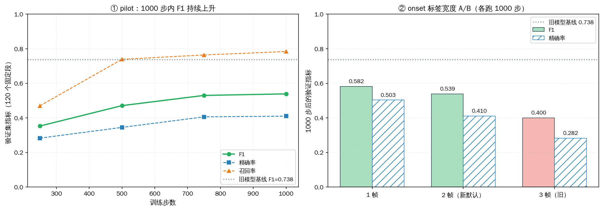
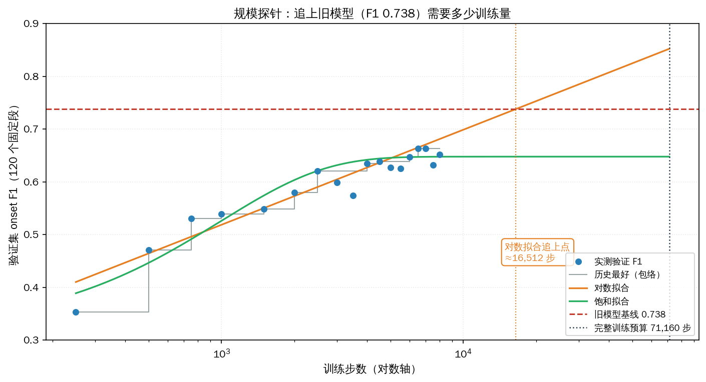

# 03 模型与训练

## 1. 模型结构（`src/piano2/model.py`）

```text
输入 x (B, T, 264)  ← 归一化后的 log-CQT
   │
   ├─ CNN：Conv2d(1→32, 3×3) + BN + ReLU
   │        Conv2d(32→64, 3×3) + BN + ReLU
   │        MaxPool2d(1, 3)  ← 264 → 88，频率轴与琴键对齐
   │        Dropout(0.25)
   │
   ├─ 展开：64 × 88 = 5632 维/帧 → Linear(5632, 512)
   ├─ 位置编码（正弦）+ 4 层 TransformerEncoder（pre-LN，8 头）
   │
   └─ 五个输出头：
        onset     (B, T, 88)   起音概率
        frame     (B, T, 88)   发声概率
        velocity  (B, T, 88)   力度
        pedal     (B, T, 1)    踏板状态
        pedal_on  (B, T, 1)    踩下瞬间
```

参数量约 1145 万。相对旧模型（`model_industrial.py`）三处关键修正：

1. **频率池化 `MaxPool(1, 2)` → `MaxPool(1, 3)`**：264 = 88 键 × 3 bin，用 3 正好对齐到琴键；
   旧的 (1,2) 会让 33% 的池化窗口跨半音；
2. **输入归一化**：旧模型直接吃 dB 值（量级 −80~0），现在统一映射到 [0, 1]；
3. **增加踏板头**：frame 标签含踏板延音，模型需要显式知道踏板状态。

## 2. 训练策略（`src/piano2/train.py`）

| 项目 | 设置 | 理由 |
|---|---|---|
| 优化器 | AdamW（lr 3e-4，weight decay 1e-4） | Transformer 的常规选择 |
| 调度 | 线性 warmup 300 步 + cosine 衰减到 3% | 避免早期大梯度破坏注意力 |
| 梯度裁剪 | 1.0 | 稳定训练 |
| 精度 | AMP（fp16） | 4060 上提速约 1.5 倍 |
| batch / 序列 | 16 × 313 帧（10 秒） | 显存 1.63 GB，余量充足 |
| loss | onset BCE（pos_weight 20）+ frame BCE（5）+ velocity MSE（只在起音帧）+ pedal BCE + pedal_on BCE（10） | 正样本稀疏，需要加权 |
| 模型选择 | **验证集 onset F1**（每 250 步） | 旧脚本按 val loss 选，与最终目标不一致 |
| 检查点 | model + optimizer + step + config + best_f1 | 可续训 |
| 可复现 | 固定种子 + DataLoader worker 种子 | G8 的遗留风险 |

启动（容器内）：

```bash
python -m piano2.train --max-steps 1000 --batch 16 --val-every 250 --val-segments 120
# 或直接：python scripts/train.py（入口见下方“入口缺失说明”）
```

> 说明：`train.py` 目前作为库模块使用（`python -m piano2.train`）。M3 会补一个 `scripts/train.py`
> 薄入口，把参数解析和运行目录约定固定下来。

## 3. 本地 pilot 结果（M1）

4060 上跑 1000 步（85 秒，每步 0.083 秒），验证集 120 个固定段：

| 步数 | 精确率 | 召回率 | F1 |
|---|---|---|---|
| 250 | 0.283 | 0.470 | 0.353 |
| 500 | 0.345 | 0.739 | 0.471 |
| 750 | 0.406 | 0.764 | 0.530 |
| 1000 | 0.410 | 0.784 | **0.539** |



对照：旧模型（3 头、6200 步）在同样的 120 个验证段上 F1=0.738。pilot 只用了计划训练量的 1.4%，
还没超过旧模型是预期内的；关键是**曲线在涨、每步耗时符合预算**。

### 3.1 规模探针：追上旧模型要多少训练量（M2 补测）

从 pilot 检查点续训到 8,000 步（约 10 分钟），验证 F1：

| 步数 | F1 |
|---|---|
| 1,000 | 0.539 |
| 2,000 | 0.580 |
| 4,000 | 0.635 |
| 6,000 | 0.647 |
| 6,500 / 7,000 | **0.663**（最好） |
| 8,000 | 0.652 |



两种外推：

| 模型 | 追赶点（F1=0.738） | 完整预算 71,160 步的预测 |
|---|---|---|
| 对数拟合 F1 = c + d·ln(s) | 约 **16,500 步**（4060 上约 23 分钟） | 0.852 |
| 饱和指数 F1 = a − b·e^(−s/τ) | 无法达到（渐近线 0.648，低于实测最大值） | 0.648 |

**结论**：

1. 饱和模型被数据否掉：实测已经到 0.663，比「饱和模型」的渐近线还高，说明曲线还没饱和；
2. 用对数模型估计，追上旧模型约 **1.5–2.5 万步**（考虑噪声，按 16.5k 步上下浮动），
   在 4060 上约 **0.35–0.6 小时**；用最终解码器复核后，实际更快（见 3.2）；
3. 完整预算 71,160 步下对数模型预测 0.852，但这是同一批验证段的乐观外推，
   正式训练仍按预注册判据（留出集 onset F1 ≥ 0.85、精确率 ≥ 0.85）验收；
4. 探针的调度是「到 8,000 步衰减完」，正式训练是「到 71,160 步衰减完」，
   学习率行为不同，探针数字只用于估量级，不用于报最终成绩。

### 3.2 用最终解码器看 8,000 步的实际效果

同一个 8,000 步检查点，用最终解码器（`DECODE_DEFAULTS`）在三首固定评测曲目上：

| 曲目 | onset F1（8k 步） | onset F1（旧模型） | note-with-offset F1（8k 步） |
|---|---|---|---|
| Haydn（稀疏） | 0.927 | 0.952 | 0.087 |
| Mozart（中等） | 0.946 | 0.943 | 0.168 |
| Beethoven（密集） | 0.736 | 0.798 | 0.140 |

**稀疏和中等曲目已基本追平旧模型（差 0.01–0.03），密集曲目还差 0.06。**
也就是说：追平旧模型大约在 1 万步以内，而不是验证集外推给的 1.65 万步——
因为训练时会按 F1 选模型，而最终解码器的抑制与门控补回了精确率。

端到端转录示例（同一检查点，65 秒音频 → 4.9 秒出谱，868 个音符事件）：


仍然明显的短板是**时值与力度**：note-with-offset F1 只有 0.09–0.17，而旧模型在 M0 口径下约 0.18。
图上可见的问题（临时升降号偏多、个别符杠分组不合理、节拍记号缺音符符号）都在已知问题清单里，
密集训练（M3）要优先解决的是时值和密集曲目的精确率。

### 3.3 首版 4060 完整调度训练（36,000 步）：路线确认

在 4060 上从零训练 36,000 步（约为完整预算 71,160 步的 50%），学习率按 36,000 步退火：

| 项目 | 结果 |
|---|---|
| 训练耗时 | 47.2 分钟，0.079 秒/步 |
| 验证集 F1 | 最佳 **0.7611**（第 25,000 步；旧模型 0.738），最终 0.739 |
| 开发曲目（最终解码器） | Haydn **0.966** / Mozart **0.963** / Beethoven **0.809**（旧模型 0.952 / 0.943 / 0.798） |
| 留出集（从未参与调参） | onset 精确率 **0.878**、召回 0.870、F1 **0.874** |
| 预注册判据 | F1 ≥ 0.85、精确率 ≥ 0.85 —— **两项都达标** |
| 时值 | note-with-offset F1：0.17 / 0.38 / 0.26；留出集 0.055（**主要短板**） |


**结论：路线确认。** 三首开发曲目全部超过旧模型，留出集也达到了 M0.5 留下的硬约束
（当时精确率差 0.015）。剩下的主要问题很明确：**时值**（note-with-offset）仍然很差，
尤其是密集曲目（留出集 0.055）——下一版要处理 offset 标签/偏移头，而不是继续拼 onset。

## 4. onset 标签宽度 A/B（各 1000 步）

| 标签 | F1 | 精确率 | 召回率 |
|---|---|---|---|
| 1 帧 | 0.582 | 0.503 | 0.689 |
| 2 帧（默认） | 0.539 | 0.410 | 0.784 |
| 3 帧（旧） | 0.400 | 0.282 | 0.685 |

3 帧明显最差（平台太宽导致假阳性多）；1 帧与 2 帧的差距在单种子噪声范围内。
**M3 会用 3 个种子 + 更长步数正式比较**，再决定是否把默认改成 1 帧。

## 5. 预算

| 项目 | 数值 |
|---|---|
| 单步耗时（4060，batch 16 × 313 帧） | 0.083 秒 |
| 峰值显存 | 1.63 GB |
| 每轮步数 | 56,922 段 ÷ 16 ≈ 3,558 步 |
| 20 轮总步数 | 约 71,160 步 |
| 预计训练时长 | 4060 约 1.65 小时；4090 按 2.5 倍假设约 0.66 小时 |

G7 实测（合成数据）为 0.082 秒/步、1.63 GB，与 pilot 实测一致。

## 6. 训练风险与对策

| 风险 | 对策 |
|---|---|
| 过拟合（数据只有 159 小时） | 监控验证 F1；必要时加数据增强（增益抖动已有，M3 再加频率遮蔽） |
| 长音/踏板边界学不好 | pedal 头 + frame 标签含踏板，M3 单独评估踏板指标 |
| 模型选择只看 F1 会忽略时值 | M3 同时记录 note-with-offset F1，选模型以 onset F1 为主、报告两者 |
| 训练中断 | 检查点含 optimizer，`--resume` 继续 |

## 7. 全量训练与断点续训（M3 第二版，进行中）

启动脚本：`scripts/full_train.sh`（容器内），详细操作见 `scripts/full_training.md`。

```bash
# 全新开始
bash scripts/full_train.sh

# 关机/中断后第二天续训
RESUME=1 bash scripts/full_train.sh
```

**断点机制**：

- 每 200 步保存 `outputs/M1/m3_full_4060/checkpoints/latest.pt`
  （模型 + AdamW 优化器状态 + 已完成步数 + best F1）；
- 每 500 步做验证，若验证 F1 刷新最佳则另存 `best.pt`；
- 每 200 步同时更新 `progress.json`（步数、best F1、学习率、更新时间）；
- 续训用 `--resume auto` 读 latest.pt：恢复权重/优化器/步数，学习率按同一 cosine 计划继续，
  训练日志追加而不是覆盖；最多丢失 200 步（约 16 秒）。

**已验证**：临时跑到 160 步后强制中断，续训从 step=160 恢复、学习率与 best F1 正确，
跑到 300 步时 lr=3e-4（warmup 结束点）符合预期。

### 7.1 正式全量训练结果（2026-11-05，RTX 4060）

- 运行：`m3_full_4060`，71,160 步（20 轮），总耗时约 98 分钟（含中途关机后从 57,800 步续训）；
- 产物：`best.pt`（第 50,000 步）、`latest.pt`（第 71,160 步）、训练曲线与日志；
- 登记：`experiments/registry/EXP-002_m3_full_4060.json`。

| 指标 | 结果 | 对照 |
|---|---|---|
| 验证集最佳 F1 | **0.7656**（第 50,000 步） | 旧模型 0.738 |
| 验证集最终 F1 | 0.7566（第 71,160 步） | 最后 21,000 步没有提升 |
| Haydn onset F1 | **0.9698** | 旧模型 0.952 |
| Mozart onset F1 | **0.9623** | 旧模型 0.943 |
| Beethoven onset F1 | **0.8200** | 旧模型 0.798 |
| 留出集 onset F1 / 精确率 | **0.870 / 0.860** | 预注册判据：F1 ≥ 0.85、精确率 ≥ 0.85（**达标**） |
| 时值 note-with-offset F1 | 0.186 / 0.380 / 0.279（留出集 0.063） | 主要短板 |

**结论**：

1. **onset 已达到预注册目标**：三首开发曲目全部超过旧模型，留出集也过线（精确率 0.860，仅高出 0.01）；
2. **20 轮后验证 F1 平台在 0.765 左右**：最佳出现在 50,000 步，之后 21,000 步没有再涨——
   说明这个配方已接近饱和，继续加 epoch 的边际收益很小；
3. **时值仍是最大短板**：note-with-offset F1 只有 0.19 / 0.38 / 0.28（留出集 0.063），
   谱面上的节奏细节不能依赖当前模型；
4. 下一步优先「改配方」而不是「加训练量」：offset 头、1 帧 onset、数据增强各做一组 A/B，
   每组 20 轮在 4060 上约 1.6 小时。
