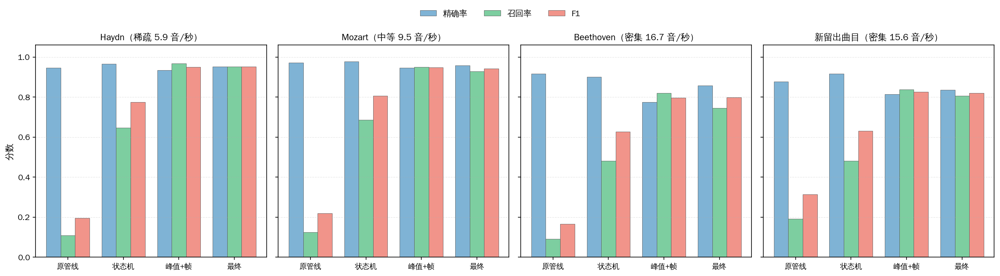
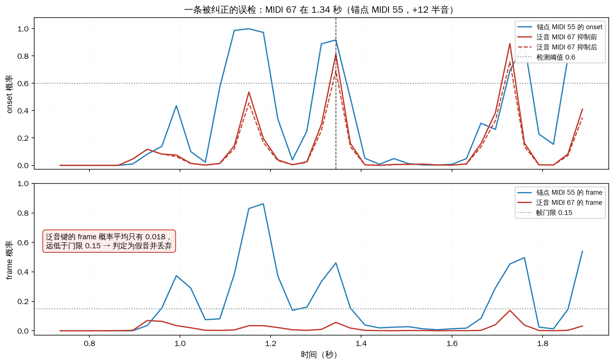
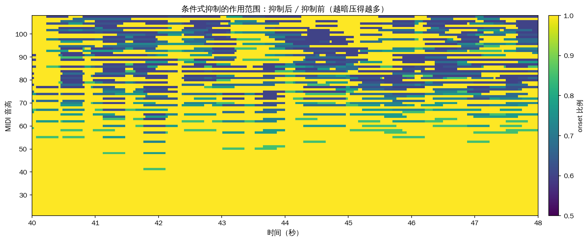

# 04 解码器

## 1. 「解码」的两种含义

机器学习里「解码」有两个意思：

- **神经网络解码器**（seq2seq decoder）：逐词生成输出，本项目**没有**；
- **规则解码**：把概率图按规则变成离散的音符事件，**本项目使用这个**。

见流水线图右侧的对照（完整流水线见 [`docs/01_overview.md`](01_overview.md)，此处不重复贴图）：

## 2. 最终解码流程（`src/piano2/decode.py`）

```text
输入：onset (T,88)、frame (T,88)、velocity (T,88) 三张概率图
① 条件式谐波抑制（conditional harmonic suppression）
     - 只在严格阈值（0.75）确认的「锚点」附近 ±5 帧内生效
     - 只压泛音键、不压锚点键；每个键取 min 而非连乘
② 起音检测：每个键找 onset 概率峰值（高度 > 0.6、突出度 > 0.005、间距 ≥ 5 帧）
③ 帧一致性门控：该键在起音附近 5 帧内的 frame 概率均值 < 0.15 → 判为假音丢弃
④ 终点：从起音帧沿 frame 概率找「释放」（低于 0.18 连续 3 帧）
⑤ 同音高合并：间隔小于 5 帧的同键重复音合并
输出：音符事件列表（音高、起点、终点、力度）
```

默认参数在 `src/piano2/constants.py` 的 `DECODE_DEFAULTS` 里（M0.5 步骤 3 选定）：

| 参数 | 值 | 作用 |
|---|---|---|
| `method` | `peak_frame` | 峰值定起点 + 帧定终点 |
| `harmonic_mode` | `conditional` | 条件式抑制（局部、非累乘） |
| `harmonic_strength` | 0.5 | 抑制强度 |
| `harmonic_window_frames` | 5 | 锚点附近生效的时间窗 |
| `harmonic_frame_max` | 0.6 | 只对帧均值低于该值的键抑制 |
| `frame_gate` | 0.15 | 帧一致性门限 |
| `onset_threshold` | 0.6 | 起音检测阈值 |
| `onset_prominence` | 0.005 | 峰值突出度 |
| `peak_distance` | 5 | 峰值最小间距（帧） |
| `frame_off_threshold` | 0.18 | 释放阈值 |
| `release_frames` | 3 | 连续释放帧数 |
| `offset_threshold` | 0.7 | offset 峰阈值（启用 offset 头时） |
| `offset_min_frames` | 2 | 起点后至少多少帧才允许结束 |
| `offset_max_frames` | 20 | offset 搜索窗口；0.7 + 20 帧是当前 note F1 最好的组合 |

## 3. 为什么这样设计（M0/M0.5 的结论）

- **旧全局谐波抑制是召回率崩掉的主因**：它对整首曲子一次性相乘，且多个锚点连乘，
  一个键可能被压到原概率的 7%。M0.5 步骤 3 的归因实验：
  - 只开帧门控：Beethoven 精确率 0.829；
  - 只开抑制：0.822；
  - 两者都开：0.858。
- **状态机的结构门限会删掉 30–40% 的起音**，调参也救不回来，所以换成峰值+帧。



## 4. 效果

onset-only F1 / 精确率（50 ms 容差）：

| 曲目 | 旧管线 | 状态机调参 | 峰值+帧 | **最终版** |
|---|---|---|---|---|
| Haydn（稀疏） | 0.196 / 0.946 | 0.774 / 0.965 | 0.950 / 0.934 | **0.952 / 0.951** |
| Mozart（中等） | 0.220 / 0.972 | 0.806 / 0.978 | 0.949 / 0.947 | **0.943 / 0.959** |
| Beethoven（密集） | 0.166 / 0.916 | 0.628 / 0.901 | 0.797 / 0.775 | **0.798 / 0.858** |
| 新留出曲目（密集） | — | — | 0.825 / 0.813 | **0.821 / 0.835** |

一个被纠正的误检案例（泛音泄漏 + 帧门控）：



抑制是局部的，不是全局一刀切：



## 5. 用法

```python
from piano2.decode import DecodeConfig, decode
from piano2.constants import DECODE_DEFAULTS

cfg = DecodeConfig(**DECODE_DEFAULTS)
events = decode(onset, frame, velocity, cfg)   # lists of NoteEvent(pitch, start, end, velocity)
```

## 6. 已知局限

- **留出集精确率 0.835，差 0.015 到 0.85 的目标**：密集曲目的泛音假音仍有一部分未被帧门控拦掉；
  下一步靠更好的训练和特征（CQT 能量比判据）改善，而不是继续调解码参数——M0.5 已经证明解码器到了天花板。
- 峰值检测阈值（0.6）对弱起音偏严格，稀疏曲目召回 0.95、密集曲目 0.80，差距主要来自模型置信度，
  不是解码器本身。
