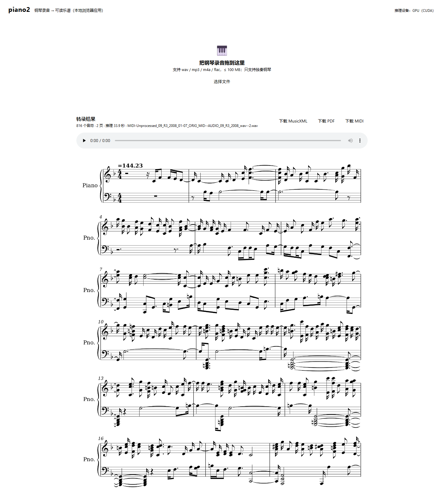
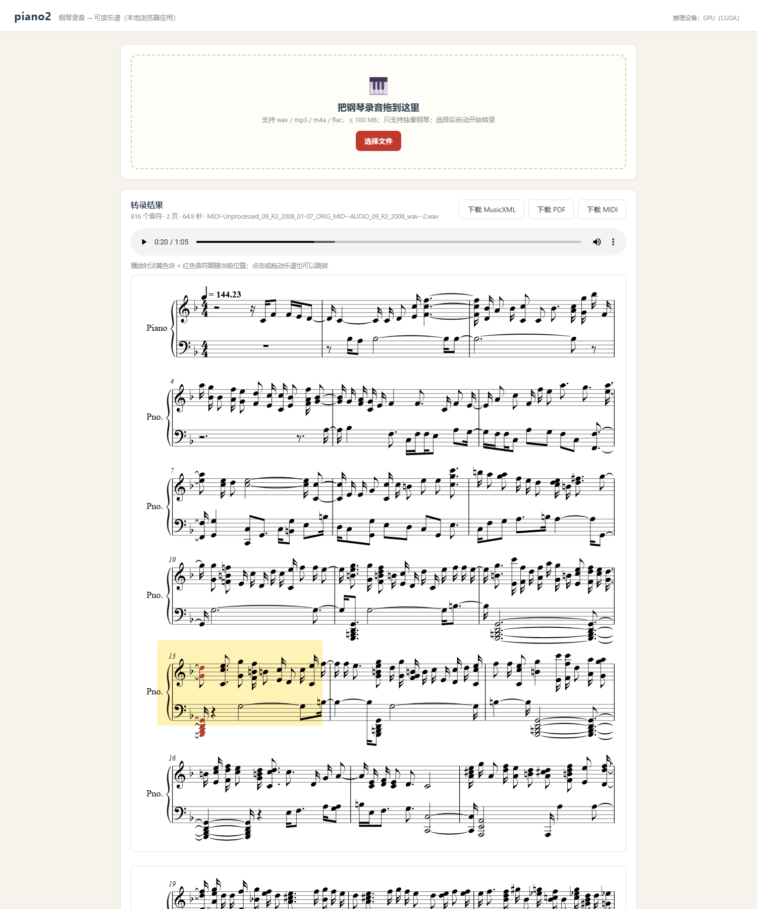
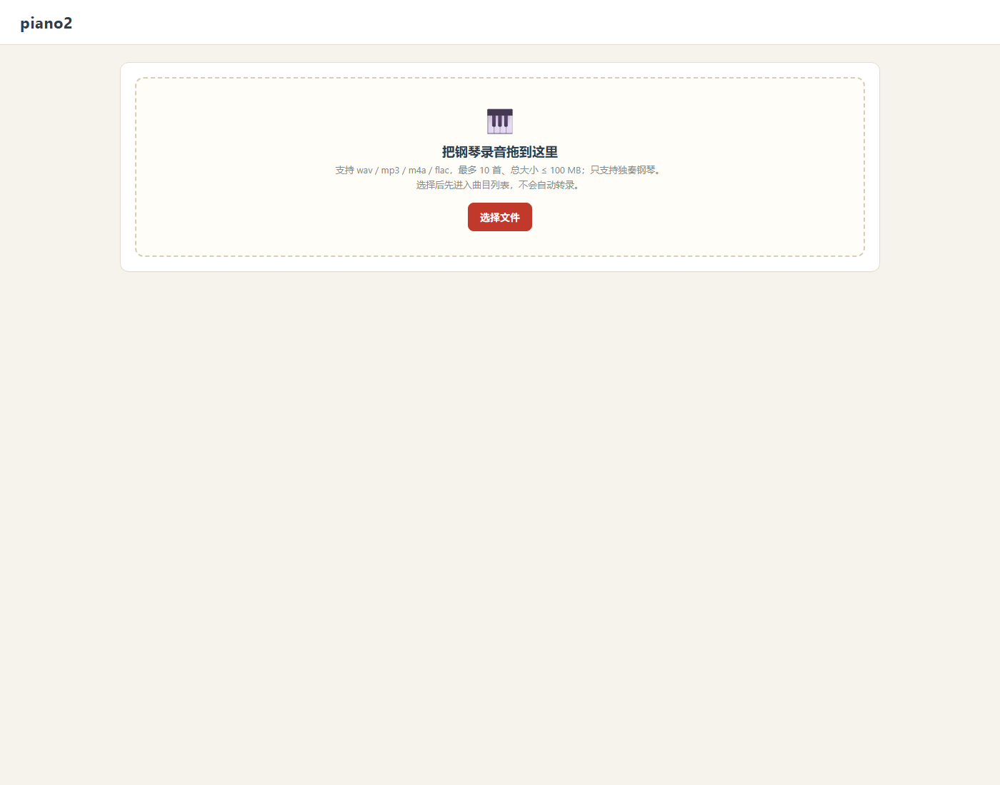
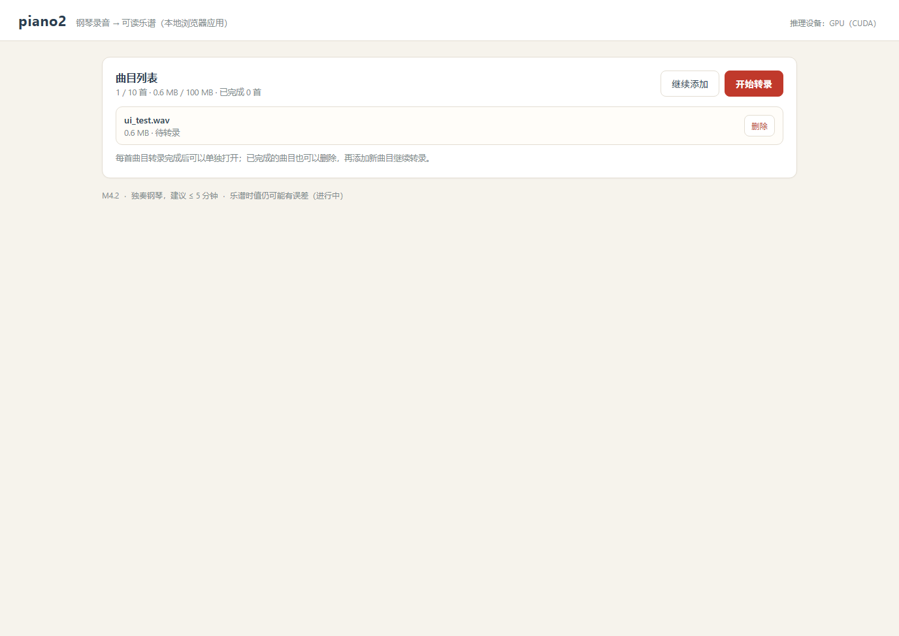
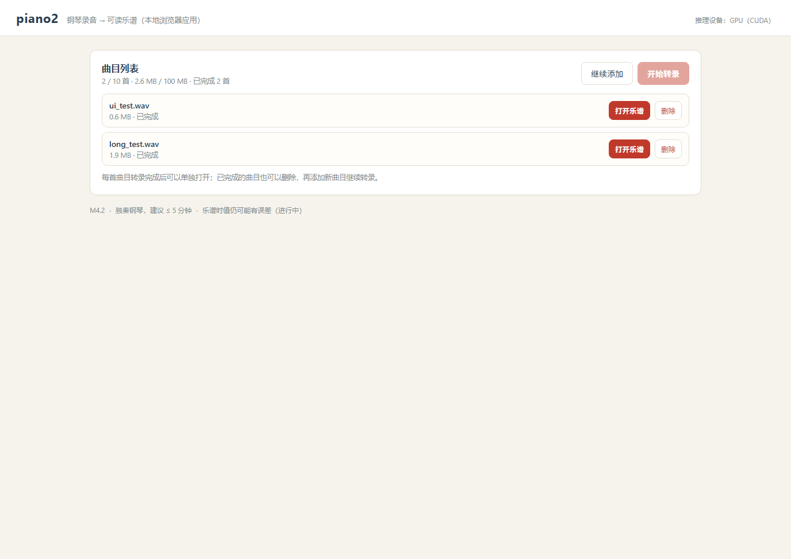
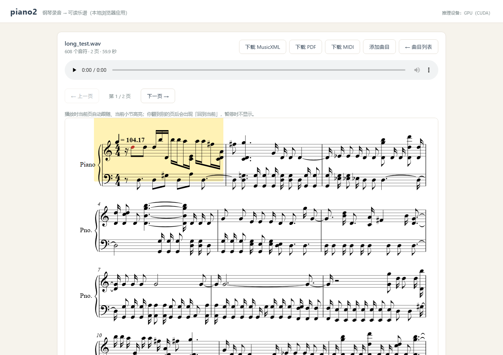
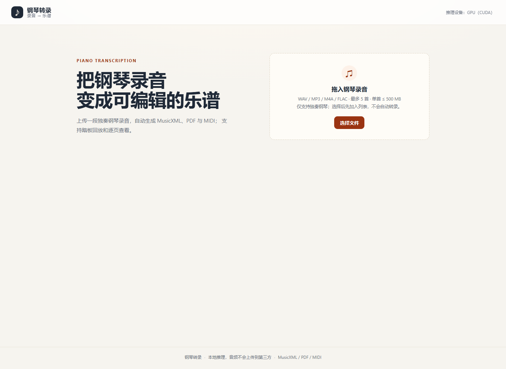
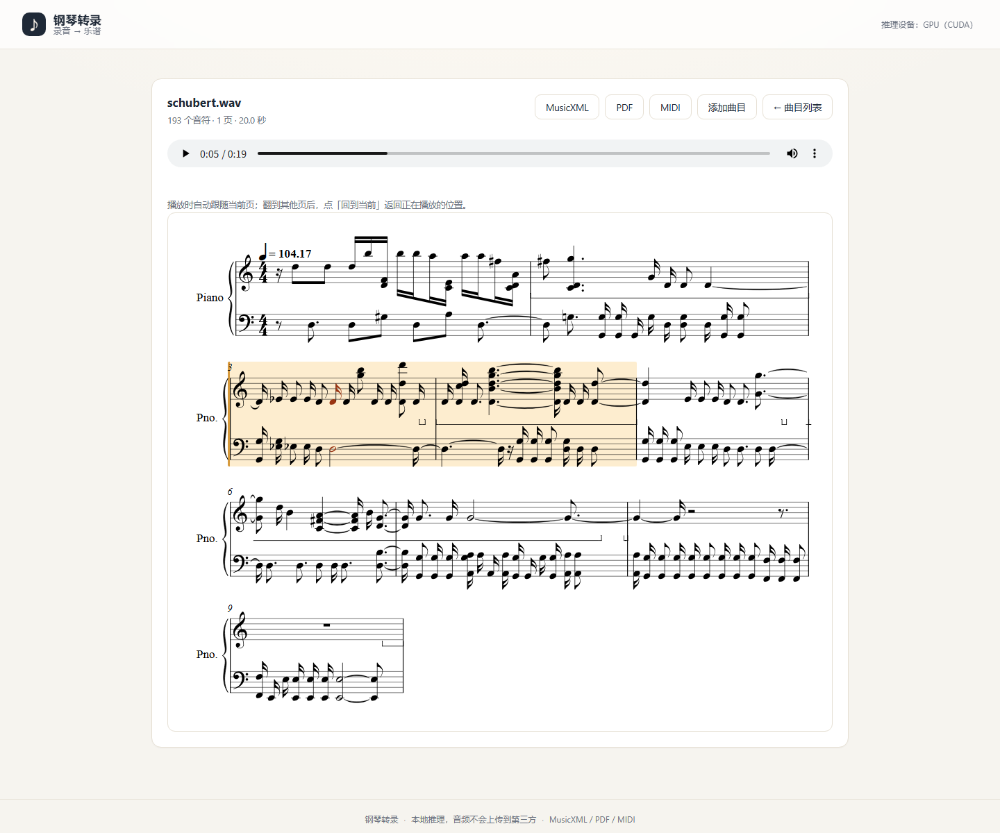

# 08 M4 浏览器应用：Docker 本地交付方案

> 状态：**M4.3 产品化打磨完成（2026-11-14）**：多曲目队列、单曲/多曲分流、
> 单页翻页查看器、真实钢琴音色回放已在本机跑通；Docker 镜像构建与分发仍待做。
> 本文是产品与技术设计文档；面向使用者的傻瓜教程见 `../tutorial/07_running_app.md`。

## 1. 目标与形态

把训练好的模型封装成一个**本地 Web 应用**，以 Docker 镜像交付：

```text
接收方：装 Docker → docker load 导入镜像 → docker run 启动 → 浏览器打开 localhost:8000
交互：拖入一段钢琴录音 → 等待 → 看乐谱 → 下载 MusicXML / MIDI / PDF → 播放
```

为什么选 Docker + Web：

| 方案 | 优点 | 缺点 |
|---|---|---|
| **Docker + 本地 Web（本项目）** | 一套镜像覆盖 Win/mac/Linux；数据不出本机；无服务器成本；浏览器体验 | 接收方要装 Docker；mac 无 NVIDIA 时慢 |
| 云端托管 | 接收方零安装 | 要付 GPU 服务器钱、要运维、音频要上传 |
| 各平台原生打包 | 体验最好 | 每个平台单独构建，mac 签名麻烦 |

## 2. 架构

```text
浏览器（单页应用）
   │ 上传音频（multipart）
   ▼
FastAPI 后端（容器内）
   ├─ 任务队列（单 worker 串行，避免抢显存）
   ├─ 推理管线：转 16 kHz → CQT → 模型 → 解码 → 记谱
   ├─ 产物：MusicXML / PNG 分页 / PDF / MIDI / 合成音频（可选）
   └─ 清理：任务完成后保留 N 分钟，定时删
   │
   ▼
浏览器展示：乐谱分页 + 下载按钮 + 回放（前端 SoundFont 播放 MIDI）
```

## 3. API 草案

| 方法 | 路径 | 作用 |
|---|---|---|
| `POST` | `/api/transcribe` | 上传音频，返回 `job_id` |
| `GET` | `/api/jobs/{job_id}` | 查询状态与进度（queued/running/done/failed） |
| `GET` | `/api/jobs/{job_id}/score` | 乐谱 PNG 分页（或 SVG） |
| `GET` | `/api/jobs/{job_id}/files/{kind}` | 下载 `musicxml` / `midi` / `pdf` |
| `GET` | `/api/health` | 健康检查（含 GPU 是否可用） |

## 4. 技术选型

| 部分 | 选择 | 理由 |
|---|---|---|
| 后端 | FastAPI + uvicorn | Python 生态一致，异步够用 |
| 推理 | 复用 `piano2.inference` + `decode` + `notation` | 不重写已验证代码 |
| 渲染 | verovio → SVG → rsvg-convert → PNG/PDF | 已有，成熟 |
| MIDI 导出 | pretty_midi 从解码事件写文件 | 简单可靠 |
| 回放 | 前端 Web Audio + 钢琴 SoundFont（播放 MIDI） | 无额外服务端依赖 |
| 前端 | 单页 HTML + 原生 JS | 需求简单，不上框架 |
| 打包 | Dockerfile（pytorch runtime 基底）+ docker save | 离线交付 |

## 5. 镜像与分发

```powershell
# 在开发机（有 GPU）构建
docker build -t piano2-app:0.1 .

# 导出成 tar（约数 GB，因为含 PyTorch CUDA 运行时）
docker save -o piano2-app-0.1.tar piano2-app:0.1

# 接收方导入并运行
docker load -i piano2-app-0.1.tar
docker run --gpus all -p 8000:8000 piano2-app:0.1
# 浏览器打开 http://localhost:8000
```

待定问题：

- 模型权重（约 135 MB）打进镜像还是作为卷挂载？**倾向打进镜像**，接收方零配置；
- 镜像体积大（PyTorch CUDA runtime 数 GB），考虑 CPU 版镜像作为轻量替代；
- macOS 没有 NVIDIA：镜像自动降级为 CPU 模式（慢但可用）。

## 5.1 设备兼容性与实测性能（M4 设计验证）

推理在容器内运行，PyTorch 通过 Docker 的 GPU 直通使用宿主机显卡（Windows 需 WSL2 + NVIDIA 驱动；
Linux 需 nvidia-container-toolkit；macOS 无法直通 NVIDIA，容器内 `mps` 也不可用，只能 CPU）。

实测（同一模型，65 秒与 305.8 秒两段音频，只算推理到 MusicXML，不含 PNG 渲染）：

| 音频长度 | CPU（10 线程） | GPU（RTX 4060） | CPU / GPU |
|---|---|---|---|
| 65 秒 | 约 3.7 秒 | 约 2–4 秒 | 约 1–2 倍 |
| 305.8 秒（5 分钟） | **8.8 秒** | **6.3 秒** | **约 1.4 倍** |

结论：**这个模型只有 1145 万参数，CPU 推理已经够用**（5 分钟音频 9 秒）。瓶颈不只是模型，
CQT 计算与 Python 侧的记谱也占相当比例。所以「没有 GPU」不是 M4 的阻断项，只是慢一些。

### 设备选择策略

```text
PIANO2_DEVICE 环境变量优先（cuda / mps / cpu）
否则自动检测：CUDA 可用 → cuda；MPS 可用（仅 macOS 原生运行，不在 Docker 内）→ mps；否则 cpu
```

不同设备的配套设置：

| 设备 | 精度 | 说明 |
|---|---|---|
| CUDA | fp16 autocast | 最快；显存占用低 |
| MPS | float32 | 仅 macOS 原生运行（不在容器内）；部分算子可能回退 CPU |
| CPU | float32 | 设置线程数；模型小，无需量化 |

### 镜像策略

| 镜像 | 基底 | 体积 | 给谁 |
|---|---|---|---|
| `piano2-app:gpu` | PyTorch CUDA runtime | 大（tar 约数 GB） | Windows/Linux + NVIDIA |
| `piano2-app:cpu` | PyTorch CPU wheel | 小（tar 约 1 GB） | macOS、无显卡机器 |

两个镜像用同一个 Dockerfile + `ARG BASE_IMAGE` 构建，代码与权重相同。

## 6. 范围与限制

| 项目 | MVP 范围 | 暂不做 |
|---|---|---|
| 输入 | 独奏钢琴录音，wav/mp3/m4a，≤5 分钟 | 多乐器、人声、超长音频 |
| 输出 | MusicXML、MIDI、PDF、PNG 分页、回放 | 交互编辑、排版美化 |
| 并发 | 单任务串行 | 多用户队列、鉴权 |
| 质量 | 结构正确（onset 达标）；时值有误差 | 时值修复（M3.5） |

## 7. 验收标准（MVP）

1. 在开发机用 `docker run` 启动，浏览器能打开页面；
2. 上传 3 段测试音频（短/中/长各一），全部得到乐谱与 PDF/MIDI 下载，无报错；
3. 65 秒音频的总耗时（上传→出谱）≤ 30 秒（GPU）；
4. 刷新/重启后任务状态不丢（或给出明确失败提示）；
5. 同一输入重复运行结果一致（可复现）。

## 8. 里程碑

| 阶段 | 内容 | 预计 |
|---|---|---|
| M4.1 | 后端 API + 单页前端，本机跑通上传→出谱→下载 | 1 天 |
| M4.2 | 回放（前端 SoundFont）+ 进度显示 | 0.5 天 |
| M4.3 | Docker 镜像 + save/load + 接收方验证 | 0.5–1 天 |
| M4.4 | 文档：tutorial/07 使用教程 + 本设计文档更新 | 0.5 天 |

## 9. 与质量改进的关系

M4 把推理管线封装好之后，M3.5（时值修复）只需要替换「解码/记谱」这一段，
应用层不用改。所以先做 M4 不会白费工。

## 10. M4.1 实现记录（MVP，2026-11-04）

### 10.1 文件

| 文件 | 作用 |
|---|---|
| `app/main.py` | FastAPI：`/` 页面、`/api/health`、`/api/transcribe`、`/api/jobs/{id}`、`/media/*` 产物 |
| `app/jobs.py` | 内存任务表 + 单 worker 线程池（串行推理）+ 过期清理 |
| `app/pipeline.py` | 音频 → 全部产物：MusicXML、PNG 分页、PDF、MIDI、回放 WAV |
| `app/render_service.py` | verovio 渲染封装（必须主线程初始化 toolkit，见 10.3） |
| `app/static/` | 单页前端：拖拽上传、进度轮询、乐谱分页、下载按钮、回放 |

### 10.2 本地运行

```bash
# 需要先装依赖：fastapi uvicorn python-multipart（已在 requirements.txt）
python -m uvicorn app.main:app --host 127.0.0.1 --port 8000
# 浏览器打开 http://127.0.0.1:8000
```

模型默认从 `models/best.pt` 读取（可用 `PIANO2_CKPT` 覆盖）；设备自动检测（CUDA → MPS → CPU）。

### 10.3 实现中踩的三个坑

1. **verovio 不能在非主线程创建 toolkit**：FastAPI 的任务跑在工作线程，直接 `verovio.toolkit()`
   会报「Bravura font could not be loaded」，`loadFile` 返回 False。解决：模块导入时（主线程）
   创建全局 toolkit，之后加锁串行复用。
2. **页数随页面选项变化**：默认选项下 3 页，换成 `pageWidth=2200, scale=48` 后是 2 页。
   必须先 `setOptions` 再 `loadFile`，否则 `getPageCount()` 返回旧值，渲染会越界。
3. **PDF 体积**：直接把 300 KB 的 PNG 塞进 PDF 会得到 28 MB 文件。改为缩小到 ≤1600 px、
   JPEG 质量 82 后再嵌入，PDF 降到 **105 KB**。

### 10.4 实测（RTX 4060）

| 项目 | 结果 |
|---|---|
| 65 秒音频 | 首次任务 15.5 秒（含模型加载），后续任务 **5.2 秒** |
| 音符事件 | 816 个 |
| 页数 | 2 页 |
| 产物 | MusicXML 245 KB / MIDI 5 KB / PDF 105 KB / WAV 2.9 MB |
| 网页 | 乐谱分页显示、三个下载按钮、浏览器内回放 |

真实界面（第一次上传测试音频、后台完成后的结果页）：



### 10.5 播放跟随高亮与拖动定位（2026-11-04 晚）

**需求**：乐谱上有一条跟随演奏进度的高亮；可拖动定位；播放中拖动→松手后从新位置继续播放；
暂停时拖动→松手后保持暂停。

**实现**：

1. 服务端把每页渲染成 **SVG**（不剥离 PUA 文本，浏览器能加载内嵌音乐字体）并内联到页面；
2. 用 verovio 的 `getElementsAtTime(ms)` 每 100 ms 采样一次，生成
   `timing.json`：`{t, page, ids, measures}`——某个时刻正在演奏的音符 id 与所在小节 id；
3. 前端用 `requestAnimationFrame` 跟随 `audio.currentTime`：
   - 给当前音符加 `.note-active` 类（**红色**）；
   - 按小节 id 取 bbox，在页面里放一个**淡黄色半透明块**（当前小节所在系统行），像卡拉 OK 的行高亮；
   - 自动滚动到可见区域；
4. **拖动**：在乐谱上按下时记录「原来是否在播放」并暂停；拖动中实时预览高亮位置；
   松手设置 `audio.currentTime`，若之前在播放则恢复播放，否则保持暂停；
5. 进度用浏览器**自带的音频播放器进度条**，不再额外做一条重复的滑条（M4.1 初版做过，已删）。

真实效果（定位到第 20 秒：淡黄色块 + 红色音符）：



**顺手解决的两个问题**：

- **节拍记号完整了**：SVG 带内嵌字体，浏览器里 `♩ = 144.23` 的四分音符能正确显示
  （PNG 版本因为去 PUA 只剩 `=144.23`）；
- **回放与谱面共用时间轴**：MIDI 改用 verovio 从乐谱导出（带速度信息），回放音频也从这份
  MIDI 合成，高亮时间轴与声音严格一致（不再用原始事件时间近似）。

**踩的坑**：

1. verovio 每次 `loadFile` 都会重新生成元素 id，所以「渲染 SVG」和「采样时间轴」
   必须在**同一次加载**里完成，否则 id 对不上、高亮永远找不到元素；
2. `getElementsAtTime` 只接受整数毫秒，且返回的字段是单数 `measure`（不是 `measures`）；
3. 初版改 CSS 时误把文件开头的 `:root` 变量块删掉，导致所有 `var(--...)` 失效——
   卡片边框、按钮颜色全部消失（用户看到「界面没有框了」），恢复变量块后正常。

### 10.6 待做（M4.2 及以后）

Docker 镜像构建与分发（GPU / CPU 两个镜像）、`docker save` / `docker load` 验证、
接收方操作文档（tutorial/07 补全）。

## 11. M4.2 实现记录（2026-11-09）

M4.2 针对真实使用中暴露的三个问题做了重构：

1. **交互**：从「选文件立刻转录 + 多页连续滚动」改成「先组队列，再转录；单页左右翻页」；
2. **音色**：回放从正弦波相加的简易合成器换成 FluidSynth + SoundFont 的真实钢琴音色；
3. **多曲目**：支持一次选择多首、删除、继续添加、转录完成后继续追加新曲目。

### 11.1 新的前端状态机

```text
IDLE（只有「选择文件」）
  → QUEUE（曲目列表：删除 / 继续添加 / 开始转录）
  → PROCESSING（逐首串行转录，每首独立状态）
  → RESULT
       1 首 → 直接进入谱面
       多首 → 曲目列表，点选进入
  → 谱面：单页左右翻页；返回列表 / 添加曲目
```

约束：

- 最多 **5 首**，单首 **≤ 500 MB**（前端与后端都按单文件 500 MB 校验）；
- 转录完成后仍可继续添加；「开始转录」只处理状态为「待转录」的新曲目，已完成的不会重跑；
- 已完成的曲目可以删除（会调用 `DELETE /api/jobs/{id}` 清理服务端产物）。

初始状态只显示「选择文件」：



选择文件后进入曲目列表，不会立刻转录：



多首完成后显示列表，删除/继续添加/打开乐谱都在同一页：



### 11.2 单页翻页与「回到当前」

旧版把多页乐谱连续排列，播放跟随时调用 `scrollIntoView()`，用户一往下拉就被拽回高亮处。
M4.2 改为**一次只显示一页**：

- 左右按钮 / 键盘 ←、→ 任意翻页，页码「第 N / M 页」；
- 播放中当前页自动跟随，当前小节黄色块 + 当前音符红色高亮；
- 播放中用户翻到别的页 → **停止自动跟随**，出现「回到当前」；
- 点「回到当前」→ 回到播放页并恢复跟随；
- 暂停时不显示该按钮；暂停时翻页，再按播放不会自动跳走，而是显示「回到当前」；
- 页面内部允许纵向滚动，但**不再有任何自动滚动**。



### 11.3 真实钢琴音色

`app/pipeline.py` 新增 `synthesize_piano_midi()`：

- 用 `fluidsynth -ni -F ...` 把谱面导出的 MIDI 渲染为 44.1 kHz WAV；
- 音色来自 `FluidR3_GM.sf2`（General MIDI 的 Acoustic Grand Piano）；
- 渲染后统一响度到 −20 dBFS 并限制峰值；
- 若 FluidSynth 或 SoundFont 缺失，自动回退到旧的 `synthesize_preview()` 简易合成器。

Dockerfile 默认使用阿里云 apt 镜像并安装 `fluidsynth` + `fluid-soundfont-gm`
（镜像约增加 150 MB）；SoundFont 路径可用 `PIANO2_SOUNDFONT` 覆盖。

### 11.3.1 踏板头接入回放（2026-11-10）

之前模型虽然训练了 `pedal` / `pedal_on` 两个头，但推理/回放完全没有使用，导致回放是
「干、断」的。现在：

- `infer_sliding_window(..., with_pedal=True)` 同时返回 pedal / pedal_on 概率；
- `decode_pedal()` 用双阈值迟滞把概率解码成踩下/松开区间；
- app 生成 `playback.mid`，写入 CC64（sustain pedal）后再交给 FluidSynth 渲染；
- `score.mid` 仍是谱面导出的 MIDI（用于下载/DAW），不含踏板；
- MusicXML/PDF 已写入标准的 `<direction><pedal type="start|stop">`，verovio 渲染成
  谱面下方的踏板线；谱面本身仍按 key-off 时值记谱。

这项改动不改变 note/onset 指标，只改变回放听感；和 SOTA 的对比中，SOTA 的原始 MIDI
本来就带 CC64，所以之前的听感差距有一部分来自我们这边漏用了踏板。

### 11.4 验证

用无头 Edge + CDP 实际跑通了以下流程：

| 场景 | 结果 |
|---|---|
| 初始页 | 只有「选择文件」 |
| 选 1 个文件 | 进入曲目列表，不自动转录 |
| 点「开始转录」 | 完成后单曲直接进入谱面 |
| 追加第 2 首 | 只转录新曲目，完成后显示多曲列表 |
| 删除已完成曲目 | 列表与统计同步更新，服务端任务被删除 |
| 60 秒音频 | 2 页；翻页控件出现，任意翻页正常 |
| 播放中翻走 | 「回到当前」出现；点击后回到播放页并恢复跟随 |
| 暂停 | 「回到当前」隐藏 |

此外修复了 PDF 透明背景导致的黑屏（`pngs_to_pdf` 先合成白底），并保留旧合成器作为音色回退。

## 12. M4.3 产品化更新（2026-11-14）

这一轮不再扩展算法，只做“现有最好模型 + 完整产品”的收敛。

### 12.1 模型

- `models/best.pt` 换成 `hybrid_reg2`（8 头：分类 6 + onset_reg/offset_reg）；
- `app/pipeline.py` 自动检测 `has_regression`：
  1. 分类头解码音符；
  2. `refine_onsets()` 用 onset_reg 在起点附近做三帧三角插值；
  3. 分类 offset 决定结束时间；
- app 结果里新增 `"model": "hybrid"`，便于确认实际使用哪条路径；
- 原始事件和回放保留亚帧时间；MusicXML/PDF 仍量化到 16 分音符，这是谱面可读性的取舍。

### 12.2 界面

- 标题从内部代号改为面向用户的「钢琴转录」，去掉左上角 `piano2`；
- 首页改成“标题 + 上传卡片”两栏，删掉重复说明；
- 统一按钮、卡片、页脚和状态文案；
- 顶栏保留推理设备状态，页脚说明本地推理与导出格式；
- 结果页保留逐页翻页、播放跟随和「回到当前」。





### 12.3 时间轴与小节高亮

- `render_svg_with_timing()` 现在接收**原始音频时间**，用 verovio timemap 取得乐谱实际时长，再按比例映射；
  返回的采样 `t` 与 `audio.currentTime` 同一条时间轴；
- `timing.json` 的 `duration` 改为原始音频时长，UI 的时长/进度条/高亮不再使用偏长的 `score.mid` 时长；
- `sampleIndexAt()` 在第一个谱面事件之前返回 -1，避免暂停/开头提前高亮下一小节；
- 小节高亮仍使用 verovio 当前 `measure` 元素，截取五线谱 staff 的屏幕包围盒。

### 12.4 踏板平滑

新增 `piano2.decode.smooth_pedal_events()`：

- 相邻踏板区间 gap ≤ 0.90 s 时直接合并，避免「松开—立刻再踩」的硬切断；
- 每个区间松开时刻延长 0.12 s，保留钢琴自然释放尾巴；
- app 在 `decode_pedal()` 后统一做这一步，再写 `playback.mid` 的 CC64 和谱面踏板线。

### 12.5 上传限制

- 前端：最多 5 首，单首 ≤ 500 MB（总上限 2.5 GB）；
- 后端：`MAX_UPLOAD_MB = 300`；
- 文案、错误提示和曲目统计同步更新。

### 12.6 长曲目的 score.mid 兜底

长曲目在 verovio 导出 MIDI 时可能生成异常大的 tick 数，`pretty_midi` 解析会抛出：

```text
ValueError: MIDI file has a largest tick of ..., it is likely corrupt
```

这不是输入音频损坏，而是导出的谱面 MIDI 文件不可靠。现在 pipeline 在写完
`score.mid` 后立刻做一次 `pretty_midi.PrettyMIDI` 校验：

- 校验通过：保留谱面时间轴 MIDI；
- 校验失败：回退到 `write_midi(events, ...)`，用原始音符事件生成可用的 MIDI，
  任务继续完成；
- 结果字段 `score_midi_fallback` 会标记是否使用了回退。

### 12.7 谱面点击跳转

- `seekFromClick()` 不再只按点击 Y 坐标投影；优先用 `document.elementFromPoint()` 命中的音符/小节 id，
  映射到 timing sample 的音频时间；
- 点击空白区域时，用当前页所有小节的 2D 包围盒距离选最近小节；
- 旧 timing.json 没有 measure 字段时，才回退到纵向投影。

### 12.8 后台完成与滚动跟随

- 多曲目串行转录时，`startTranscription()` 完成后若用户已经在 score 页面，**只弹 toast 提示**，不再调用 `showTracks()`，也不暂停 audio；
- 页面切换时 `.score-viewport` 自动回到页首；
- 播放中当前小节高亮会自动滚入视口（`ensureBandVisible()`），避免用户滚到下面后看不到当前小节；
- timing 采样从 0.10 s 缩短到 0.04 s，并额外加入每个音符起点，改善快速段落的高亮边界。

### 12.9 验收

```text
上传 20 秒 Schubert 录音 → 8 秒内完成 → 193 个音符 / 1 页
API health 返回 device=cuda
任务结果 model=hybrid
timing.duration = 20.0，与 preview.wav 一致
```

详细使用步骤见 `../tutorial/07_running_app.md`。
