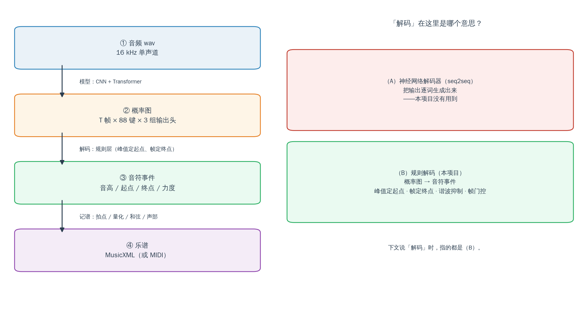

# 03 系统蓝图：8 个大块、两步走、以及我们怎么配合

> 这是给学员版的说明。比 `02_diagnosis_and_roadmap.md` 简单：先讲人话，再讲结构。
> 日期：2026-10-31

---

## 0. 我们怎么配合

- **我（教练 + 实现）**：负责设计、写代码、跑测试、维护文档。每个决定说明「为什么」，每条结论配数字。
- **你（评审 + 学员）**：看结论是否合理、看谱面是否达到「人可读」、听音频、提问。不需要盯代码细节。
- **节奏**：按里程碑交付，每个里程碑我交四样东西——可运行命令、产物（谱/图/音频）、数字对比、一页说明。
- **文档**：旧仓从现在起只做必要改动；新仓从第一天起就有固定文档位（见 §5），每个里程碑同步更新，不做「先写代码后补文档」。

---

## 1. 三句话讲清现在的毛病

**毛病 A（记谱）**：把「演奏的秒数」直接抄成「乐谱的时值」。
打个比方：录音里你按了 0.06 秒的键，乐谱却要写「这个音多长」。你现在的程序直接把 0.06 秒换算成谱面时值——在 120 BPM 下这只有 1/16 个四分音符，于是**每个音都被写成 16 分音符**；长一点音又会被小节线切成几段、用连音线（tie）接起来。所以满页黑音符。

**毛病 B（训练）**：模型只练了 6200 步，而且学习率提前归零。
打个比方：一本 200 页的教材，它只翻了 20 遍的开头几页，然后学习节奏被你自己调成了「越来越慢，最后不动」。所以它不是学坏了，是**没学完**。

**毛病 C（评测）**：唯一的分数 0.044 是一场「物理上不可能及格」的考试。
这场考试要求「音高对、起点对、**时值也对**」，但你的程序强制每个音至少 0.192 秒，而真实演奏的按键只有 0.05–0.08 秒。也就是说，**哪怕检测全对，最高也只能考到 0.264**。何况这场考试只用了三首最短最密的曲子、还用了其中前 60 秒。

一句话：**谱面难看主要是 A，模型不够好主要是 B，而 C 让你看不见真实水平。**

---

## 2. 为什么第一步是「拿标准答案当输入」

这叫 **GT 直通实验**（GT = ground truth，标准答案）。
拿正确的 MIDI 当输入，跳过模型，直接走你的「音符 → 乐谱」那段代码，看输出好不好。

比喻：打印机打出来的字歪了，先别怀疑扫描仪，**先把标准文件直接喂给打印机**。如果标准文件打出来也歪，那问题在打印机。

我们做过了：把完全正确的 MIDI 喂进现在的记谱代码，24 首里有 86.3% 的黑音符。**打印机坏了**。这就是为什么第一步不是重训模型。

---

## 3. 最终版系统 = 9 个大块

先看整体，再逐块说。每块都回答四件事：干嘛的、输入是什么、输出是什么、为什么需要它。

| # | 大块 | 一句话作用 | 输入 → 输出 |
|---|---|---|---|
| 1 | 数据与标签 | 把 200 小时演奏变成「题目 + 标准答案」 | wav + MIDI → 定长片段 + 5 组标签 |
| 2 | 特征（声音→图像） | 把波形变成时频图，让 CNN 有「图」可看 | 波形 → T×F 矩阵 |
| 3 | CNN | 找局部的「击弦瞬态」「泛音花纹」 | T×F 图 → T×D 帧特征 |
| 4 | Transformer | 让每一帧看到前后几秒，理解和声与乐句 | T×D → T×D' |
| 5 | 输出头 | 把每帧变成 88 个琴键的多组概率 | T×D' → 5 组 T×88 概率图 |
| 6 | 解码 | 把概率图变成离散音符事件 | 概率图 → 音符列表 |
| 7 | 记谱 | 把演奏事件变成人能读的五线谱 | 音符列表 → MusicXML |
| 8 | 评估与实验 | 让「变好」可以被测量 | 预测 + GT → 指标与图表 |
| 9 | 应用 | 做成别人能用的网页服务 | 音频 → 网页谱面 / MIDI / PDF |

### 块 1：数据与标签

- **干嘛的**：模型不认识音符，只认识数字。这一块负责把演奏切成定长片段，并把 MIDI 转成「每个时刻 88 个键的状态」。
- **输入**：MAESTRO 的 wav + 对齐好的 MIDI。**输出**：10 秒片段 + 5 组标签（onset / frame / offset / velocity / pedal）。
- **为什么需要**：标签质量决定天花板。我们之前大半的麻烦都来自这里——frame 标签被踏板拉长、onset 标签宽了 3 倍、验证集每次随机切窗口导致分数不可比。
- **我们会学到**：数据清洗、标签设计、训练/验证/测试划分，以及为什么「每个 epoch 只看了 11% 的数据」是 bug 级的浪费。

### 块 2：特征（声音 → 图像）

- **干嘛的**：把一维波形变成二维时频图。低频在下面、高频在上面，横轴是时间。这就是模型眼里的「谱」。
- **输入**：16 kHz 单声道波形。**输出**：T×F 的矩阵，每一列是一帧（10 毫秒或 32 毫秒）。
- **我们的选择**：以 **log-mel 229** 为主（和论文、开源预训练权重一致，方便对照），**CQT 264** 作为对照（你原来走的路，物理上更直观）。
- **我们会学到**：STFT / mel / CQT 的区别，为什么「特征的频率分辨率要和标签对齐」。

### 块 3：CNN（局部模式）

- **干嘛的**：从时频图里找局部花纹——「一下击弦」长什么样、「一个音的泛音」长什么样。这是卷积最擅长的事。
- **输入**：T×F 图。**输出**：T×D 的帧特征。
- **设计要点**：只在**频率方向**做池化，时间方向保持精度（因为起音时刻必须准）。
- **我们会学到**：卷积、感受野、BatchNorm、通道数，以及「时间轴不能随便池化」的原因。

### 块 4：Transformer（全局上下文）

- **干嘛的**：让每一帧能「看到」前后几秒，判断这是不是同一个和弦、踏板是不是还踩着、这句旋律有没有重复。
- **输入**：T×D。**输出**：T×D'（同样是每帧一个向量，但带上下文）。
- **设计要点**：pre-LN、6 层、8 头、RoPE 位置编码、dropout。10 秒片段约 1000 帧，注意力计算量完全可以接受。
- **我们会学到**：注意力（Q/K/V）、为什么是 O(T²)、位置编码、pre-LN 与 post-LN 的区别、残差连接。

### 块 5：输出头（多任务）

- **干嘛的**：把每帧的向量变成 88 个琴键的几组概率。
- **5 个头**：onset（击弦瞬间）、frame（正在响）、offset（松开）、velocity（力度）、pedal（踏板）。
- **为什么多头**：这几种是不同物理事件；共享同一个 backbone，多任务之间能互相帮助。
- **我们会学到**：多任务学习、类别不平衡、pos_weight、分类损失（BCE）与回归损失的区别、loss 怎么加权。

### 块 6：解码（概率 → 音符）

- **干嘛的**：概率是连续的，音乐是离散的。这一层负责把「几帧都大于阈值」变成「第 3.21 秒弹了 C4，持续 0.4 秒」。
- **做法**：找 onset 峰 → 要求 frame 支持 → 处理最短/最长时值 → 限制同时发声数 → 同音高合并。
- **为什么单独一层**：模型给概率，音乐要事件。这层可解释、可调参、可以用指标来优化。
- **我们会学到**：峰值检测、状态机与动态规划、阈值和 F1 的关系。

### 块 7：记谱（音符 → 乐谱）

- **干嘛的**：把「演奏事件」变成「人能读的谱」。这是**演奏 → 记谱的逆问题**，本身就是一个研究课题（连商业软件都要做几十年）。
- **子步骤**：速度/拍点估计 → 节奏量化（把时间吸到节拍网格上）→ 声部划分（左右手、每只手两个声部）→ 和弦化 → 调号/拍号 → MusicXML。
- **两条路**：先用现成软件（MuseScore 命令行）做参照和兜底，**最终自己实现，做成自包含的**。
- **我们会学到**：节奏量化、动态规划、基础乐理规则、MusicXML 文件结构。

### 块 8：评估与实验

- **干嘛的**：让「变好」变成数字，否则一切改进都是感觉。
- **内容**：mir_eval 的三种口径（只看起点 / 起点+时值 / 逐帧）、谱面可读性指标（黑音符占比、连音线数、每小节声部数、休止符占比）、**oracle 自检**（把标准答案当预测，分数必须是 1.0）、固定测试集、实验日志。
- **我们会学到**：指标定义、TP/FP/FN、为什么 loss 下降不等于 F1 上升、消融实验怎么做。

### 块 9：应用（浏览器）

- **干嘛的**：上传音频 → 等几十秒 → 网页上看谱、播放、下载 MusicXML/MIDI/PDF。
- **技术**：FastAPI 后端 + 单 GPU 队列 + OSMD 或 alphaTab 渲染 + Docker 一键起。
- **我们会学到**：模型服务化、并发与显存、前后端接口设计。

---

## 4. 数据流一张图



（图：整条流水线分成四个阶段；右侧说明「解码」一词的两种含义——本项目只用规则后处理，不用神经网络解码器。图中第②段对应前面的块 2–5，第③段对应块 6，第④段对应块 7；块 8（评估）贯穿全程，块 9 是浏览器应用。）

注意：**块 8 不是最后一步**，它要贯穿始终——每改一处，都用它报数字。

---

## 5. 新仓库长什么样（一次性搭好最终版）

不做 Level 1、Level 2 那种分步。直接按最终形态建骨架，每块一个模块，先把接口定好，再填实现。

```text
piano2/
├─ README.md
├─ requirements.txt
├─ Dockerfile
├─ docker-compose.yml
├─ configs/
│   ├─ feature_logmel.yaml
│   ├─ model_base.yaml
│   └─ decode_default.yaml
├─ data/                    # 只放小样本；大数据用环境变量指路径
├─ src/piano2/
│   ├─ features.py          # 块 2
│   ├─ labels.py            # 块 1
│   ├─ dataset.py           # 块 1
│   ├─ model/
│   │   ├─ cnn.py           # 块 3
│   │   ├─ transformer.py   # 块 4
│   │   └─ heads.py         # 块 5
│   ├─ decode.py            # 块 6
│   ├─ notation/            # 块 7
│   │   ├─ tempo.py
│   │   ├─ quantize.py
│   │   ├─ voicing.py
│   │   └─ musicxml.py
│   ├─ eval/                # 块 8
│   └─ app/                 # 块 9
├─ scripts/
│   ├─ prepare_data.py
│   ├─ train.py
│   ├─ evaluate.py
│   ├─ transcribe.py
│   └─ oracle_check.py
├─ tests/                   # 单元测试 + 回归测试 + oracle 自检
├─ docs/
│   ├─ 01_overview.md
│   ├─ 02_data_and_labels.md
│   ├─ 03_features.md
│   ├─ 04_model.md
│   ├─ 05_training.md
│   ├─ 06_decoding.md
│   ├─ 07_notation.md
│   ├─ 08_evaluation.md
│   ├─ 09_app.md
│   ├─ decisions/           # ADR-001, ADR-002 ... 每个重要选择的理由
│   ├─ experiments/         # EXP-001 ... 每次实验的假设、设置、数字、结论
│   └─ roadmap.md
└─ artifacts/               # 输出，被 gitignore
```

文档纪律（你说的「文档要一直更新和保存好」）：

| 文件 | 什么时候写 | 内容 |
|---|---|---|
| `docs/decisions/ADR-xxx.md` | 每做一个技术选择 | 背景、候选方案、决定、后果 |
| `docs/experiments/EXP-xxx.md` | 每做一次实验 | 假设、设置、数字、结论、复现命令 |
| `docs/roadmap.md` | 每个里程碑 | 已完成 / 进行中 / 待办 / 风险 |
| 各模块文档 | 改代码时同步 | 输入、输出、意图、参数、坑 |

---

## 6. 里程碑（大块，不是一步一步）

| 里程碑 | 在哪 | 做什么 | 产出 | 时间 |
|---|---|---|---|---|
| **M0** | 旧仓 | 修评测自检 + 修记谱 v1 + 用「GT / 现有模型 / ByteDance 预训练」三种输入各出一份谱 | 3 份 before/after 谱 + 指标表 + 一页说明 | 1–2 天，本机 CPU |
| **M1** | 新仓 | 一次性搭最终版骨架：9 块接口 + 文档位 + 单测，把 M0 验证过的记谱和评测迁进去 | 能跑 `pytest` 的骨架 + 全文档 | 2–3 天，本机 |
| **M2** | 新仓 | 数据重切 + 5 头模型 + 5 万步训练 | 基线模型 + 评测报告 | 1–2 天，含 4090 上 6–10 小时 |
| **M3** | 新仓 | 浏览器 MVP | 上传即出谱的网页 | 2–3 天 |

M0 的意义：**先看到「正确的内容」长什么样**。你会在旧仓里看到三份谱的对比，第一次能把「模型问题」和「记谱问题」分开看。

---

## 7. 训练成本 vs 能力：怎么平衡

你问的这个问题很关键。四个档位：

| 档位 | 做法 | 成本 | 预期能力 | 适合什么 |
|---|---|---|---|---|
| A 不训 | 用开源预训练权重（ByteDance，约 172 MB）当检测器 | 0 GPU 小时 | 检测接近论文水平（onset F1 约 0.96，论文口径） | 先出正确谱面、验证记谱层 |
| B 微调 | 现有权重 + 1 万步 + 数据增强 | 1–2 小时 | 小幅提升；起点是退化的权重，风险高 | 不推荐 |
| C 重训（推荐） | 数据修好 + 5 头 + 5–10 万步 | 6–12 小时（4090） | 接近 Onsets and Frames 量级，模型完全自包含 | 最终版 |
| D 追 SOTA | 50 万步 + 大量增强 + 集成 | 数天到数周 | 收益递减 | 不适合当前目标 |

我的建议：**A 用来「先把谱面弄对」，C 作为最终模型。** 这样记谱层和模型层可以解耦推进——先证明「即使检测完美，谱面也得靠块 7 才能读」，再证明「自己的模型能追上来」。

---

## 8. 负清单（我们不做的事）

1. 不用提高阈值来压黑音符（会把谱子掏空）。
2. 不按 val loss 选模型，不在随机窗口上比较验证集。
3. 不在 test 集上调参。
4. 没有 oracle 自检的 F1 一律不信。
5. 不自研端到端 audio → MusicXML（没有公开 SOTA，且排版是另一门学问）。
6. 不在浏览器端跑模型。
7. 不为了「看起来高级」堆层数；每个改动都要有消融数字。

---

## 9. 名词表（看不懂时查这里）

| 名词 | 人话解释 |
|---|---|
| onset | 击弦的那一瞬间（音符开始） |
| frame | 这一帧这个键是不是在响 |
| offset | 松开/停止发声的时刻 |
| velocity | 力度（按键多用力），对应谱面上的强弱记号 |
| pedal（CC64） | 延音踏板。踩下时琴弦继续振动，声音拖长 |
| CQT | 恒定 Q 变换：频率轴按「每个半音固定几条」排列，和琴键一一对应 |
| log-mel | 另一种时频特征，按人耳感知划分频带，是语音/音乐领域的常用输入 |
| 标签（label） | 标准答案，模型要学着预测的东西 |
| BCE | 二分类交叉熵，用来训练「是/不是」的判断 |
| pos_weight | 因为正样本很少，给正样本加的权重 |
| F1 | 精确率和召回率的调和平均，衡量「找得准」和「找得全」的平衡 |
| oracle 自检 | 把标准答案当预测喂进去，分数必须是 1.0，用来证明评测代码没写错 |
| 量化（quantize） | 把连续的时间吸到节拍网格上，比如全部吸到 1/16 音符 |
| tie | 连音线：同一个音跨小节或跨时值时，用弧线连起来 |

---

## 10. 现在需要你确认的一件事

按你的工作方式，动手前我先问一句：

**是否从 M0 开始？** 我计划的动作是：

1. 在旧仓写一个 `oracle_check.py`（纯 CPU）：用标准答案自检评测代码，证明它能给出 1.0；同时把「只看起点 / 起点+时值 / 逐帧」三种口径分开报。
2. 修 `write_readable_musicxml`：同 onset 和弦化、按「到下一个 onset 的间隔」重估时值、估计 BPM 与拍点、补齐左右手小节数。
3. 用 GT、现有模型、ByteDance 预训练三种输入各生成一份 MusicXML，放在 `outputs/M0/`，并给一张 before/after 指标表。

验收标准：GT 直通的黑音符占比从 86.3% 降到 25% 以下；三份谱你自己打开看，至少 GT 那份要像「人写的」。

M0 阶段我**不改训练代码、不动模型权重、不建新仓**。等你看到谱面后，我们再决定 M1 什么时候开工。
