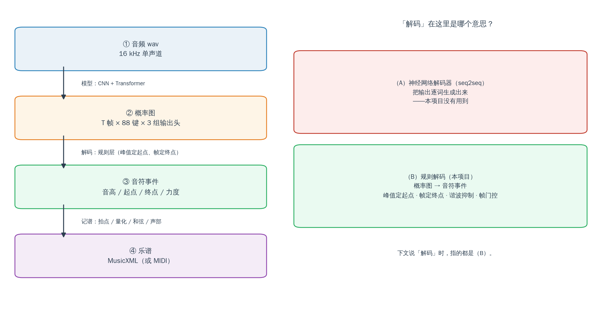
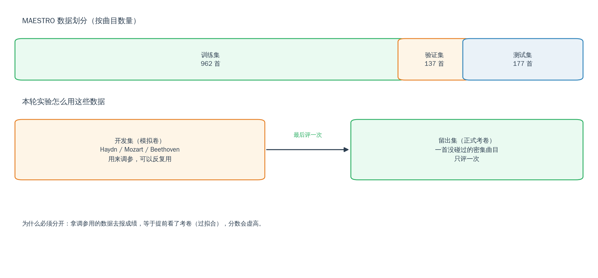
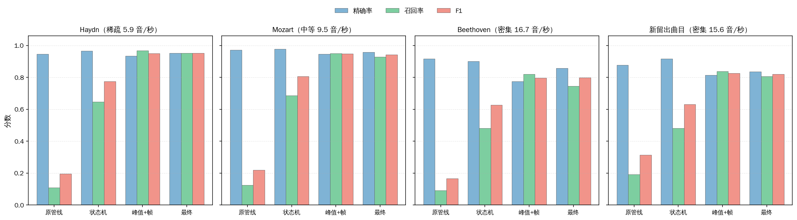
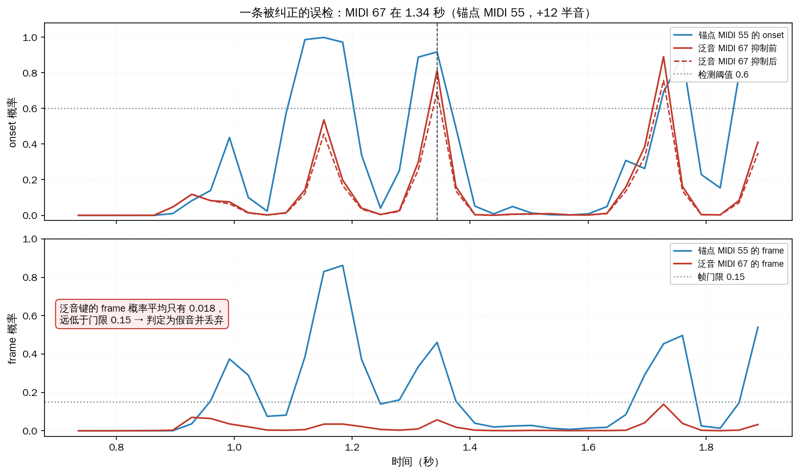
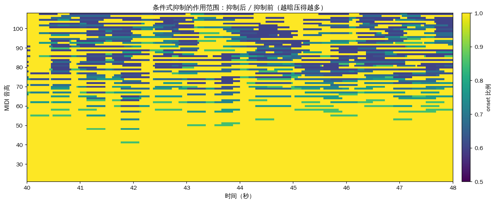

# 05 术语与问答：GT、解码、谐波抑制，以及"多音 vs 漏音"

日期：2026-11-01
这是给学员看的解释文档。技术细节见 `04_m0_results.md`，数字见 `../outputs/M0/report.md`。

---

## 1. GT 与「GT 直通」

**GT = Ground Truth，标准答案。**
在钢琴转录任务里，标准答案就是 MAESTRO 数据集给每段录音配的 MIDI：它记录了"第几秒按了哪个键、按了多久、力度多大"，并且已经和音频对齐。模型要学的就是它。

**GT 直通 = 把标准答案当成模型的输出，直接送进后面的「音符 → 乐谱」环节。**
这样做可以绕过模型，单独检查记谱代码：如果连标准答案都排不出好谱，那问题一定在记谱，不在模型。相当于先拿一份正确的文件去试打印机。

M0 里做过这件事：GT 直通时旧记谱每首有 2000–4500 个休止符、2–3 个声部/小节；新记谱只剩 44–65 个休止符、1 个声部/小节。

---

## 2. 演示用的三首曲目（都是 MAESTRO test 集）

| 我叫它 | 实际曲目 | 时长 | 音符密度 |
|---|---|---|---|
| sparse（稀疏） | Haydn, Sonata in D Major, Hob. XVI:24 | 272 s | 5.9 音/秒 |
| medium（中等） | Mozart, Sonata in B-flat Major, K.333 第一乐章 | 299 s | 9.5 音/秒 |
| dense（密集） | Beethoven, Rondo, Op.129 | 338 s | 16.7 音/秒 |

「完美输入走新记谱」那张图就是 **Haydn 那首**（GT 直通、新记谱、第一页）。

---

## 3. 这次改了什么？答：模型没动，动的是测量、解码和记谱

**用的就是你自己训练出来的 `trained_data/checkpoints/model_best.pth`**，和 `piano_transcriber/checkpoints/model_best.pth` 的 SHA256 完全一样。没有重训，没有换权重。

变好的是三件事：

1. **评测**：先把"怎么打分"修对（oracle 自检 + 三种指标口径），才可能判断哪里坏了。
2. **解码**：发现谐波抑制在吃真音，M0 里把它关掉，并把状态机参数放宽（最短时值 192 ms → 64 ms 等）。
3. **记谱**：把"固定 120 BPM + 按键秒数当时值 + 每个音单独塞进去"改成"估拍点 → 量化 → 和弦化 → 按时值树切开 → 手动建小节"。

所以这次"调得好"的本质是：**把测量和工程修对了**，而不是让模型变强。模型的检测能力本来就在，只是一直被后处理浪费掉。

---

## 4. 解码层的三个名词

模型输出的不是音符，而是**概率图**：每 32 毫秒，对 88 个琴键各给一个 0–1 的数，表示"这个键此刻正在响/刚被敲的概率"。把概率图变成音符列表的规则层，就叫解码。

| 解码方式 | 做什么 | 比喻 | 用途 |
|---|---|---|---|
| 纯峰值检测 | 对每个琴键，在 onset 概率曲线上找"尖峰"，每个峰记一次击键，时值统一给固定值 | 只看心电图上的 R 波，不管波形之后怎么走 | 测模型检测能力的上限 |
| 状态机 | 用 onset 峰决定"开始"，用 frame 曲线决定"结束"（连续若干帧低于阈值才结束），再加最短音长、同音合并 | 有开关的追踪器：按下算开，松开算关 | 真正产出音符的方式 |
| 正式管线 | 状态机 + 两轮谐波抑制 | 追踪器外面再套一层"泛音降噪" | 项目原来的做法 |

M0 的对照结果：纯峰值 onset F1 0.95 / 0.95 / 0.80；状态机降到 0.74 / 0.75 / 0.56；正式管线只剩 0.21 / 0.29 / 0.23。**同一份概率，换解码器能差 70 个百分点。**

---

## 5. 谐波抑制是什么，为什么过猛

**物理背景**：钢琴一个音不只是那根弦在振。敲 C4，C5、G5、E5 等泛音也会跟着响。所以在模型的 onset 概率图上，真正被敲的键和它的泛音键可能同时亮。

**原代码的想法**：先用严格阈值找出一批高置信度的"锚点"真音，然后把每个锚点上方 12/19/24/28/31/34/36 个半音（八度、五度、三度……）的 onset 概率乘上一个小于 1 的衰减系数，让泛音位置不容易被误判成新音。

**问题有两层**：

1. **时间上全局**：它对整首曲子的所有帧生效。只要 C4 在全曲任何地方被确认过，C5 的 onset 概率在所有时刻都被乘 0.85。
2. **锚点之间连乘**：一个键可能同时是 6–7 个不同锚点的泛音位置，衰减系数被连乘起来：0.85 × 0.775 × 0.725 × 0.675 × 0.625 × 0.6 × 0.6 ≈ **0.07**。

结果：这个键的真实音符概率只剩 7%，过不了 0.4 的阈值 → 漏音。M0 里实测 51 个锚点，把 80–88% 的真音压没了。

修复方向（M0.5 要做的）：不跨锚点连乘、只在"该键的 frame 不支持"时衰减、或者干脆用"onset 与 frame 一致"的约束替代它。

---

## 6. 「多音」还是「漏音」？两个都出现过，但不是同一版本

| 现象 | 典型产物 | 原因 |
|---|---|---|
| 多音（假阳性） | 2026-03 的 `final_readable_score.musicxml`（32 音/秒，是 GT 的 3.8 倍） | 早期模型 + 早期解码 + 导出 bug |
| 漏音（假阴性） | 2026-05 的当前产物（nezha2 只有 118 个音） | 谐波抑制过猛 + 状态机最短时值 192 ms |

用渔网打比方：网眼小，捞得多但混着杂物（precision 低）；网眼大，干净但漏鱼（recall 低）。**多音和漏音是同一条绳的两端**，而这次的数据显示：现在这版是「网眼太大」——精确率 0.93–0.98 很高，召回率 0.12–0.17 崩了。

你之前的直觉"是多音了"没错，只是那是早期版本的病；现在的官方管线反过来，漏音成了主要矛盾。

---

## 7. 新谱还有什么不足（诚实的部分）

1. nezha2 新谱 400 个击键 / 144 秒 ≈ 2.8 音/秒，仍然偏稀疏。原因：状态机 recall 只有 0.6，加上这是域外音频（不是 MAESTRO 的录音条件）。
2. 新记谱是「一只手一条声部」的简化版，复杂织体会丢内声部，长音有时偏长。
3. 调号和速度是自动估的，个别曲目会有偏差（nezha2 这次估到 104 BPM、两个降号，听起来合理）。

M0.5 把解码器修好之后，这两项的观感会再上一个台阶。

---

## 8. 图解：上面这些词在图上是什么

这一节把前七节里的概念落到图上，配合正文重新看一遍会更清楚。

### 8.1 整条流水线：「解码」到底在哪一段

- 四段：① 音频 → ② 概率图 → ③ 音符事件 → ④ 乐谱。
- **解码**指 ②→③ 这一段：把概率图按规则变成音符事件，**不是神经网络里的 decoder（解码器）**。
- 下游的 ③→④ 叫**记谱**（notation），负责拍点、量化、声部、和弦、调号。
- GT 直通（ground truth，标准答案直通）就是从 ③ 开始，跳过 ①→②→③ 的模型和解码，只测 ③→④。
- 「解码」一词在机器学习里还有另一个意思——seq2seq 模型里逐词生成输出的神经网络 decoder。本项目**没有**那个东西（图下半部分用红框标出了这个区别）。

### 8.2 数据怎么分：开发集与留出集

- 上排是 MAESTRO 的原始划分：train（训练）962 首、validation（验证）137 首、test（测试）177 首。
- 下排是我们这轮实验的用法：**dev set（开发集，相当于模拟卷）** 用来调参（Haydn / Mozart / Beethoven）；**holdout（留出集，相当于正式考卷）** 另选一首没碰过的密集曲目，只在最后评一次。
- 原因：如果调参和最终评价用同一批数据，分数会虚高（等于提前看了考卷）。步骤 3 一开始就把 Beethoven 当留出集，于是调出来的参数系统性偏松，后来改成「Beethoven 进开发集 + 新曲目做留出集」，这就是调试日志里坑 14 的来龙去脉。

### 8.3 解码器改进：精确率、召回率、F1 怎么变了

- 横轴是四种解码器，每组的蓝 / 绿 / 红三根柱子分别是精确率、召回率、F1。
- 原管线：精确率高（0.92–0.98），但召回率只有 0.09–0.12——几乎什么都不报。
- 状态机调参：召回回到 0.48–0.69，F1 到 0.63–0.81。
- 峰值+帧：F1 顶到天花板，但密集曲目精确率掉到 0.78。
- 最终版（条件式谐波抑制 + 帧一致性门控）：召回保持，密集曲目精确率回到 0.86。

### 8.4 一条误检是怎么被去掉的

- 上图：真音 MIDI 55 的八度泛音 MIDI 67 被模型点亮到约 0.8（超过阈值 0.6），会被误报成新音；条件式抑制把它压低一点（虚线），但还没跌破阈值。
- 下图：MIDI 67 的 frame（逐帧发声）概率只有约 0.02，远低于门限 0.15——它并没有在持续发声。**帧一致性门控**因此把这条误检丢掉。
- 一句话：抑制负责削弱，门控负责最终判定。

### 8.5 抑制的作用是局部的

横轴时间、纵轴音高，颜色是「抑制后 / 抑制前」的 onset 比例，越暗压得越多。深色条纹只出现在特定音高的特定时段——原实现是整首曲子全局一刀切，这张图说明现在是局部的。

### 8.6 谱面：修复前与修复后

上图是旧管线在 nezha2 上的产物（右手第一行全空、连音线糊成一片、左右手小节数不一致）；下图是最终版（两行正常、小节对齐、有调号和速度标记）。对照看能直观感到「结构对了」比「音符多了」更重要。

