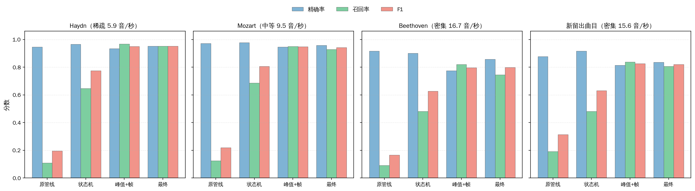
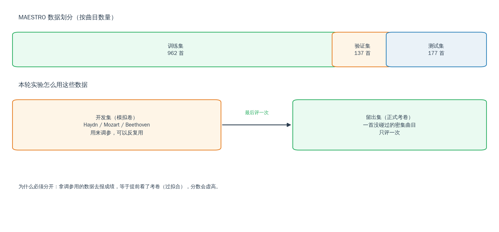

# 07 调试日志：这一轮踩过的坑

日期：2026-11-01
用途：把「发现问题的过程」留下来当教材。每条按「症状 → 假设 → 实验 → 结论」记录，包括我（教练）判断错的地方。

---

## 坑 1：审计用的 MusicXML 解析器把和弦时值重复计算

- **症状**：解析出来的小节长 4.25 拍，而谱面明明是 4/4。
- **假设**：music21 写坏了？还是解析器读错了？
- **实验**：直接数 XML 里每个 `<note>` 的 `duration` 之和 → 每小节正好 4 拍；再看解析器代码，发现 `pos += dur` 对 `<chord/>` 的成员也执行了。
- **结论**：解析器 bug（和弦音共享起点，不应再推进时间轴）。修复后所有谱面指标才可信。
- **教训**：测量工具本身也要被测量。

## 坑 2：渲染出来是纯白图

- **症状**：PNG 生成成功、尺寸正常，但整张图是白的。
- **假设**：verovio 没解析出内容？还是栅格化失败？
- **实验**：检查 SVG 里 `<path>` 有 325 个（有内容）；用 PyMuPDF 打开 SVG 后像素均值 255（全白）。
- **结论**：verovio 的 SVG 依赖 `<style>` 里的 CSS class，PyMuPDF 的 SVG 解析不认 CSS，所以什么都不画。换成 rsvg-convert（librsvg）后正常。
- **教训**：文件"生成成功"不等于"内容正确"，要检查像素。

## 坑 3：谱面左上角出现巨大的 "A5"

- **症状**：渲染图里有一个比谱表还大的乱码字形。
- **假设**：字体缺失？
- **实验**：遍历 SVG 里的 `<tspan>`，发现一个私有区字符 `\ueca5`（SMuFL 的音符符号），字号 720；它来自速度记号里的"四分音符"图标。
- **结论**：rsvg 不加载 SVG 内嵌的 Leipzig 音乐字体，私有区字符被当普通文本渲染，尺寸失控。预览时把这些私有区字符删掉即可。
- **教训**：音乐符号字体（SMuFL）和普通文本字体是两套东西。

## 坑 4：文字大小失控（谱号、拍号、速度全被放大）

- **症状**：音符大小正常，但所有文字元素被放大几倍。
- **假设**：verovio 的缩放参数冲突。
- **实验**：把 `svgViewBox` 选项去掉后恢复正常。
- **结论**：同时打开 `svgViewBox` 与 `adjustPageHeight` 会让文本坐标系和路径坐标系不一致。
- **教训**：渲染库的选项之间存在耦合，改一个要重看全图。

## 坑 5：误判"三行谱"

- **症状**：渲染图看起来一页有三行五线谱，但 XML 里明明只有两个 part。
- **假设**：music21 写坏了？verovio 出错？
- **实验**：做 A/B/C 三个极简对照（有两行谱 / 加 StaffGroup / 加速度记号），数 SVG 里的 staff 元素与标签文本。发现多出来的那个"Piano"标签是 StaffGroup 的乐器名，画在两行谱中间的左侧，缩略图里看着像第三行。
- **结论**：不是 bug，是乐器名标签的位置造成的视错觉。顺手把两个 part 的 partName 置空，只保留 StaffGroup 的名字。
- **教训**：看缩略图容易误判，要放大或直接数结构。

## 坑 6（最重要）：我自己的错误结论——"模型欠训练是主因"

- **症状**：产物音符稀疏（nezha2 只有 118 个音），我据此推断"模型欠训练"。
- **假设**：6200 步太少，模型没学会。
- **实验**：同一份模型概率，换三种解码方式比 onset F1。纯峰值 0.95/0.95/0.80，状态机 0.74/0.75/0.56，正式管线 0.21/0.29/0.23。
- **结论**：模型检测能力接近论文水平；产品稀疏的主因是谐波抑制（召回掉到 0.12–0.17）。**我上一份报告里的归因是错的，已更正。**
- **教训**：只有"产物稀疏"这一手证据时，不能推出"模型不行"；要用对照实验把每一层的损失单独量出来。

## 坑 7：稀疏解码让谱面时长缩短 18.8%

- **症状**：旧解码（118 个音）配新记谱，谱面总时长 117.5 秒，音频 144.6 秒。
- **假设**：速度估计错了？
- **实验**：换回 407 个音的解码后误差变成 -4.4%。说明速度估计没问题，是"最后一个检测到的音"结束得太早，记谱层按它算总长。
- **结论**：记谱层应该用音频总时长做兜底，而不是用最后一个音符。记入 M0.5 待修清单。
- **教训**：下游模块不应该假设上游一定完整。

## 坑 8：小事故——忘了 import 常量

- **症状**：脚本跑到一半 `NameError: HOP_LENGTH is not defined`。
- **结论**：改代码时把常量从模块里删了但没同步 import。
- **教训**：小步提交、每步跑一次，比一次改一大片更容易定位。

---

## 坑 9：我预测 F1 会落在 0.80–0.88，实际 0.79

- **症状**：参数网格搜索的最优均值 F1 = 0.790，落在永新猜的 0.74–0.80 区间，而不是我猜的 0.80–0.88。
- **假设错在哪**：我把「参数」当成了主要杠杆，以为只要网格够密就能往天花板靠。
- **实验**：把每个参数逐个放开做消融，发现多数参数完全无效，全部放开也只到 0.82/0.87。
- **结论**：真正的限制是状态机的**结构**（起点和音尾耦合），参数空间里根本没有能突破它的开关。
- **教训**：调参前先确认「模型结构允许的上下限」，否则网格再密也是在错误的空间里搜。

（图：坑 9 的现场。横轴是四种解码器，三根柱子分别是精确率（蓝）、召回率（绿）、F1（红）。看图就能明白为什么「调参」到不了天花板——状态机不管怎么调，F1 都到不了「峰值+帧」的位置。）

## 坑 10：探针脚本的时间单位写错，参照组 F1 = 0

- **症状**：消融脚本里「纯峰值检测」参照组 P=0、R=0、F1=0，而同一逻辑在主脚本里是 0.95。
- **假设**：mir_eval 参数不对？还是数据没对齐？
- **实验**：检查代码，发现把帧号转时间写成了 `t = frame * 帧率`（31.25），正确应该是 `t = frame / 帧率`。时间被放大 976 倍，自然全部对不上。
- **结论**：低级单位错误。
- **教训**：任何「参照组应该满分或接近满分」的实验，先验证参照组。参照组崩了，先怀疑自己的代码。

## 坑 11：猜错了「prominence 是召回杀手」

- **症状**：状态机召回只有 0.65，而纯峰值是 0.97；我怀疑是 prominence 参数把密集段落里的峰滤掉了。
- **实验**：把 prominence 从 0.005 扫到 0.06，结果**完全相同**（每一行数字一模一样）。
- **结论**：高度阈值已经把峰筛得足够干净，prominence 在这批数据上不是约束。
- **教训**：参数敏感性要用实验测，不能靠因果推理。一个参数看起来该有影响，不代表真的有。

## 坑 12：两个参数互相遮蔽，怎么调都没反应

- **症状**：`min_reattack_gap` 从 0.08 改到 0.15，指标一位小数都不变。
- **实验**：把 `peak_distance` 从 5 帧改成 1 帧后，发现同键峰距本来就被限制在 160 ms 以上，再设 80 ms 或 150 ms 的最小重击间隔都属于冗余约束。
- **结论**：参数之间存在遮蔽关系，单独扫描会得到「无效」的假象。
- **教训**：网格搜索要同时看参数的联合分布，不能只看边际效应。

---

## 坑 13：重写模块时丢了常量，跑出 NameError

- **症状**：步骤 3 的条件式抑制一开跑就崩，`NameError: HARMONIC_OFFSETS is not defined`。
- **原因**：重写 `decode_v2.py` 时只 import 了函数，忘了把泛音偏移表 `HARMONIC_OFFSETS` 一起 import。
- **教训**：重写模块后先跑一个小样本冒烟测试，再跑长实验。

## 坑 14：用错了 holdout（方法学错误）

- **症状**：步骤 3 第一版把 Beethoven 当 holdout，但网格按稀疏/中等曲目调参，导致密集曲目的 precision 只有 0.821；而在 holdout 上继续调参又等于泄漏。
- **修正**：把 Beethoven 改成开发集（它正是要调的密度区间），另选一首全新密集曲目 holdout2，只评一次。
- **教训**：holdout 的密度/难度分布必须和调参目标一致，否则调出来的参数在 holdout 上系统性偏松。

（图：坑 14 的概念图。左边橙色是开发集（模拟卷，可以反复做），右边绿色是留出集（正式考卷，只能交一次）。）

## 坑 15：速度定义不一致，谱面时长偏差 4.4%

- **症状**：修了「总时长用音频兜底」之后，nezha2 的谱面时长仍比音频短 4.4%。
- **实验**：对比 beat_track 报告的速度与实测拍点间隔，发现两者不一致；而且第一个拍点之前的引导时间被丢掉了。
- **结论**：速度标签和拍点位置必须来自同一套定义，并把 t=0 对齐到位置 0。
- **结果**：偏差从 -18.8% → -2.83%（仍略超 2% 目标）。
- **教训**：时间轴的「起点」和「单位」是两件事，两件都要对齐。

