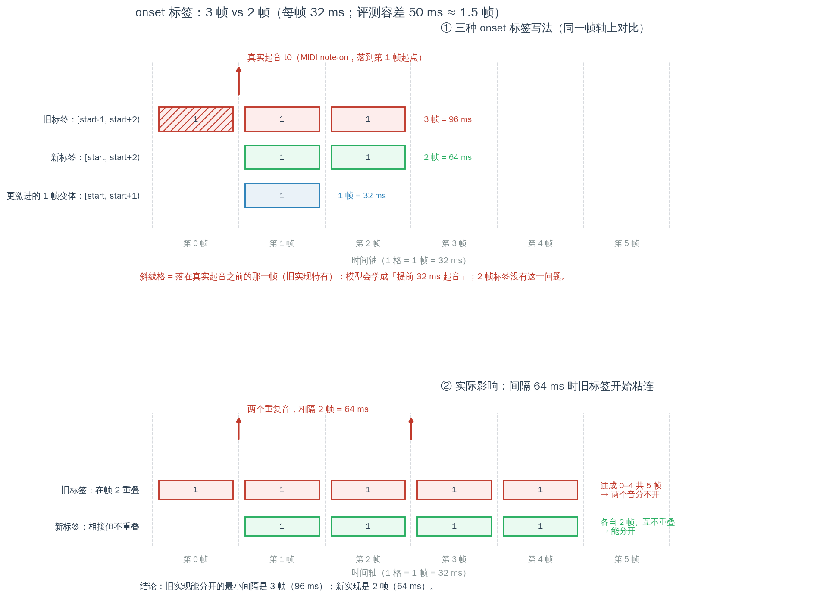

# 08 训练前门禁：检查结果与训练就绪清单

日期：2026-11-02
代码：`m0/preflight.py`（一条命令可复现）
产物：`outputs/M0/preflight_report.json`、`outputs/M0/preflight_summary.md`、
`outputs/M0/registry/EXP-000_baseline.json`

## 摘要

本文记录 M1 训练前的自动化门禁检查：8 项检查各自看什么、当时的 PASS/WARN/FAIL 结果、每个数字怎么算出来，以及为什么在已知数据问题修完前不宜上云长期训练。读者不需要了解检查脚本的实现；读完后能看懂各检查项的含义与当时的阻塞点。

---

## 2. 预算：比想象中便宜

G7 实测（4060，合成数据，沿用现有 3 头模型作代理）：

| 项目 | 数值 |
|---|---|
| 单步耗时 | 0.082 s（batch 16 × 313 帧 = 5 秒音频的 16 倍） |
| 峰值显存 | 1.63 GB（8 GB 卡余量充足，可以加大 batch 或模型） |
| 训练量估算 | 159.24 小时音频按 10 秒一段 → 57,327 段；batch 16 → 3,583 步/轮；20 轮 ≈ **71,658 步** |
| 预计时长 | 4060 上约 **1.6 小时**；4090 上约 **0.7 小时**（按 2.5 倍加速假设，未实测） |

结论：**云端预算很低，可以承受多组对照实验**（例如不同标签口径、不同学习率），不必担心烧钱。这改变了之前的策略判断：训练本身不贵，贵的是「数据没修好就训练」造成的浪费。

---

## 3. 上云前必须补的缺口

### 3.1 数据侧（M1 的核心）

| 缺口 | 现状 | 修法 |
|---|---|---|
| onset 标签宽 3 帧 | `[start-1, start+2)`，均值 3.04 帧 | 改成 `[start, start+2)` 两帧 |
| frame 标签含踏板延音 | 正样本率 5.35%，发声时长中位约 466 ms，而按键中位仅约 218 ms | 二选一：A 保留含踏板 frame + 增加踏板输出头；B 改成去踏板 frame + 踏板头。**建议 A**（改动小，与现有乘积一致） |
| 采样效率 | 旧方案每轮每首只随机截 65 秒，且每步解压整首 npz | 预切 10 秒段索引，按段采样 |
| 短曲填充 | 用 `np.pad(..., 0)` 在 dB 域补 0（等于最响） | 改成补 -80 dB |
| 验证集窗口随机 | 每轮看到的验证帧不同，val loss 不可比 | 固定验证窗口 |
| 没有数据版本清单 | 改了数据无法追溯 | 生成 `data_manifest.json`（文件名 + sha256 + 标签口径版本） |

**onset 标签的 3 帧 vs 2 帧**（每帧 32 ms，评测容差 50 ms ≈ 1.5 帧）：



- 旧实现 `s = start-1, e = start+2` 标记 3 帧，其中 `start-1` 落在真实起音之前，模型会学成提前 32 ms；
- 新实现 `[start, start+2)` 标记 2 帧，最坏时间误差 +32 ms，仍在 50 ms 容差内；
- **「粘连」只对同一琴键的重复音成立**：onset 标签是 (时间 × 88 键) 的矩阵，不同音高在不同列，标签不会重叠；
- 同键重复的两个阈值（同一帧被两个音同时标为 1 = 重叠；中间出现 0 帧 = 可分辨的间隙）：

| 写法 | 开始重叠的间隔 | 出现 1 帧间隙的间隔 |
|---|---|---|
| 旧（3 帧，含 start-1） | ≤ 64 ms | ≥ 128 ms |
| 新（2 帧） | ≤ 32 ms | ≥ 96 ms |

**时间尺度对照**（1 帧 = 32 ms；120 BPM 时 16 分音符 = 125 ms、32 分音符 = 62.5 ms）：

| 间隔 | 每秒音符数 | 类比 | 现实演奏 |
|---|---|---|---|
| 32 ms | 31 | 120 BPM 的 64 分音符 | 同键做不到，超出人手极限 |
| 64 ms | 15.6 | 120 BPM 的 32 分音符 | 极快的同键反复/颤音，接近专业极限 |
| 96 ms | 10.4 | 78 BPM 的 32 分音符 | 快速同键反复，古典曲目常见 |
| 125 ms | 8 | 120 BPM 的 16 分音符 | 常见快速段落 |

因此这项修改的预期收益要保守：**计时偏差和标签一致性会改善，onset F1 预计只有小幅提升**；M1 会用 3 帧 / 2 帧 / 1 帧三组做对照实验，用数字决定。

### 3.2 训练脚本（M1 的另一半）

- AdamW + cosine 调度 + 前 1000 步预热（warmup）；梯度裁剪（gradient clipping）1.0；
- 分头记录 loss（onset / frame / velocity / pedal），而不是只记总和；
- 按验证集 onset F1 选模型（不是按 val loss）；
- 检查点（checkpoint）保存 optimizer/epoch/配置，可续训；
- 固定随机种子，并显式给 DataLoader worker 设种子（G8 遗留风险）；
- `--max-steps` 与 `--dry-run` 参数，支持小规模试跑（pilot run）。

### 3.3 训练侧流程

1. 数据 v2 生成 → 过 G1/G2/G3；
2. 本地 4060 跑 pilot：1000–2000 步，确认 loss 下降、验证 F1 上升、无 NaN、耗时符合 G7 估算；
3. 预注册（pre-registration）：写下假设与判据（例如 onset F1 提升 ≥0.05 才算有效）；
4. 上 4090 跑正式训练，按 G6 的基线对比。

---

## 4. 现在需要你提供什么

**不需要数据。** 原始 MAESTRO（1276 对 wav/midi）、处理后的 npz（962/137/177）、模型检查点都在本地，4060 容器在线，E 盘剩余 262 GB。

后续唯一可能需要你提供的是 **autoDL 平台的账号/实例**（在 M1 通过本地 pilot 之后才用到）。到时候我会先给出「要开什么规格的实例、跑什么命令、预计多少钱」。

---

## 5. 复现方式

```powershell
docker exec -w /Docker/git/piano_practice/m0 `
  -e PYTHONPATH=/Docker/git/piano_practice/m0:/Docker/git/piano_practice `
  piano python preflight.py
```

输出：控制台 PASS/FAIL 列表 + `outputs/M0/preflight_report.json` + `preflight_summary.md`。

---

## 6. 下一步

**M1：数据 v2 + 训练脚本 + 本地 pilot**（预计 1–1.5 天）。

- 数据 v2：改 onset 宽度、踏板口径、段索引、填充值、固定验证窗口、生成 manifest；
- 训练脚本：按 3.2 的要求重写；
- pilot：4060 上 1000–2000 步，产出 loss/F1 曲线与预算复核；
- 通过后再决定建新仓（新仓的触发条件见 `03_system_blueprint.md` 第 6 节）。

## 结论（存档，2026-11-02）

## 1. 结论

**当前状态：6 项 PASS、1 项 WARN、1 项 FAIL。**
唯一 FAIL 是已知的标签问题（onset 标签宽 3 帧，应为 2 帧）；另有三处已知缺口没有被自动化检查覆盖（踏板标签、短文件填充、数据版本清单）。**在这些修完之前不宜上云长期训练。**

> **M1 更新（2026-11-02）**：G1 的失败项已在数据 v2 中修复——onset2 标签实测均值 2.007 帧、99.6% 恰好 2 帧；同时补上了踏板标签、短曲填充修正、固定验证段与数据 manifest。详见 `09_m1_data_v2_and_pilot.md`。

| 检查项 | 状态 | 关键数字 |
|---|---|---|
| G1 数据完整性与标签统计 | **FAIL** | npz 数量正确（962/137/177）；onset 正样本率 1.03%、frame 5.35%；**onset 目标宽度均值 3.04 帧（98.6% 是 3 帧）**，标准是 2 帧 |
| G2 划分无泄漏 | WARN | 文件级重复 0；跨 split 的同作品 5 个（0.6%，MAESTRO 固有） |
| G3 训练/推理特征一致性 | PASS | 两首曲目重算 CQT 与 npz 完全一致：帧数 2099/2099、3036/3036，相关系数 1.000000，平均绝对差 0.0 |
| G4 评测 oracle 自检 | PASS | GT 当预测 F1=1.000；+32 ms=1.000；+64 ms=0.082；打乱音高=0.193 |
| G5 解码器达到天花板 | PASS | Haydn 0.952、Mozart 0.943、Beethoven 0.798、新留出 0.821（天花板 0.950/0.949/0.797/0.825） |
| G6 基线指标登记 | PASS | 已写入 registry；模型 sha256 = `4f43ca73…`，大小 78,626,869 字节 |
| G7 资源与预算 | PASS | 可行配置 batch=16、seq=313 帧：**每步 0.082 s、峰值显存 1.63 GB** |
| G8 可复现性 | PASS | 重复解码结果一致；DataLoader 顺序在固定种子下可复现 |

---
