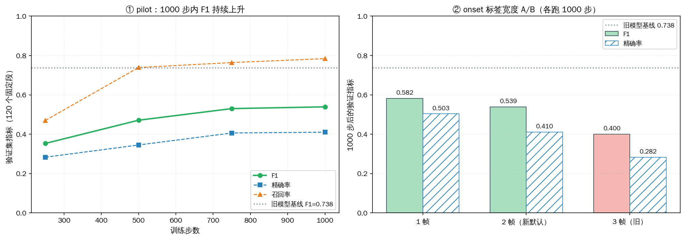

# 09 M1 结果：数据 v2 + 训练脚本 + 本地 pilot

日期：2026-11-02
代码：`m1/`（`build_data_v2.py`、`dataset_v2.py`、`model_v2.py`、`train_v2.py`）
产物：`outputs/M1/`（manifest、日志、检查点、summary、标签检查）

## 摘要

本文记录 M1 阶段的三件事：数据 v2 重建、训练脚本 v2、本地 pilot 训练结果，以及 pilot 通过后为什么可以进入下一阶段。读者不需要读过 M0 的文档；读完后能知道 v2 数据修了什么、pilot 的数字说明什么、还有哪些预期内的不足。

---

## 2. 数据 v2

| 项目 | 数值 |
|---|---|
| 存储 | 33.12 GB（CQT 用 `.npy` 存，便于 memmap 随机切片） |
| 分段 | 10 秒 = 313 帧；train 56,922 / validation 6,935 / test 7,128 段 |
| 标签通道 | frame、onset1、onset2（默认）、onset3、velocity、pedal |
| 标签正样本率 | frame 5.95% / onset1 0.35% / onset2 0.70% / onset3 1.05% / pedal 60.5% |
| 标签宽度自检 | onset2 均值 **2.007 帧**（99.6% 恰好 2 帧）；onset3 均值 3.036 帧（98.7% 恰好 3 帧）；onset3 比 onset2 多出的帧数 ≈ onset2 正样本数的 0.498 倍（正是「提前一帧」的量） |
| manifest | `outputs/M1/data_manifest.json`（配置、拆分、统计、脚本指纹） |

设计取舍：

- **CQT 用 `.npy` 而不是压缩 npz**：训练时用 memmap 随机切片，不用每步解压整首歌（旧管线约 9 倍无效 I/O）；
- **frame 标签保留踏板延音**（方案 A），另外生成 pedal 通道给踏板头学；
- **标签与 CQT 分离**：CQT 是从已通过 G3 特征一致性检查的 v1 npz 复制来的，没有重算，节省 100 秒整。

## 3. 训练脚本 v2

- 五头模型：CNN（`MaxPool(1,3)`，264→88 与琴键对齐）+ 4 层 Transformer（pre-LN）+ 5 个输出头；
- 输入归一化在 Dataset 里做（dB [-80,0] → [0,1]），不再直接喂 dB 值；
- AdamW + warmup 300 步 + cosine 衰减；梯度裁剪 1.0；AMP；
- 每 250 步在 120 个固定验证段上算 onset F1，按 F1 存 best；
- 检查点保存 model/optimizer/step/config，可续训；
- 每个 head 的 loss 分别记 CSV。

## 4. pilot 结果

| 步数 | 精确率 | 召回率 | F1 |
|---|---|---|---|
| 250 | 0.283 | 0.470 | 0.353 |
| 500 | 0.345 | 0.739 | 0.471 |
| 750 | 0.406 | 0.764 | 0.530 |
| **1000** | **0.410** | **0.784** | **0.539** |

- 每步 0.083 秒（与 G7 实测 0.082 秒一致），1000 步 85 秒；
- F1 仍在上升，未饱和；
- 旧模型（3 头、旧标签、6200 步）在同样 120 个验证段上的基线是 **F1=0.738**（P=0.705、R=0.774），仍高于 pilot。这是预期内的：pilot 只用了计划训练量的 1.4%。

## 5. onset 标签宽度 A/B（各 1000 步）

| 标签 | F1 | 精确率 | 召回率 |
|---|---|---|---|
| 1 帧 | **0.582** | 0.503 | 0.689 |
| 2 帧（新默认） | 0.539 | 0.410 | 0.784 |
| 3 帧（旧） | 0.400 | 0.282 | 0.685 |

初步结论：**3 帧（旧写法）明显最差**，主要被精确率拖累（平台太宽，假阳性多）。1 帧略好于 2 帧，但差距（0.043）在单种子、1000 步的噪声范围内，不足以定论。

后续要做的（在正式训练阶段）：每种标签跑 3 个种子 × 更长步数再比较；目前仍以 2 帧为默认（对帧量化/对齐更稳健）。

## 6. 预算复核

- 计划：56,922 段/轮 ÷ batch 16 ≈ 3,558 步/轮 × 20 轮 ≈ 71,160 步；
- 实测 0.083 秒/步 → 4060 上约 1.65 小时；4090 按 2.5 倍加速假设约 0.66 小时；
- 结论不变：云端预算很低，主要成本仍是「数据是否正确」，这部分已在 M1 解决。

## 7. 已知限制

1. A/B 只跑了 1000 步、单种子，结论只能当趋势；
2. pilot 的验证解码用的是最简单的峰值阈值（0.5），没有调过 —— 绝对 F1 会偏低；
3. “旧模型基线”是在新验证段上重新推理解的，不算严格同条件对比（旧模型输入未归一化）；
4. 踏板头刚刚加入，pilot 里还没有评估踏板指标（下一阶段补）。

## 8. 复现

```powershell
# 1. 构建数据 v2（约 2 分钟）
docker exec -w /Docker/git/piano_practice/m1 `
  -e PYTHONPATH=/Docker/git/piano_practice/m1 piano python build_data_v2.py --workers 8

# 2. 标签宽度自检
docker exec -w /Docker/git/piano_practice/m1 piano python check_labels.py

# 3. 小规模试跑（约 90 秒）
docker exec -w /Docker/git/piano_practice/m1 `
  -e PYTHONPATH=/Docker/git/piano_practice/m0:/Docker/git/piano_practice/m1 `
  piano python train_v2.py --max-steps 1000 --batch 16 --val-every 250 --val-segments 120

# 4. 旧模型基线
docker exec -w /Docker/git/piano_practice/m1 `
  -e PYTHONPATH=/Docker/git/piano_practice/m0:/Docker/git/piano_practice/m1 `
  piano python eval_old_model.py
```

## 9. 下一步

新仓的触发条件（见 `03_system_blueprint.md` 第 6 节）：

| 触发条件 | 现状 |
|---|---|
| 数据 v2 冻结（onset/踏板/段索引/填充/manifest） | **完成** |
| 训练脚本本地 pilot 通过 | **完成** |
| 解码 v2 定型 | 完成（M0.5） |
| 记谱 v1.1 定型 | 基本完成（时长误差 -2.83%，略超 2% 目标） |
| 评测协议冻结 | 完成（M0） |
| 文档模板齐 | 完成（术语表、调试日志、实验登记） |

→ 可以建新仓。**M2：一次性搭最终版仓库骨架并迁移已验证代码**；随后 M3 在 4090 上做全量训练（含 3 种子 A/B）。

## 结论（存档，2026-11-02）

## 1. 结论

M1 三件事都跑通了：

1. **数据 v2 重建完成**：33.12 GB，1276 首全部重建；onset 标签已修正为 2 帧（实测均值 2.007 帧、99.6% 恰好 2 帧），并保留 1 帧 / 3 帧变体供对照；
2. **训练脚本 v2**：五头模型（onset / frame / velocity / pedal / pedal_on），memmap 按段采样，固定验证集，按 F1 选模型，支持 `--max-steps` / `--dry-run` / `--resume`；
3. **本地 pilot（1000 步，4060，85 秒）**：验证集 onset F1 从 0.353 持续升到 **0.539**（召回 0.784），每步 0.083 秒，与 G7 预算估算一致。

pilot 通过，可以进入下一阶段（建新仓 + 全量训练）。**但要注意：1000 步只是计划训练量（约 7.2 万步）的 1.4%，还没有超过旧模型基线 0.738，这是预期内的。**



---
