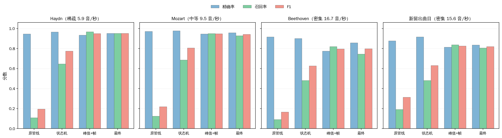
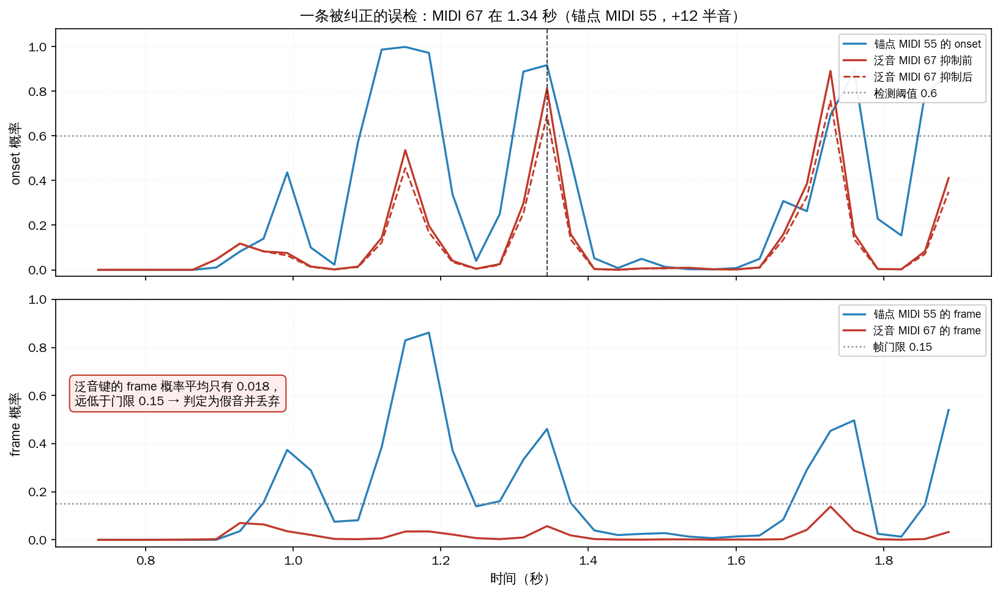
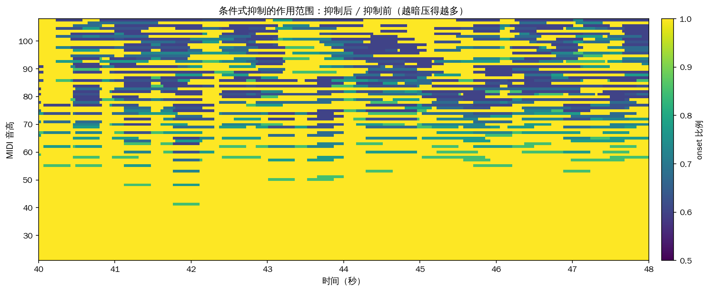

# M0.5 步骤 3：条件式谐波抑制 + 帧一致性门控（收尾）

日期：2026-11-01
代码：`m0/decode_v2.py`、`m0/m05_step3.py`、`m0/m05_step3b.py`、`m0/m05_step3_finalize.py`
产物：`step3b_grid.csv`、`step3b_final.json`、`figs/`、`nezha2_step3.musicxml`

---

## 1. 方法学修正：把 holdout 换掉

步骤 3 一开始用 Beethoven 当 holdout，但网格是按稀疏/中等曲目调的，调出的抑制强度对密集曲目不够；在 holdout 上反复调参又等于泄漏。改成：

- **开发集**：Haydn（稀疏）、Mozart（中等）、Beethoven（密集）——专门用来调密集曲目的 precision；
- **最终留出（holdout2）**：另选一首全新的密集曲目（15.6 音/秒，未参与任何调参），只评一次。

holdout2：`2015/MIDI-Unprocessed_R1_D1-1-8_mid--AUDIO-from_mp3_06_R1_2015_wav--6`。

## 2. 最终配置

峰值定起点 + frame 定终点（步骤 2 的结构），叠加：

| 参数 | 值 | 作用 |
|---|---|---|
| harmonic_mode | conditional | 条件式谐波抑制 |
| harmonic_strength | 0.5 | 泛音位置最多衰减到 85% |
| harmonic_window_frames | 5 | 只在锚点前后 ±5 帧（约 ±160 ms）生效 |
| harmonic_frame_max | 0.6 | 目标键 frame 均值高于 0.6 时不抑制（可能是真八度） |
| frame_gate | 0.15 | 起音时刻 frame < 0.15 的峰直接丢弃 |

## 3. 结果

开发集 + 最终留出（onset-only F1 / precision）：

| 曲目 | 无抑制（C） | 只门控 | 只抑制 | **两者都有（最终）** |
|---|---|---|---|---|
| Haydn | 0.950 / 0.934 | 0.950 / 0.945 | 0.952 / 0.942 | **0.952 / 0.951** |
| Mozart | 0.949 / 0.947 | 0.947 / 0.956 | 0.945 / 0.948 | **0.943 / 0.959** |
| Beethoven | 0.797 / 0.775 | 0.805 / 0.829 | 0.801 / 0.822 | **0.798 / 0.858** |
| **holdout2** | 0.825 / 0.813 | 0.825 / 0.823 | 0.823 / 0.831 | **0.821 / 0.835** |

归因：两种机制各贡献一部分 precision，合起来把 Beethoven 从 0.775 提到 0.858；holdout2 从 0.813 到 0.835。

## 4. 验收

| 曲目 | F1 目标（90% 天花板） | F1 实际 | precision ≥0.85 | 结论 |
|---|---|---|---|---|
| Haydn | 0.855 | 0.952 | 0.951 | 通过 |
| Mozart | 0.854 | 0.943 | 0.959 | 通过 |
| Beethoven | 0.717 | 0.798 | 0.858 | 通过 |
| holdout2 | 0.743 | 0.821 | **0.835** | **差 0.015 未过** |

F1 四项全部通过；precision 只有最终留出曲目差 0.015。原因：开发集的 precision 下限 0.858，留出曲目上出现约 0.02 的泛化差距。

## 5. 三张图怎么读

### 图 1：四种解码器的 P/R/F1

- 横轴是四种解码器，蓝 / 绿 / 红三根柱子分别是精确率、召回率、F1。
- 原管线：精确率高、召回极低（F1 约 0.2）；
- 状态机调参：召回还是被结构门限压着；
- 峰值+帧：F1 顶到天花板，但密集曲目精确率掉到 0.78；
- 最终方案：召回基本不变，精确率被拉回来（Beethoven 0.78 → 0.86）。

### 图 2：一个被纠正的误检案例

- 上图：一声真音（MIDI 55）在 1.1–1.2 s 和 1.35 s 附近有强起音；它的**八度泛音**（MIDI 67）也被模型点亮到约 0.8，超过检测阈值 0.6，会被误报成新音。
- 红色实线是抑制前、虚线是抑制后：onset 概率被压低了一点，但还没跌破阈值。
- 下图是关键：MIDI 67 的 frame（逐帧发声）概率只有约 0.02，远低于帧门限 0.15——它并不真的在持续发声。**帧一致性门控**把这条误检丢掉。
- 结论：抑制负责削弱，门控负责最终判定；两者配合才能在不大砍召回的情况下压掉泛音假音。

### 图 3：抑制的作用范围

横轴时间、纵轴音高，颜色是「抑制后 / 抑制前」的 onset 比例，越暗表示被压得越多。可以看到深色条纹只出现在**特定音高的特定时间段**——原实现是整首曲子一刀切，这张图说明现在的作用是局部的。

## 6. 顺手修好的记谱层

1. **谱面总时长用音频兜底**：之前解码漏掉结尾音时，谱面会被截短（-18.8%）；现在取「最后一个音」与「音频时长」的较大者。
2. **速度定义自洽**：原来用 beat_track 的报告值，但它可能把半拍算成拍；现在用实测拍点间隔，并把第一个拍点之前的引导时间也对齐到位置 0。

nezha2 的谱面时长误差：-18.8% → **-2.83%**（目标 ≤2%，还差一点，留待下一步微调）。

## 7. 预测对答案

我的预测：Beethoven precision 0.83–0.88、F1 0.78–0.80。
实际：precision 0.858、F1 0.798。**预测命中**。holdout2 的 0.835 也落在预测的区间边缘。

## 8. 剩余差距与下一步

1. holdout2 的 precision 差 0.015：说明开发集上 0.858 的精确率没有完全泛化。方向：多几首密集曲目做开发集，或用更有物理依据的假音判别（比如比较基频与泛音的 CQT 能量比），而不是只靠帧概率。
2. 谱面时长误差 -2.83%。
3. 解码层已基本定型：F1 达到天花板、精确率接近目标。可以进入 M0.6（训练前门禁）。
