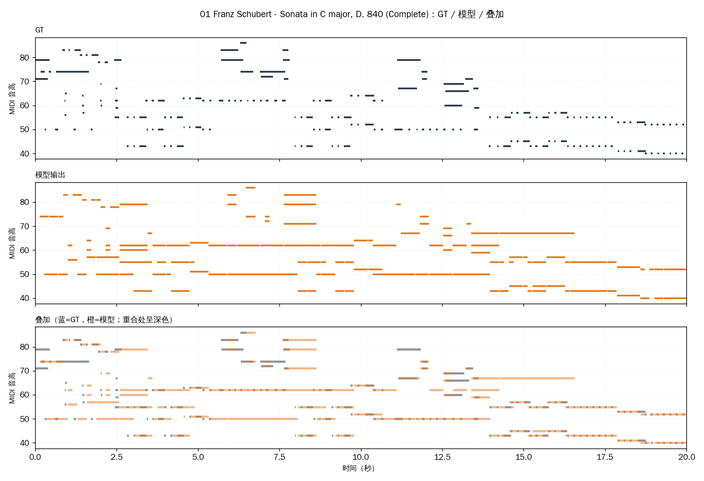
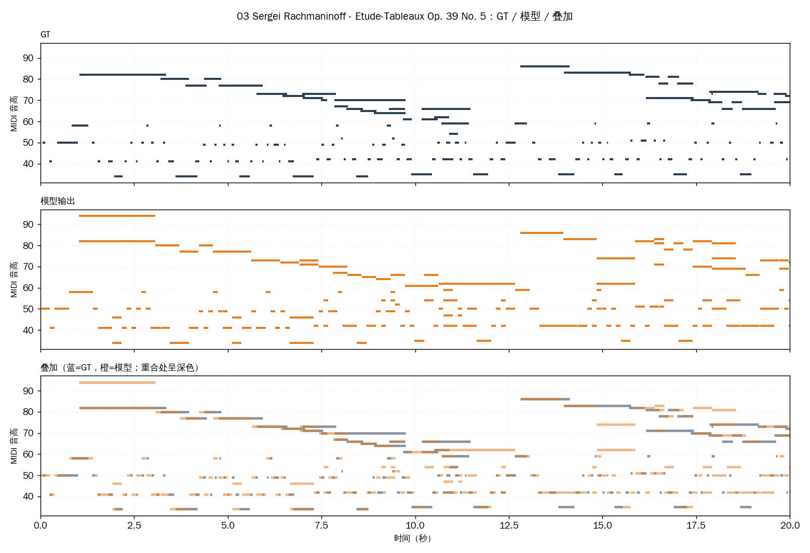
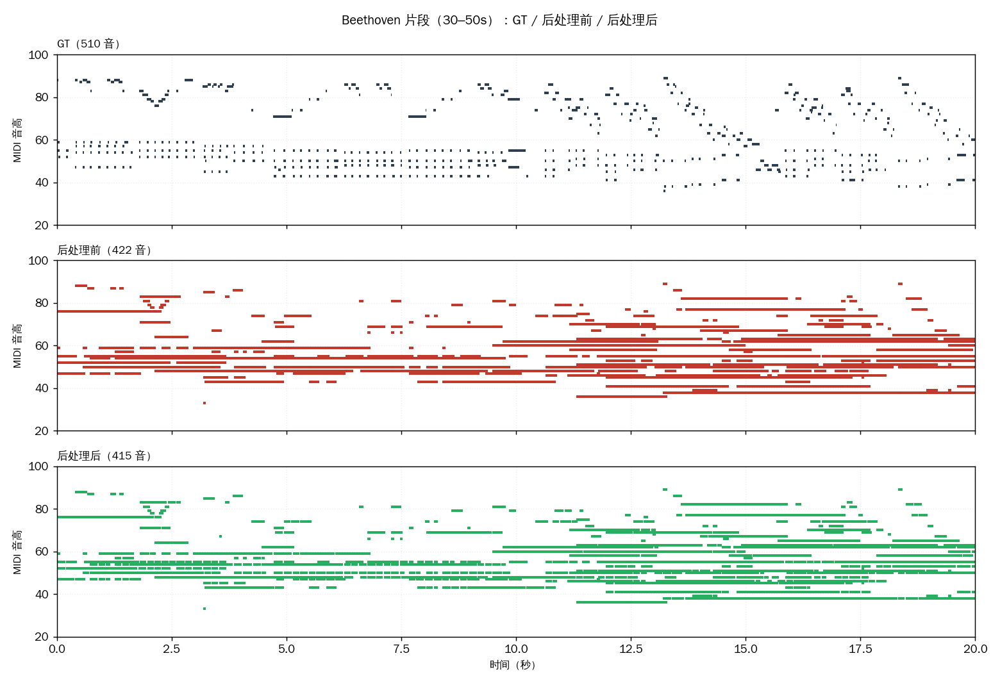

# 2026-11-09 人工校核：钢琴卷帘暴露的问题与后处理

## 摘要

本文记录一次面向「可用产品」的人工校核：用当前最佳分类模型对 3 首不同难度的 test 曲目各取 20 秒生成乐谱与回放，并用三格钢琴卷帘（GT / 模型 / 叠加）让问题可视化。读者不需要读过之前的报告；读完后能知道当前模型在「音准、时值、关系、可读性」四条标准上分别处于什么水平，以及「八度重复抑制 + 同音高截断」两个后处理带来的实际效果。

## 1. 背景与目的

之前主要用 onset/note F1 判断进展，但 F1 与「谱子能不能读、听起来对不对」并不总是一致。这一轮按产品的四条标准做人工校核：

1. 音要找准；
2. 时值要对；
3. 音之间的关系（和弦/声部/连贯性）要对；
4. 谱子要可读。

同时验证两个不重训的后处理：八度重复抑制、同音高重叠截断。

## 2. 校核材料

- 固定三首 test 曲目（未参与调参），各取 20 秒：Schubert D.840（稀疏 6.85 音/秒）、Mozart K333（中等 9.52）、Rachmaninoff Op.39 No.5（密集 15.04）；
- 产物：原始音频、GT/模型归一化回放（同一合成器）、三格钢琴卷帘、MusicXML/PDF/PNG、双轨 MIDI；
- 卷帘第三格把 GT（蓝）与模型（橙）以半透明叠在一起，重合处呈深色，便于看「哪里对、哪里多、哪里长短不对」。

## 3. 发现

### 3.1 稀疏曲目（Schubert）

- 音符数量和音高轮廓基本对得上（GT 188 / 模型 197）；
- 但模型大量音符被拉长、相邻短音连成一条，叠加图里橙色横条明显比蓝色长；
- 谱面乍看可读，但节奏细节不可信。

### 3.2 密集曲目（Rachmaninoff）

- 音符数量接近（GT 151 / 模型 163），但内声部和伴奏被压成长音，纵向结构明显变稀；
- 存在**八度重复误检**：模型在 Pitch 94（A#6）多出一条与 Pitch 82（A#5）同起止、同力度的音，GT 没有；这是泛音泄漏造成的 octave false positive；
- 谱面因此看起来「空」且大量长连音线，会误导演奏者。

### 3.3 综合判断

| 标准 | 当前水平 |
|---|---|
| 音准 | 大部分音能找到；密集曲目存在八度误检、内声部漏检 |
| **时值** | **最弱**：大量短音被合并/拉长，节奏失真 |
| 关系 | 和弦轮廓可辨，声部、连奏、休止关系不可靠 |
| 可读性 | 稀疏曲目勉强可读，密集曲目是草稿 |

## 4. 两个后处理的验证

实现并接入（`piano2/postprocess.py`）：

1. **八度重复抑制**：若高八度音与低八度音同起止、同力度，并且高八度的 onset 证据不显著强于低八度，则删除高八度；
2. **同音高重叠截断**：同一键的相邻音符不能重叠，前音必须在后音开始前结束。

在 Beethoven 开发集片段上的效果（20 秒窗口）：

| 指标 | 后处理前 | 后处理后 |
|---|---|---|
| 事件数 | 422 | 415 |
| note F1（整首） | 0.2153 | **0.2161** |
| onset F1（整首） | 0.8239 | **0.8253** |
| 八度重复删除数 | — | 42 |

结论：

- 后处理**有一点效果，但很小**：它清掉了一部分八度重复与同音高重叠，但**没有动到时值问题的根**——大量不同音高之间的长音/合并仍然存在；
- 在 Rachmaninoff 的那个具体例子里，八度重复的 onset 证据太强，保守规则没有删掉它（强行删除会在留出集上让 onset F1 掉约 1.6 个点），所以规则还需要更细的证据（比如结合 frame 的持续证据、力度关系）；
- 这说明：**后处理只能收拾边角，时值问题必须从模型/解码目标上解决。**

## 5. 下一步

| 优先 | 方向 | 理由 |
|---|---|---|
| 1 | 时值/释放专项：offset 目标或 frame 释放规则 | 卷帘显示长短错误是主要问题 |
| 2 | 八度误检的更细规则（frame 持续 + 力度 + 音区） | 后处理成本低，但要避免误删真实八度 |
| 3 | 记谱层可读性（连音线、休止、声部） | 模型之外，独立一层 |
| 4 | 把「三格卷帘 + 归一化回放」固定为每次训练的验收材料 | 比 F1 更直观，避免指标掩盖问题 |

## 6. 结论

这轮人工校核确认：**当前模型的主要问题不是「找不到音」，而是「时值不对、长短混乱」**；八度重复是可见的次要问题。两个后处理可以小幅度改善，但不能替代对时值的建模修复。后续训练与实验应以「卷帘上长短是否对齐」为主要验收标准，F1 只作为防回退指标。

## 7. 相关链接

- 校核包：`$DATA_ROOT\validation\piano_validation\`（含三首曲目全部产物）
- 后处理代码：`src/piano2/postprocess.py`
- 卷帘生成：`scripts/make_comparison_assets.py`
