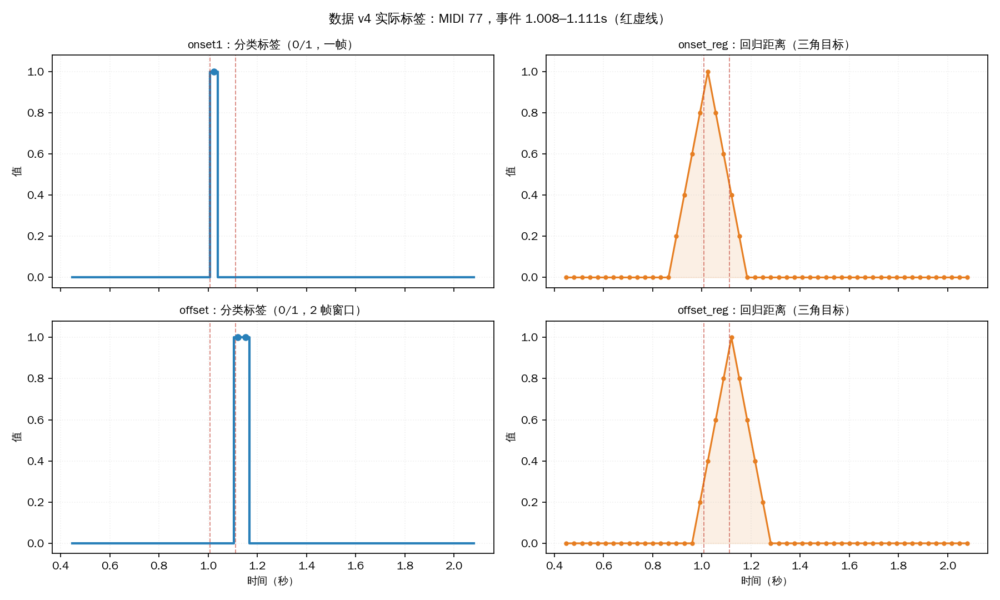
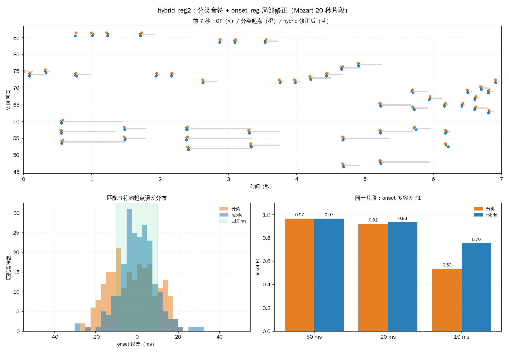

# 2026-11-11 offset 窗口对照与混合回归模型

## 摘要

本文记录两组时值专项训练：先比较「1 帧 offset + 高损失权重」和「2 帧 offset + 高损失权重」，确认窗口宽度仍是关键；再把 onset_reg 回归头接入分类模型的解码链路，训练 `hybrid_reg2`。读者不需要读过之前的报告；读完后能知道当前最佳模型的 note/onset 指标、10 ms 高分辨率能力的来源，以及为什么下一步值得走混合模型而不是继续调 offset 损失。

## 1. 背景

之前的结论：

- onset 分类在 32 ms 网格上到顶，10 ms 指标只有约 0.51；
- offset 2 帧标签 + loss 2.0 是当前最好的分类配方；
- 回归模型的 onset_reg 在 ±1 帧局部修正后能把 10 ms onset 提到 0.66，但纯回归 decoder 的 note F1 很差。

这一轮要回答两件事：

1. 把 offset 窗口从 2 帧缩到 1 帧、并提高损失权重，能不能修时值？
2. 能不能用「分类音符 + onset_reg 局部修正」同时保住 note F1 和高分辨率 onset？

## 2. 实验设计

所有训练均为 20 轮 / 71,160 步，batch 16，lr 3e-4 cosine，RTX 4060。

| 实验 | 数据 | 配置 | 目的 |
|---|---|---|---|
| `duration_1f_w3` | v3c（offset 1 帧） | offset-loss 3.0，无回归 | 1 帧 + 高权重是否可行 |
| `duration_2f_w3` | v3b（offset 2 帧） | offset-loss 3.0，无回归 | 同权重下窗口宽度对照 |
| `hybrid_reg2` | v4（9 通道） | offset-loss 2.0 + reg-loss 0.5 | 分类音符 + onset_reg 局部修正 |

`evaluate_hybrid.py` 的混合解码：

1. 用分类 onset/frame/offset 头按原 decoder 解码出音符；
2. 对每个音符，在 onset_reg 的 ±1 帧内找峰并做三角插值，只替换起点；
3. 时值仍来自分类 offset，不改。

## 3. 结果

### 3.1 offset 窗口/损失对照（留出集）

| 实验 | note P | note R | note F1 | onset F1 | n_pred |
|---|---:|---:|---:|---:|---:|
| `duration_1f_w3` | 0.319 | 0.279 | **0.298** | 0.874 | 1858 |
| `duration_2f_w3` | 0.421 | 0.385 | **0.402** | 0.866 | 1942 |
| 当前 best（combo, loss 2.0） | 0.410 | — | **0.410** | 0.868 | — |

结论：

- **1 帧 + 高权重明显更差**：正样本太少，提高损失权重无法补偿监督密度；
- **2 帧仍然最好**；但从 loss 2.0 加到 3.0 没有提升，反而略低；
- offset 的瓶颈不是损失权重，继续调权重收益很低。

### 3.2 混合模型 `hybrid_reg2`

留出集：

| 解码 | note F1 | onset 50 | onset 20 | onset 10 |
|---|---:|---:|---:|---:|
| 分类 baseline | 0.4036 | 0.8779 | 0.8194 | 0.5240 |
| + onset_reg 修正 | **0.4046** | **0.8779** | **0.8311** | **0.6600** |

开发集三首（base → refined）：

| 曲目 | note F1 | onset10 |
|---|---:|---:|
| Haydn | 0.343 → 0.343 | 0.551 → **0.737** |
| Mozart | 0.510 → 0.510 | 0.589 → **0.783** |
| Beethoven | 0.225 → 0.225 | 0.473 → **0.533** |

和当前分类 best（holdout note 0.410 / onset10 0.516）相比：

- note F1 只差约 0.006；
- onset10 提升约 **+0.144**；
- onset20 也从 0.819 提到 0.831。

也就是说，混合模型用很小的 note F1 代价，换到了接近 SOTA 路线的 10 ms 分辨率。

### 3.3 MAESTRO test split（177 首）

| 指标 | 分类 best（combo） | `hybrid_reg2` | 变化 |
|---|---:|---:|---:|
| onset F1 @50 ms | 0.8709 | **0.8701** | -0.0008 |
| onset F1 @30 ms | 0.8606 | 0.8530 | -0.0076 |
| onset F1 @20 ms | 0.8039 | **0.8119** | +0.0080 |
| onset F1 @10 ms | 0.5067 | **0.6264** | **+0.1197** |
| note-with-offset F1 | 0.3272 | **0.3314** | +0.0042 |

聚合计数：74,1410 个 GT 音符，70,6237 个预测；10 ms 下命中 453,391 个。

结论：**test split 验证了 hybrid 的核心收益**——note F1 和 50 ms onset 基本不降，
20/10 ms onset 明显提升，10 ms 提升约 12 个点。30 ms 略低 0.0076，属于局部修正
在中等容差边界上的波动，不影响整体判断。

### 3.2.1 可视化

数据 v4 的实际标签（MIDI 77，事件 1.008–1.111 s）：

- 左列是分类标签：onset1 只有一帧为 1，offset 是 2 帧为 1；
- 右列是回归标签：以事件为中心形成三角，值编码「帧中心到事件的距离」；
- 同一事件，分类只给出“在哪一帧”，回归给出了“离这一帧多远”。

hybrid 修正的实际效果（Mozart 20 秒片段）：

- 上：GT 起点（×）、分类起点（橙）、onset_reg 修正后（蓝）；
- 左下：匹配音符的起点误差分布，蓝色明显更集中到 0 附近；
- 右下：该片段 onset10 从 **0.53 提到 0.76**，onset50 保持在 0.97。

## 4. 解释

- **offset 标签**：1 帧监督太稀，2 帧仍是最佳折中；继续加 loss 只是让模型更相信同样稀疏的目标，不能补信息。
- **onset_reg**：回归头学到的亚帧信息是有效的；不需要用它重新解码整首曲子，只需要在分类起点附近做局部插值，就能显著提升严格容差 F1。
- **为什么 note F1 不掉**：时值仍由分类 offset 决定，混合解码只改起点 ±16 ms 范围内的位置；50 ms 容差下大多数匹配不变，10 ms 容差下收益明显。

## 5. 下一步

| 优先级 | 任务 | 目的 |
|---|---|---|
| 1 | 把混合解码接入 app/推理 | 让产品也用上亚帧 onset |
| 2 | 继续 offset 标签/目标设计（软标签、中心窗口、回归 offset） | 真正修时值，而不是只调权重 |
| 3 | 若确认产品收益，把 hybrid 作为新的默认模型 | 高分辨率与 note F1 的平衡 |
| 4 | 和 SOTA 的同口径对比继续保留 onset/高分辨率为主 | SOTA 的 note-off 受踏板语义影响 |

## 6. 结论

- 1 帧 offset 不可行；2 帧是当前 offset 的最佳监督方式，loss 从 2.0 加到 3.0 无收益；
- `hybrid_reg2` 在留出集上达到 **note F1 0.4046 / onset10 0.660**，相比分类 best 用约 0.006 note F1 换到 +0.144 的 10 ms F1；
- 亚帧 onset 不必重写整套 decoder，**局部修正分类起点**就足够有效；
- test split 上 `hybrid_reg2` 的 onset10 从 **0.5067 提到 0.6264**，note F1 从 0.3272 升到 0.3314，
  50 ms onset 基本不变，因此它是当前**高分辨率指标的新 best**，下一步应接入 app/推理。

## 7. 相关链接

- 留出集对照：`outputs/eval/duration_1f_w3_holdout.json`、`duration_2f_w3_holdout.json`
- 混合评测：`outputs/eval/hybrid_reg2_hybrid.json`、`hybrid_reg2_holdout.json`
- test split：`outputs/eval/hybrid_reg2_test.json`
- 模型：`outputs/M1/hybrid_reg2/checkpoints/best.pt`
- 脚本：`scripts/hybrid_queue.sh`、`scripts/evaluate_hybrid.py`、`scripts/evaluate_hybrid_test.py`
