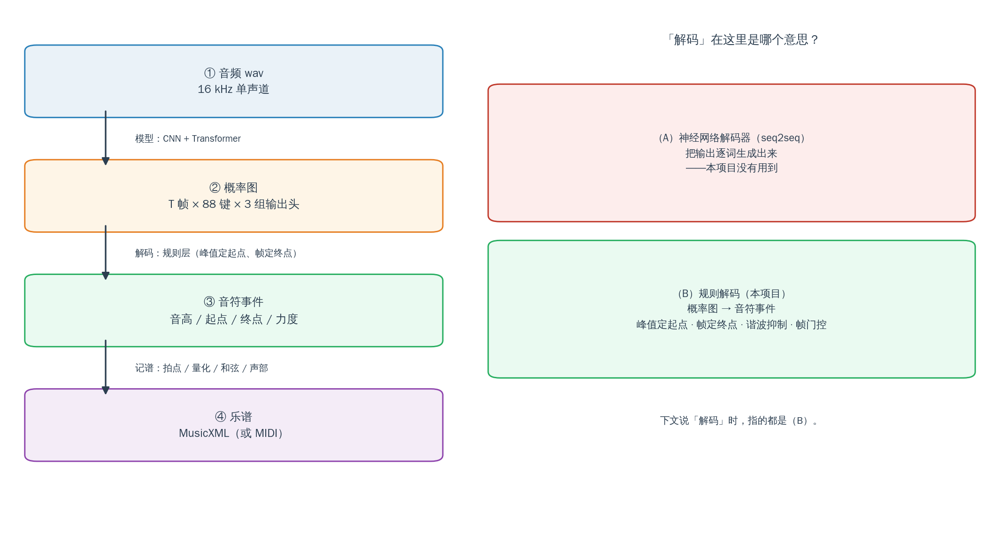

# 01 音乐的四种数据形态

## 结论

同一段钢琴音乐，在计算机里有四种常见表示，本项目的流程是：

```text
wav 波形  →  CQT 时频图  →  标签/概率矩阵  →  音符事件  →  MusicXML 乐谱
（连续声音）  （给模型看）    （训练监督信号）    （离散符号）    （给人看）
```

MIDI 不在主流程里，它是**标签的来源**（我们用它生成每一帧的 0/1 标签）。

## 四种形态各是什么

| 形态 | 文件格式 | 存的是什么 | 本项目的角色 |
|---|---|---|---|
| 波形 | `.wav` | 每秒 16,000 个采样点的振幅 | 输入 |
| 时频图 | `.npy`（CQT 矩阵） | 每 32 ms 一列、264 个频率 bin 的能量 | 模型输入 |
| 标签矩阵 | `.npy`（6 通道） | (时间帧 × 88 键) 的 0/1、力度、踏板 | 监督信号 |
| 符号谱 | `.midi`、`.musicxml` | 音符事件、时值、小节、声部 | MIDI 产标签；MusicXML 是输出 |

## 为什么需要这么多形态

- 模型不能直接看波形：波形里有相位、有泛音，直接学很难；时频图把「哪个音高、什么时候响」显式地摆出来；
- 模型也不能直接输出五线谱：符号化的谱要排版、要量化、要处理声部，这是乐理问题，规则比神经网络可靠；
- 所以流程被切成四段，每段只做一件事，出错时也容易定位是哪一段的问题。



## 一个容易混淆的词：「解码」

机器学习里「解码」有两种意思：

1. **神经网络解码器**（seq2seq decoder）：逐词/逐帧生成输出，本项目**没有**用；
2. **规则解码**：把概率图按规则变成音符事件，**本项目用的是这个**。

图右侧专门区分了这两种，后面 `05_pipeline_end_to_end.md` 会详细讲。

## 深入阅读

- 数据 v2 的完整设计：`../docs/02_data.md`
- 端到端流程与每段职责：`../docs/01_overview.md`
