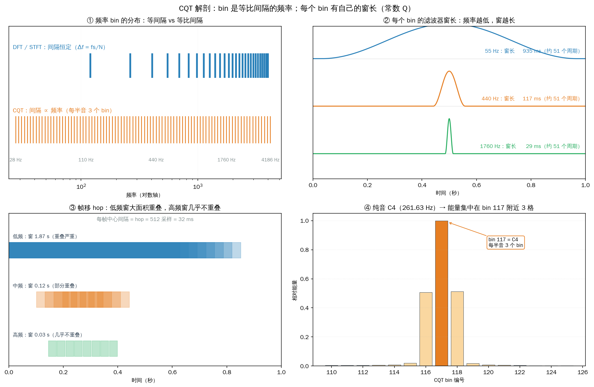
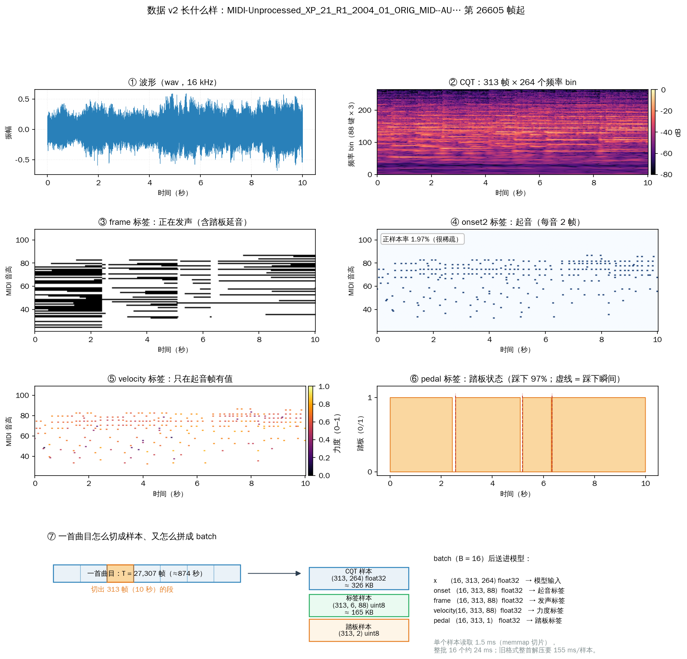

# 02 特征：CQT、hop、帧与 T

## 结论

- 模型不看波形，看的是 **CQT（常 Q 变换）** 时频图；
- **hop 512** 决定帧与帧的间隔：每 512 个采样点推进一帧 → 31.25 帧/秒 → 1 帧 = 32 ms；
- 每帧不是 1 个数，而是 **264 个数**（88 键 × 3 bin/半音）；
- **T 是帧数**，不是采样点数；1 秒音频 → T = 32 帧。

## 从 1 秒例子走一遍

假设有一段 1 秒、16 kHz 的单声道录音：

```text
输入 wav：        (16000,)        16000 个采样点
CQT 结果：        (264, 32)       每帧 264 个频率值，共 32 帧
我们的惯例：      (32, 264)       转置后：时间 × 频率
T：                32
```

帧数公式：`T = 1 + floor(16000 / 512) = 32`。可以记成 **帧数 ≈ 时长 × 31.25 + 1**。

## hop 是什么，窗口又是什么

**hop（帧移）**：相邻两帧前进多少采样点。hop 512 → 每 32 ms 一帧。

**窗口**：算每一帧特征时用的一段信号，长度**随频率变化**（下面是实测值）：

| 频率 bin | 窗长 | 直观感受 |
|---|---|---|
| 最低 bin（A0，27.5 Hz） | 30,221 采样点 ≈ 1.89 秒 | 低频要长窗才能分辨音高 |
| 中间 bin | 2,379 采样点 ≈ 149 ms | 中等 |
| 最高 bin（C8） | 191 采样点 ≈ 12 ms | 高频短窗就够 |

所以「每 512 个点算一个值」这个说法有两处不准确：

1. 每帧不是 1 个值，是 264 个值；
2. 512 是**步长**，不是窗长；窗长可以远大于 512（低频接近 2 秒）。

## 为什么用 CQT 而不是 STFT

**STFT（短时傅里叶变换）**：固定窗长、频率轴线性。
**CQT（常 Q 变换）**：频率轴按对数划分（每半音 3 个 bin），每个 bin 的窗长与该频率成反比。

音乐的音高感知是**对数**的（八度、半音），CQT 的 bin 正好对应半音，模型更容易学「哪个琴键在响」。
代价是低频窗很长，细节会被平滑，但对我们「识别音高」的目标是划算的。

## CQT 到底在算什么（图解）



- ① **bin 是频率**：DFT/STFT 的 bin 等间隔（Δf = fs/N）；CQT 的 bin 等比间隔
  （每半音 3 个，f_k = 27.5 × 2^(k/36)）。bin 117 正好是 C4（261.63 Hz）。
- ② **每个 bin 一个滤波器**：「常数 Q」意味着每个 bin 的窗里都有约 51 个周期，
  所以低频窗长（55 Hz → 935 ms）、高频窗短（1760 Hz → 29 ms）。
- ③ **帧移 hop**：相邻帧中心差 32 ms；低频窗 1.87 s 与相邻帧大面积重叠，高频窗只有 29 ms，几乎不重叠。
- ④ **单音测试**：261.63 Hz 的纯音，能量集中在 bin 116–118（中心 117）；
  之后模型用 `MaxPool(1,3)` 把这 3 个 bin 合成一个琴键通道。

和 DFT 的关系：CQT 可以理解为「**很多个不同窗长的 DFT 并行做**」，但 bases 不正交、
长度也不同，所以它是一组过完备的带通滤波器，而不是一次正交坐标变换。

## 一张图看清楚



图中 ② 是 CQT：横轴 10 秒（313 帧），纵轴 264 个频率 bin，颜色是 dB（越亮越响）。
水平亮线是各个音的基频与谐波。

## 深入阅读

- 完整的数据设计：`../docs/02_data.md`
- 特征一致性检查（训练/推理必须一致）：`../docs/06_stage_programs.md` 的 G3
