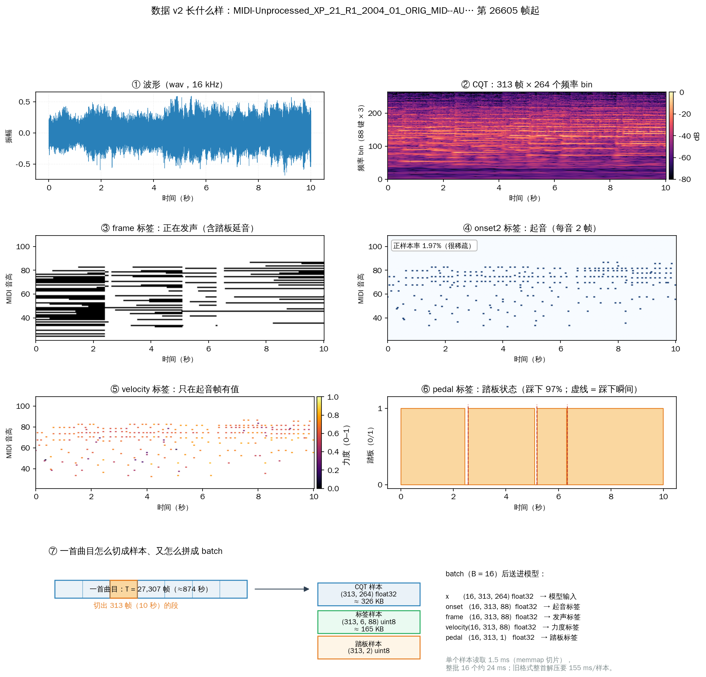

# 03 标签：6 个通道从 MIDI 来

## 结论

`lab.npy` 的 6 个通道**全部来自与音频对齐的 MIDI**，没有手工标注：

| 通道 | 来源 | 生成规则 |
|---|---|---|
| frame | MIDI note on/off | 该键按下到松开之间置 1；默认应用延音踏板 |
| onset1 | note-on 时刻 | 帧号 = round(t × 31.25)，只标 1 帧 |
| **onset2（默认）** | 同上 | 标 2 帧：`[start, start+2)` |
| onset3 | 同上 | 标 3 帧：`[start-1, start+2)`（旧写法，对照用） |
| velocity | `note.velocity` | 0–127 |
| pedal | MIDI CC64 | ≥64 视为踩下，逐帧 0/1 |

## 为什么能对齐

MAESTRO 的 MIDI 和音频是**演奏时同步录制**的（Yamaha Disklavier），所以 MIDI 事件的秒数
直接乘帧率就能得到帧号，不需要再做音频-MIDI 对齐。

## 踏板：MIDI 里真的有

延音踏板在 MIDI 里是 **CC64（控制器 64 号）** 控制变化，值 0–127（模拟深度），不只是开关。

实测 5 首 MAESTRO 曲目：

| split | 音符数 | CC64 事件数 | 踩下占比 | 按键时长中位数 | 发声时长中位数 |
|---|---|---|---|---|---|
| test | 1,864 | 2,153 | 82% | 68 ms | 192 ms |
| train | 6,115 | 8,708 | 62% | 146 ms | 672 ms |
| train | 2,351 | 975 | 53% | 70 ms | 96 ms |
| test | 2,622 | 3,763 | 52% | 73 ms | 96 ms |
| train | 5,065 | 12,483 | 62% | 139 ms | 192 ms |

「发声时长 > 按键时长」的部分就是踏板延音。旧版把踏板**隐含**在 frame 标签里（发声被延长），
数据 v2 才把踏板**显式**拆成 `pedal`（状态）和 `pedal_on`（踩下瞬间）两个通道。

## onset 为什么是 2 帧，不是 3 帧

旧实现标记 `[start-1, start+2)` 三帧，其中一帧落在真实起音**之前**，模型会学成提前 32 ms。
新实现从 `start` 开始标 2 帧：最坏时间误差 +32 ms，仍在评测容差 50 ms 内。

A/B 实验（各 1000 步）：3 帧 F1=0.400、2 帧 0.539、1 帧 0.582。旧写法明显最差。

## 为什么标签用 uint8

标签只有 0/1 和 0–127 的力度，1 个字节就够；CQT 需要浮点精度，用 float32（4 字节）。
训练数据 33 GB 里，标签只占很小一部分，但能省则省。

## 一张图看清楚

图中 ③–⑥ 分别是 frame、onset2、velocity、pedal 四个标签通道的直观样子：

- frame 是长条（发声时长）；
- onset2 是稀疏的点（起音）；
- velocity 也是稀疏点，但颜色表示力度；
- pedal 是 0/1 方波（不分琴键），红色虚线是「踩下瞬间」。

## 深入阅读

- 数据 v2 的完整设计：`../docs/02_data.md`
- 标签宽度修复的来龙去脉：`../docs/history/09_m1_data_v2_and_pilot.md`
