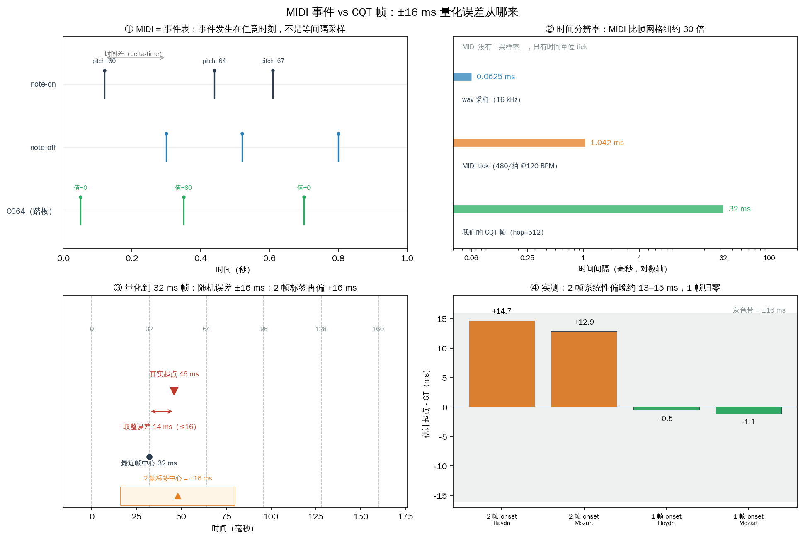
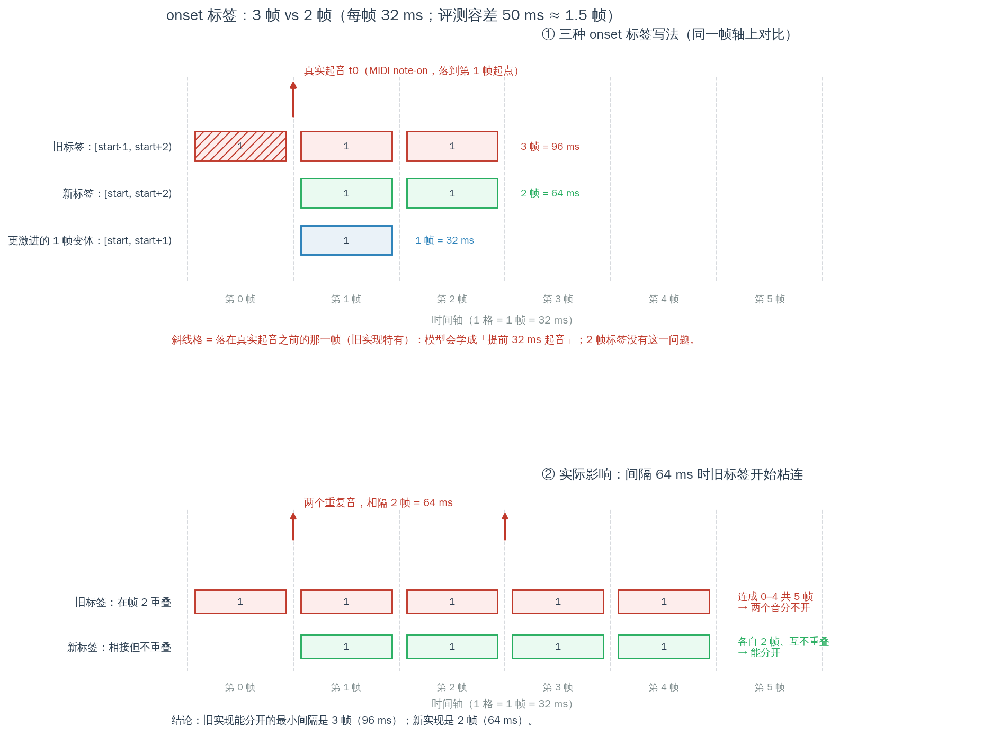
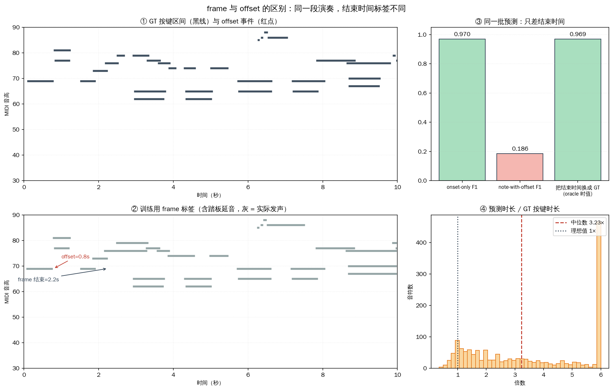

# 03 标签：从 MIDI 到训练通道

## 结论

`lab.npy` 的前 6 个通道**全部来自与音频对齐的 MIDI**，没有手工标注：

| 通道 | 来源 | 生成规则 |
|---|---|---|
| frame | MIDI note on/off | 该键按下到松开之间置 1；默认应用延音踏板 |
| onset1 | note-on 时刻 | 帧号 = round(t × 31.25)，只标 1 帧 |
| **onset2** | 同上 | 标 2 帧：`[start, start+2)`（旧默认；M3.5 最佳配方改用 onset1） |
| onset3 | 同上 | 标 3 帧：`[start-1, start+2)`（旧写法，对照用） |
| velocity | `note.velocity` | 0–127 |
| pedal | MIDI CC64 | ≥64 视为踩下，逐帧 0/1 |
| offset（v3b 起） | MIDI note-off | 标窗口：v3b 2 帧、v3c 1 帧、v3d 3 帧居中 |

## 为什么能对齐

MAESTRO 的 MIDI 和音频是**演奏时同步录制**的（Yamaha Disklavier），所以 MIDI 事件的秒数
直接乘帧率就能得到帧号，不需要再做音频-MIDI 对齐。

## MIDI 文件里到底有什么

这一节用一首真实的 MAESTRO 曲目（Haydn，27.4 KB）实测，把「MIDI 给了什么、我们算了什么」列清楚。

### 文件格式：二进制事件表

MIDI 文件是**二进制**的 Standard MIDI File（SMF，标准 MIDI 文件），不是文本。
文件头是 `MThd`，后面跟若干个 `MTrk`（轨道）；每个事件由「时间差（delta-time）+ 状态字节 + 数据」组成。

| 项目 | 实测值（Haydn） |
|---|---|
| 文件格式 | 二进制 SMF，文件头 `MThd` |
| 时间精度 | 480 ticks / 拍（resolution） |
| 速度 | 120 BPM（文件内 tempo 事件） |
| 1 tick | 60 / (120 × 480) ≈ **1.042 ms** |
| 音符事件 | 1,601 个 note-on/off |
| 踏板事件 | 4,286 条 CC64 |

### BPM、拍与 tick

BPM（beats per minute，每分钟拍数）：四分音符 = 120 表示一分钟弹 120 个四分音符，
也就是一拍 500 ms——数字越大越快，和钢琴课上的记法一致。

```text
1 分钟 × 120 拍/分钟 × 480 ticks/拍 = 57,600 ticks/分钟
→ 1 tick = 60 / (120 × 480) 秒 ≈ 1.042 ms
```

MIDI **没有采样率**：它不是每毫秒记录一次，而是「事件发生时记一条」，用 tick 作为时间单位。
同一时刻可以有多个事件，没有事件的时间段不占空间。这也是为什么 27 KB 就能存下整首 8 分钟的演奏。

### 踏板事件

CC64（控制器 64 号）的值是 0–127 的连续值（可以有半踏板），但同样**只在变化时记录事件**，
不是每 1 ms 更新一次。数据里把它转成逐帧状态（`pedal`）和踩下瞬间（`pedal_on`）。

### 三种时间刻度



- ① MIDI 是事件表：事件发生在任意时刻，不是等间隔采样；
- ② 三种刻度对比：wav 采样 0.0625 ms、MIDI tick 1.042 ms、我们的 CQT 帧 32 ms；
- ③ 把事件映射到 32 ms 帧：取整误差最坏 ±16 ms（半帧）；
- ④ 实测偏差：2 帧 onset 标签让模型系统性偏晚约 13–15 ms，1 帧归零。

### 从 MIDI 直接得到的 vs 我们计算出来的

| 数据项 | 是 MIDI 直接给的？ | 来源 / 用途 |
|---|---|---|
| 音高 pitch | ✅ 直接 | note-on 数据字节 |
| 力度 velocity | ✅ 直接 | note-on 数据字节（1–127） |
| 起点 start | ✅ 直接 | note-on 的 tick → 秒 |
| 结束 end | ✅ 直接 | note-off 的 tick → 秒 |
| 踏板 CC64 | ✅ 直接 | 控制器事件（0–127） |
| 速度 tempo | ✅ 直接 | meta 事件（本文件 120 BPM） |
| 时值 duration | ⚠️ 计算 | `end − start` |
| `frame_key`（T×88） | ❌ 计算 | 按键区间 → 帧号 |
| `frame`（含踏板） | ❌ 计算 | note on/off + CC64 踏板延音合成 |
| `onset1/2/3` | ❌ 计算 | note-on 帧的 1/2/3 帧窗口 |
| `offset` | ❌ 计算 | note-off 帧的 1/2 帧窗口 |
| velocity 标签 | ❌ 计算 | 力度放到 onset 帧、除以 127 |
| `pedal` / `pedal_on` | ❌ 计算 | CC64 → 逐帧状态 / 踩下事件 |
| 评测 GT 区间 | ⚠️ 半计算 | 直接取 note on/off 两端 |
| CQT 特征 | ❌ 与 MIDI 无关 | 由 wav 计算 |
| MusicXML / 五线谱 | ❌ 与 MIDI 无关 | 解码 + 记谱层生成 |

一句话：**MIDI 提供「哪个音、多响、从何时开始到何时结束、踏板怎么踩」；帧标签、时值统计、评测区间都是我们在它之上算出来的。**

### 误差来源：为什么会对不齐

| 来源 | 大小 | 性质 |
|---|---|---|
| 映射到 32 ms 帧网格 | 最坏 ±16 ms（实测平均 8.1 ms） | **随机**，平均为 0 |
| 2 帧标签窗口中心 | +16 ms | **系统偏差**：正样本中心在 `start+1` |
| 解码峰值与迟滞 | 几 ms | 取决于解码器 |
| CQT 时间模糊 | 低频窗长可达 1.9 s | 特征本身的时间平滑，不是标签误差 |
| MAESTRO 音频-MIDI 对齐 | 未知 | 数据集对齐算法引入，独立于前几项 |

所以「±16 ms」来自 **32 ms 帧网格的一半**；而「+16 ms」是 2 帧窗口额外引入的系统偏差，
两者叠加后，2 帧模型实测偏晚约 13–15 ms（图 ④）。

## 踏板：MIDI 里真的有

延音踏板在 MIDI 里是 **CC64（控制器 64 号）** 控制变化，值 0–127（模拟深度），不只是开关。

实测 5 首 MAESTRO 曲目：

| split | 音符数 | CC64 事件数 | 踩下占比 | 按键时长中位数 | 发声时长中位数 |
|---|---|---|---|---|---|
| test | 1,864 | 2,153 | 82% | 68 ms | 192 ms |
| train | 6,115 | 8,708 | 62% | 146 ms | 672 ms |
| train | 2,351 | 975 | 53% | 70 ms | 96 ms |
| test | 2,622 | 3,763 | 52% | 73 ms | 96 ms |
| train | 5,065 | 12,483 | 62% | 139 ms | 192 ms |

「发声时长 > 按键时长」的部分就是踏板延音。旧版把踏板**隐含**在 frame 标签里（发声被延长），
数据 v2 才把踏板**显式**拆成 `pedal`（状态）和 `pedal_on`（踩下瞬间）两个通道。

## onset 标签：3 帧 → 2 帧 → 1 帧

旧实现标记 `[start-1, start+2)` 三帧，其中一帧落在真实起音**之前**，模型会学成提前 32 ms。
改成从 `start` 开始标 2 帧后，pilot A/B（各 1000 步）F1 为：3 帧 0.400、2 帧 0.539、1 帧 0.582。



**2 帧也有隐患**：正样本中心在 `start+1`，比真实起点晚半帧（16 ms）。2026-11-06 用带符号偏差
（估计起点 − GT 起点）测出来：2 帧模型中位偏晚 **+14.7 ms（Haydn）/ +12.9 ms（Mozart）**，
正好是半帧；改成 1 帧后偏差变为 **-0.5 / -1.1 ms**，留出集 onset 精确率从 0.860 提到 0.901。

结论：**当前最佳配方用 1 帧 onset**。注意两点：

1. 评测容差是 ±50 ms，+16 ms 的偏差会被 F1「吸收」，所以只看 F1 发现不了，要看带符号的 Δt；
2. 验证集 F1 的 1 帧口径正样本更窄，不能和 2 帧口径直接比较。

（上面的「MIDI 文件里到底有什么」一节的图 ④ 就是这组实测偏差。）

## frame 和 offset 的区别（很容易混淆）

先把三个东西分清楚——它们是**不同类型**的对象：

| 名字 | 类型 | 来源 | 含踏板？ | 当前状态 |
|---|---|---|---|---|
| note-on（起音） | 事件（时间点） | MIDI note-on | — | 有标签（onset） |
| note-off（键释放） | 事件（时间点） | MIDI note-off | — | **没有标签** |
| frame（逐帧发声） | 状态（每帧 0/1） | note-on/off + CC64 踏板延音**合成** | **是** | 有标签 |

三个概念互相之间的关系：

```text
按键:   note-on ────────────────── note-off
发声:   frame 为 1 ────────────────────────── 发声结束（含踏板延音）
时间轴:  0.5s        1.0s                       2.0s
```

- **frame** 是一条「状态曲线」：每一帧都回答「这个键现在响不响」。它是**从 MIDI 合成出来的标签**，不是从音频测出来的：先把 note on/off 的区间标 1，如果踏板踩着，就继续往后延（我们的数据用 pretty_midi 的默认踏板处理，阈值 64）。
- **offset** 是「按键松开」的**那一个时间点**（MIDI note-off）。它落在 frame 区间**内部**（键是在发声期间松开的），但它不是 frame 的"一部分"——一个是事件、一个是状态。
- 只有踏板抬起时，"发声结束"才约等于 offset；踏板踩着时，两者可以差好几秒。

**所以「offset 从属于 frame」的说法要修正**：offset 是 frame 区间内部的一个边界时间点；frame 描述"响多久"，offset 描述"键什么时候松"。谱面上的**音符时值应该用 offset**（键释放时长），而 frame 用来判断"这个音是否还在响（可能需要延音线/踏板记号）"。

**当时的问题**：数据 v2 里只有 frame（含踏板），没有 offset 通道；模型只能从 frame 概率的下降去猜结束时间，既受踏板影响，也不够准——早期 note-with-offset F1 只有 0.19–0.38。

**现在的进展**：M3.5 已建 v3a（frame_key）、v3b（offset 2 帧）、v3c（offset 1 帧）、v3d（offset 3 帧居中），并给模型加了 offset 头。最佳配方 combo_base（v3b + 1 帧 onset + offset 损失）把留出集 note F1 从 0.063 提到 **0.372**，onset 精确率从 0.860 提到 **0.924**。

**看得见、听得到的对比**（同一段 10 秒 Haydn 演奏）：



- ① 黑线 = GT 按键区间，红点 = offset 事件（键释放）；
- ② 灰线 = 训练用 frame 标签（含踏板）——同一个音在 **offset=0.8 秒** 键就松了，frame 却延续到 **2.2 秒**；
- ③ 同一批预测：onset-only F1 0.970，note-with-offset F1 只有 0.186，把结束时间换成 GT 后回到 0.969——差距全部来自结束时间；
- ④ 预测时长 / GT 按键时长中位数 **3.23 倍**。

可以对比试听（`E:\Docker\piano2_demo\`）：

| 文件 | 内容 | 听感 |
|---|---|---|
| `correct_ref.wav` | 用 MIDI note-off（正确时值）合成 | 干净、该停就停 |
| `app_output.wav` | 当前模型输出（结束时间从 frame 推） | 拖长、和弦互相压住、发闷 |
| `original.wav` | 原始录音 | 真实演奏参照 |

**已实施的数据与模型改动**：

- **数据 v3a**：frame 改为 `frame_key`（按键时长，不含踏板），CQT/pedal 硬链接复用 v2；
- **数据 v3b**：在 v3a 上增加第 7 通道 `offset`（note-off 帧起 2 帧），作为 offset 头的监督；
- **数据 v3c**：offset 改 1 帧，验证「窗口中心偏差」；实验显示留出集 note F1 0.251，低于 v3b 的 0.372，所以**保留 2 帧**；
- **数据 v3d**：offset 改 3 帧居中（`[end-1, end+2)`），正在验证中；
- **模型**：增加第 6 个头（offset），解码时优先用 offset 峰确定结束时间，找不到再退回 frame；
- 训练时用 `--offset-loss` 控制 offset 损失权重（只对 v3b/v3c/v3d 数据打开）。

## 为什么标签用 uint8

标签只有 0/1 和 0–127 的力度，1 个字节就够；CQT 需要浮点精度，用 float32（4 字节）。
训练数据 33 GB 里，标签只占很小一部分，但能省则省。

## 一张图看清楚


图中 ③–⑥ 分别是 frame、onset2、velocity、pedal 四个标签通道的直观样子：

- frame 是长条（发声时长）；
- onset2 是稀疏的点（起音）；
- velocity 也是稀疏点，但颜色表示力度；
- pedal 是 0/1 方波（不分琴键），红色虚线是「踩下瞬间」。

## 深入阅读

- 数据 v2 的完整设计：`../docs/02_data.md`
- 标签宽度修复的来龙去脉：`../docs/history/09_m1_data_v2_and_pilot.md`
