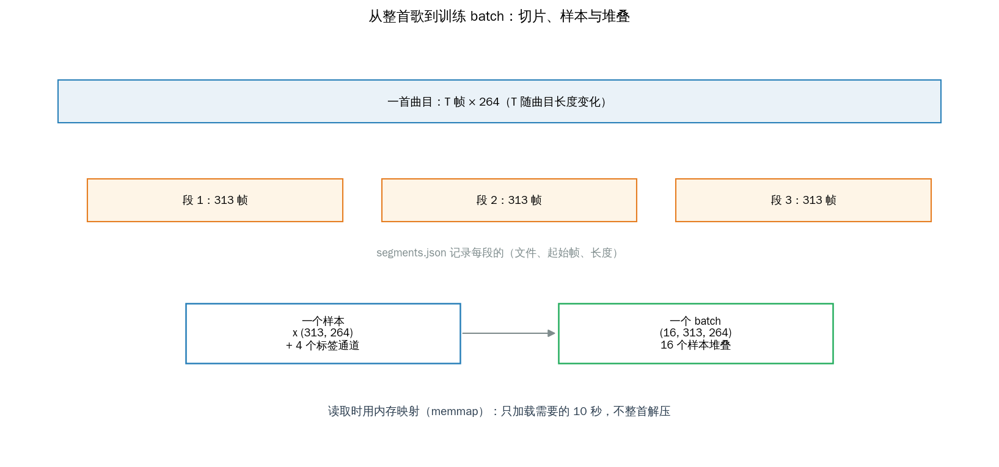
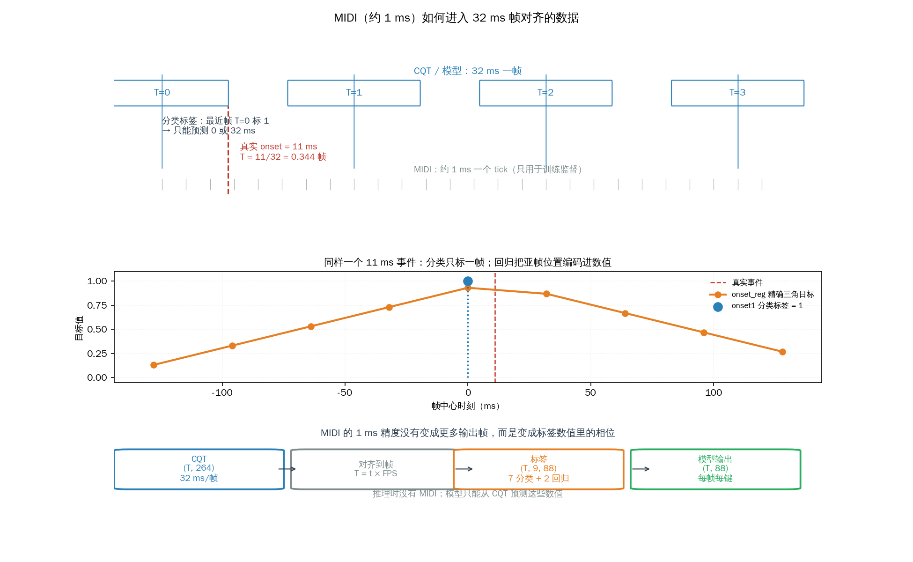
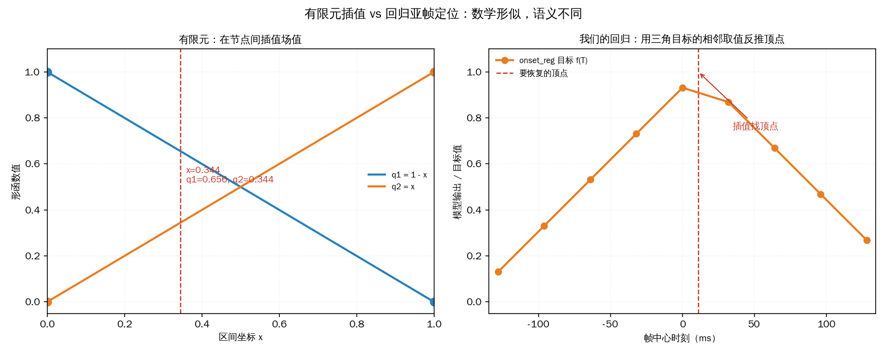

# 04 数据集：切片、样本与 batch

## 摘要

本文解释整首歌的数据怎么切成训练样本与 batch（批）：切片规则、segments.json 的作用、单个样本包含哪些数组、内存映射（memory mapping）怎么加速读取。读者不需要了解 PyTorch 的 DataLoader；读完后能看懂 x、onset、frame 等张量的形状和 batch 的维度。

## 从整首歌到 batch



这张图把过程拆成三步：**整首歌**（T 帧 × 264，T 随曲目长短变化）→ **按 313 帧切段**
（`segments.json` 记录每段的文件、起始帧、长度）→ **堆叠成 batch**（16 个样本，形状 `(16, 313, 264)`）。
图中还标出了读取方式：内存映射（memmap）只加载当前需要的 10 秒，不整首解压。

```text
一首曲目 T 帧（例子 27,307 帧 ≈ 874 秒）
   │  按 313 帧切段
   ▼
一个样本：CQT (313, 264) + 标签 (313, 6, 88) + 踏板 (313, 2)
   │  batch 16
   ▼
x        (16, 313, 264) float32
onset    (16, 313, 88)  float32
frame    (16, 313, 88)  float32
velocity (16, 313, 88)  float32
pedal    (16, 313, 1)   float32
```

## 为什么要切成 10 秒

1. **显存和速度**：Transformer 的注意力计算量随序列长度**平方**增长，65 秒（2048 帧）比 10 秒（313 帧）
   贵约 40 倍（注意力部分）；
2. **训练效率**：切段后每轮能见到约 57,000 段，而不是每首歌只截一个 65 秒窗口；
3. **事件完整**：10 秒足够包含若干完整的「起音-释放」，也不会跨太多乐句。

不足 313 帧的段会补零（Dataset 里处理），batch 里形状永远一致。

## memmap：为什么读得快

旧版每取一个样本要**解压整首压缩 npz**（平均 155 ms），但只用其中 10 秒。
新版把 CQT 存成无压缩 `.npy`，用内存映射（memory-mapped file）打开：

```python
arr = np.load(path, mmap_mode="r")     # 文件当数组，不整体读入
seg = np.asarray(arr[start:start + 313])  # 只把 10 秒搬进内存
```

实测：**155 ms → 1.5 ms/样本**（约 100 倍）。代价是磁盘占用变大（17 GB → 33 GB），
用空间换速度，很划算。

## 为什么 MIDI 要转成帧对齐的标签



训练时有两个时间尺度：

- **CQT**：32 ms 一帧，是模型真正能看到的输入；
- **MIDI**：约 1 ms 一个 tick，是标注（监督），不是推理输入。

模型输出必须和输入帧一一对应，所以标签也要变成 `(T, 88)`：

```text
T = 时间 × FPS
```

一个 11 ms 的 MIDI 事件，帧坐标是 `11/32 = 0.344`：

- 分类 `onset1` 只好把它归到最近帧 `T=0`，时间被量化成 0 ms；
- 回归 `onset_reg` 把「离事件多远」写进每一帧的值（三角目标），
  于是 11 ms 的相位信息被保存在**标签数值**里，而不是增加帧数。

MIDI 的密度优势没有浪费：它用来生成精确的回归目标；但推理时没有 MIDI，
模型只能从 CQT 预测这些数值。要直接输出 1 ms 分辨率的帧，需要更密的 CQT/特征
和更大的计算量，这是另一个维度的升级。

## 回归像不像有限元插值



数学上确实很像：

```text
f(x) = f1 · q1(x) + f2 · q2(x)
```

在有限元里，`q1=1−x`、`q2=x` 是线性形函数，用节点值插值区间内任意一点的场值。

我们的回归：

- 每一帧的模型输出是 `f(T)`，目标是一个三角形状的距离场；
- 事件时间是三角的**顶点**，不是某个节点的值；
- 推理时取峰值帧 B 和左右邻帧 A/C，用三点的值反推顶点：

```text
δ = 0.5 × 32ms × (y_C − y_A) / (y_B − y_A)
```

所以它和有限元共享“用形函数/相邻节点恢复连续位置”的数学形式，但语义不同：
**有限元是插值场值，我们是在已知三角形形状的前提下反推顶点位置。**

注意：当前 v4 的回归目标用 `round(note.start × FPS)` 取整，标签峰落在最近整数帧，
严格来说没有完整编码亚帧相位；精确时间目标（v5）已经试过，但这一轮没有提升，
当前最佳仍是 v4 的 `hybrid_reg2`。

## 验证数据（可选）

```bash
python scripts/check_labels.py    # onset2 是否 2 帧、踏板通道是否 0/1
```

## 深入阅读

- 数据 v2 的完整设计：`../docs/02_data.md`
- 训练脚本怎么用这些样本：`../docs/03_model_training.md`

## 小结

- 整首歌的数组按 **313 帧（10 秒）** 切成段，`segments.json` 记住每段的（文件、起始帧、长度）；
- 一个**样本** = 313 帧的所有通道：`x (313, 264)`、`onset (313, 88)`、`frame`、`velocity`、`pedal`；
- 一个 **batch** = 16 个样本堆叠：`x (16, 313, 264)` 等；
- 数据用**内存映射**（memmap）读取，只读需要的 10 秒，不整首解压。
