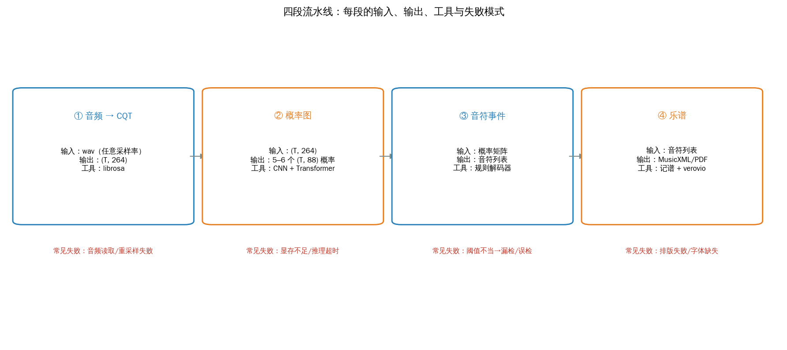

# 05 端到端流水线：从音频到乐谱

## 摘要

本文把整个系统串起来：从 wav 输入到 MusicXML 输出的四段流程，每段的输入、输出、使用的工具与常见失败模式。读者不需要读过前面教程；读完后能知道一个错误应该去哪个阶段排查，以及各部分之间的接口是什么。



图中的四段从上到下对应：音频输入、模型概率、解码事件、乐谱输出；每段下方标了该阶段最常见的失败模式，排查问题时可以先按这个顺序定位。

## 每一段在做什么

**① 音频 → CQT**：把波形切成每 32 ms 一帧，算出 264 个频率 bin 的能量（dB）。
详见 `02_features_cqt_hop_frames.md`。

**② CQT → 概率图**：CNN 提取局部模式（比如「这个音高开始起音」的时频纹理），
Transformer 捕捉长程上下文（比如「这个音已经持续两拍」）。输出 5 组概率图。

**③ 概率图 → 音符事件**：这是「解码」层，用规则不是网络：

```text
找 onset 峰（起点） → 沿 frame 概率找释放（终点） → 条件式谐波抑制（去泛音假音）
→ 帧一致性门控（去「只出现一帧」的假音） → 同音高合并
```

**④ 音符事件 → MusicXML**：拍点估计 → 量化 → 和弦化 → 时值拆分 → 手动建小节 → verovio 渲染。

## 为什么这么切

- 每段只做一件事，出错时容易定位；
- 解码器和记谱层是**规则**，可以独立调参、独立验证；M0.5 就是靠这个把 onset F1 从 0.196 提到 0.95；
- 模型只负责「哪里有个音」，不负责「这个音在谱上怎么写」。

## 当前效果（M3 第一版）

| 指标 | 结果 |
|---|---|
| 留出集 onset F1 | 0.874（精确率 0.878） |
| 三首开发曲目 onset F1 | 0.966 / 0.963 / 0.809 |
| 一段 65 秒音频出谱耗时 | 4.1 秒（4060） |
| 主要短板 | 时值（note-with-offset F1 只有 0.17–0.38） |

## 深入阅读

- 解码器原理与参数：`../docs/04_decoding.md`
- 记谱与评测：`../docs/05_notation_eval.md`
- 训练结果：`../docs/03_model_training.md`

## 小结

整条流水线分四段，每段的职责和输出都很明确：

| 段 | 输入 | 输出 | 谁来做 |
|---|---|---|---|
| ① 音频 | wav（任意采样率） | 16 kHz 单声道 + CQT (T, 264) | librosa |
| ② 概率图 | CQT | onset / frame / velocity / pedal 概率 | CNN + Transformer |
| ③ 音符事件 | 概率图 | 音符列表（音高、起点、终点、力度） | 规则解码器 |
| ④ 乐谱 | 音符事件 | MusicXML（+ PNG/PDF 预览） | 记谱 + verovio |
